<a id="top"></a>

# 🏛️ **TRADE-CAPTURE V2 (IMPROVED UI/UX)** — Autocallable Trade-Capture Platform & Trading Terminal: The Complete File-by-File Field Guide

> **Full-stack reference · v2.0 (UI/UX modernisation edition)** · Prepared by **Shaikat** · Date: **2026-10-13**
> **Stack baselines read from the code:** Java **17** · Spring Boot **3.5.0** (+ WebSocket) · Spring Kafka · PostgreSQL **16** · Flyway · Micrometer/Prometheus · Angular **^21.2** (zoneless, signals, `OnPush`) · TypeScript **~5.9** · **Tailwind v4** · **spartan/ng brain 1.6** · **TanStack Table 8 + Query 5** · **NgRx Signals 21** · **Lightweight Charts 5** · Angular **CDK 21** · RxJS **~7.8** · Vitest **4** · Playwright **1.64** · nginx-unprivileged **1.27** · OpenTofu **≥ 1.8** · Kubernetes + Kustomize + KEDA + External Secrets.

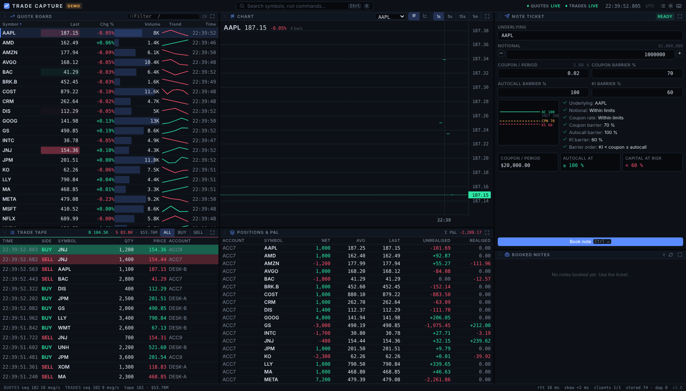

*(The picture is a real Chromium capture of the production build.)*

---
---

[↩️ Back to README.md](../README.md)

---
---

<a id="how-to-read"></a>

## 🧭 How to Read This Document

| If you are… | Read in this order |
|---|---|
| 🧒 **Complete newbie** | [§0 What changed](#whats-new) → [§1 Reality Check](#reality) → [§2 Big Picture](#big-picture) → [§4 Foundations](#foundations) → [§5 UI/UX](#ux) → then walk Parts A → B → C → D in order |
| 🎨 **Front-end / UX engineer** | [§0](#whats-new) → [§5](#ux) → [Part A](#part-a) (config → core → feed → state → api → ui → panels → shell) → [§7 Contract](#contract) → [Part C tests](#part-c) |
| ☕ **Back-end engineer** | [§2](#big-picture) → [Part B](#part-b) (ingest → Kafka → DB → **live feed + notes API**) → [Part D](#part-d) → [§14 Findings](#findings) |
| ☁️ **Platform / DevOps** | [§2](#big-picture) → [Part D](#part-d) (now incl. web image, nginx, compose) → [Part E (OpenTofu)](#part-e) → [§13 Runbook](#runbook) |
| 🧪 **Reviewer / tech lead** | [§0](#whats-new) → [§1](#reality) → [§14 Findings & Roadmap](#findings) (status column shows what v2 fixed) |

**Conventions used throughout**

| Symbol | Meaning |
|---|---|
| 🧒 *Feynman* | the idea explained so a 12-year-old could repeat it |
| 🎯 | the one-sentence purpose of the file |
| 📥 / 📤 | what comes **in** / goes **out** |
| 🔗 | who calls it / what it calls (data-flow neighbours) |
| ⚠️ | gotcha, latent bug, or sharp edge **observed in the code** |
| 🔧 | concrete improvement you can make |
| ✅ | verified by running code (tests, build, browser) |
| 🆕 / *(changed)* / *(unchanged)* | file status relative to the original zip (v1) |

> 🛡️ **Honesty rule of this guide:** everything stated as fact was read from the files or verified by running them. Items I could **not** run in the sandbox (Maven, Docker, Kubernetes, cloud) are labelled *read, not executed* / *not verified* — notably the new Spring classes were **compiled against hand-written stubs only**, never built by Maven ([F-27](#findings)).

---

<a id="toc"></a>

## 📑 Table of Contents

| Part | Section |
|---|---|
| 0 | [🧭 How to Read](#how-to-read) · [📖 Synopsis](#synopsis) · [🆕 §0 What Changed in v2](#whats-new) · [🔍 §1 Reality Check](#reality) |
| 1 | [🗺️ §2 The Big Picture](#big-picture) · [📂 §3 Repository Map & File Ledger](#repo-map) · [🧮 §4 Foundations (Feynman + Math)](#foundations) · [🖼️ §5 UI/UX Design & Wireframes](#ux) |
| A | [🅰️ Front End — the Trade-Capture Terminal](#part-a): [§6 files in flow order](#frontend) (config · core · feed · state · api · ui · panels · shell) · [§7 The Front↔Back Contract v2 & Mock Twin](#contract) |
| B | [☕ Back End — from the broker's message inward, and out to the browser](#part-b): [§8 Java core](#core) · [§9 Spring layer](#spring) (+ [live feeds & notes API](#spring-live)) · [§10 Database & Config](#dbconfig) |
| C | [🧪 Tests, Quality & Tooling](#part-c): [§11](#tests) · [§12 Build & tooling files](#tooling) |
| D | [🐳 Packaging (API + web + compose) & Kubernetes](#part-d) |
| E | [☁️ OpenTofu: AWS · Azure · GCP](#part-e) |
| F | [🚀 §13 Runbook](#runbook) · [🩺 §14 Findings & Roadmap](#findings) · [📚 Glossary](#glossary) · [🗃️ Appendix A: v1 `target/`](#appendix-target) · [📚 References](#references) |

---

<a id="synopsis"></a>

## 📖 Synopsis

**What the system is.** A *trade-capture* platform listens for **executions** (fills) from brokers and from Murex, turns each into one canonical record (`TradeEvent`), moves it durably through **Kafka**, and stores it exactly once in **PostgreSQL**. **New in v2:** every *newly stored* trade is also pushed — through an in-memory sequenced board — to a browser **trading terminal** over WebSockets, and the terminal can **book autocallable notes** through a validated REST API. Everything ships as Docker images (service + web), runs on Kubernetes and is provisioned on AWS, Azure or GCP with OpenTofu.

**Why "autocallable"?** The business context is equity-linked structured notes. The system captures their *key terms* (underlying, notional, coupon, three barriers) and the *fills*; it does **not** price them.

**What makes the code interesting (the design "spine")**

1. 🧱 **Hexagonal split** — `core/` is pure Java with *no Spring*; `spring/` is wiring (rule in [`AGENTS.md`](#f-agents-md)). v2's new logic (`LiveBoard`, `FeedJson`, `NoteTerms`) lives in `core/` and is unit-tested without Spring.
2. 🔁 **Effectively-once processing** = *at-least-once delivery* + *idempotent insert* on `(source, trade_id)` — and **idempotent views** (a redelivery never creates a second tick on screen).
3. 📮 **Transactional outbox** so "write to DB" and "publish to Kafka" never disagree.
4. ☠️ **Dead-letter topic** with exponential back-off.
5. 🔢 **No floating point for money anywhere** — `long` micros (prices), cents (notional), basis points (rates, barriers); `BigInt` in the browser.
6. 📡 **Snapshot + delta + sequence numbers + heartbeats**, reduced by *pure, batch-oriented functions* on the client; a gap triggers exactly one resync.
7. 🖥️ **A real terminal UI**: dockable panels, tokens for themes and density, virtualised grids, charting, an execution ticket with a state machine, a command palette, keyboard-first.
8. 🛡️ **Hardened deployment** — non-root images (service and nginx), read-only root FS, default-deny network policy, workload identity, encrypted state.

[⬆️ Back to TOC](#toc)

---

<a id="whats-new"></a>

## 🆕 §0 What Changed in v2 (the modernisation, at a glance)

**The trigger.** The v1 UI (screenshot below, as a wireframe) was a scaffold: five unlabeled inputs, a Book button that did nothing, glued text (`AAPL187.251K`), no layout, no charts, no keyboard support, and a back end that did not serve the UI. The brief was to reach *top-tier trading-desk quality* using the modern Angular + TypeScript stack.

```text
BEFORE (v1, 900 px)                              AFTER (v2, 1680×960)
┌──────────────────────────────────────┐         ┌──────────────────────────────────────────────────────────────────────┐
│ [1000000][0.02][70][100][60] [Book]  │         │ ▣ TRADE CAPTURE [DEMO]  🔍 Search…  Ctrl K   ● QUOTES LIVE ● TRADES LIVE │
│ [filter] live · seq 100              │         ├──────────────┬────────────────────────┬─────────────────────────────┤
│ [sym][px][qty]                       │         │ QUOTE BOARD  │ CHART  AAPL  [🕯|⌇][1s…]│ NOTE TICKET            [READY]│
│ AAPL187.251K   ← glued, unstyled     │         │ sortable,    │ candles / area         │ labels · live checks · ladder │
│ AMZN178.101K                         │         │ flashing,    │                        │ KPIs · Ctrl+Enter to book     │
└──────────────────────────────────────┘         │ sparklines   ├────────────────────────┤                               │
                                                 │ ───────────  │ POSITIONS & P&L        ├─────────────────────────────┤
                                                 │ TRADE TAPE   │ exact BigInt maths     │ BOOKED NOTES                  │
                                                 └──────────────┴────────────────────────┴─────────────────────────────┘
                                                  status bar: seq · msg/s · rtt · skew · clients · stored/dup
```

### 0.1 Before → after, by area

| Area | v1 | v2 |
|---|---|---|
| **UI shell** | 2 components, 3 lines of CSS | top bar, 6-panel dockable workspace, status bar, palette, help, toasts — **Tailwind v4 tokens**, dark/light, compact/cozy |
| **Primitives** | none | **spartan/ng brain** (resizable, command, toggle-group) + own `HlmBtn` (`cva`), icons, kbd, flash, spark |
| **Data grid** | hand-rolled windowing (`window.ts`) | **TanStack Table** engine + **CDK virtual scroll**; 5,000 symbols verified |
| **Server state** | `HttpClient` calls in a form | **TanStack Query** (`notes`, `system`, `book` mutation) |
| **Client state** | `BlotterStore` (one store) | **NgRx `signalStore`** ×5: quotes, trades, workspace, toasts + feed-health helper |
| **Live data** | one quote feed, per-message reduce | two feeds, **micro-batched** (50 ms), shared `gate()`, heartbeats, **stale detection**, **reconnect fixed (F-11)** |
| **Charts** | none | **Lightweight Charts** v5 behind a `ChartHandle` seam, candles/area, 1 s–1 m |
| **Layout** | fixed | **CDK drag-to-swap + brain splitters**, maximise, **persisted** in `localStorage`, self-repairing parser |
| **Order entry** | 5 raw inputs | **ticket**: pre-trade checks, payoff ladder, size hotkeys, 5-state machine, 422 field errors |
| **Keyboard** | none | resolver with 11 shortcuts + **⌘K palette** |
| **Money maths** | none | **BigInt fixed-point**: formatting, VWAP, average-cost positions, P&L |
| **API** | none | `/ws/quotes`, `/ws/trades`, `/api/notes`, `/api/system/status`, correlation ids, RFC 9457 errors |
| **Back end** | pipeline only (F-3) | + `LiveBoard`, `FeedJson`, `NoteTerms`, hub, socket handler, controllers, `V2__notes.sql`, demo generator; **F-1 fixed** |
| **Packaging** | service image only | + **web image (nginx)**, **docker-compose** full stack |
| **Tests** | 15 + 7 + 8 web, 1 Java IT | **130 web + 13 e2e + 28 Java unit** + 1 Java IT; 8 screenshots |
| **Repo hygiene** | `target/` committed | `.gitignore`; `target/` dropped |

### 0.2 File accounting (original 116 → enhanced 170)

| Bucket | Count | Meaning |
|---|---:|---|
| 🆕 **New** | **97** | e.g. 11 Java main files, 4 Java tests, 1 SQL, ≈ 60 web source/spec files, 8 screenshots, Docker/nginx/compose, configs |
| ✏️ **Changed** | **15** | `pom.xml`, `DedupStore`, `TradeListener`, `application.yml`, `web/{README, angular.json, package.json, package-lock.json, tsconfig.app.json}`, `src/{index.html, styles.css}`, `app.{ts, config.ts, int.spec.ts}`, `e2e/mock-backend.mjs` |
| ⏺ **Unchanged** | **58** | all other Java, `k8s/**`, `infra/**`, `AGENTS.md`, V1 migration, `docker/Dockerfile`, `.vscode/*`, favicon, `main.ts`, … |
| 🗑 **Removed** | **13** | `blotter.component`, `blotter.store`, old `feed.client/feed.reducer/models/rx-utils/ws-feed.client` (moved + rewritten under `core/` and `feed/`), `money-compact.pipe` → `ui/compact.pipe`, `terms.api` → `api/notes.api`, `terms.form` → `panels/ticket.panel`, `window.ts` (replaced by CDK), `specs.spec.ts`, `blotter.e2e.spec.ts` |
| 🗃 **Dropped** | 30 | the committed `target/` build output ([Appendix A](#appendix-target)) |

> ✅ 86 − 13 removed = 73 survivors (58 unchanged + 15 changed); 73 + 97 new = **170**.

### 0.3 Design principles the enhancement followed

1. **Progressive, not a rewrite:** the proven pipeline and the sequence-gating idea were kept; the UI was rebuilt on top of them.
2. **Pure core, thin shell:** every rule (gate, reducers, positions, checks, hotkeys, layout, fuzzy, candles) is a pure function with tests; Angular code only wires them.
3. **Seams for everything non-deterministic:** `FEED_CLIENT`, `NOW`, `FLUSH_MS`, `STALE_MS`, `CHART_FACTORY`, `LAYOUT_STORAGE` — tests replace them, production uses defaults.
4. **Never trust the browser:** the ticket's checks are repeated in `NoteTerms` and again in a DB `CHECK` constraint.
5. **Honesty about limits:** every shortcut or unverified step is in [§14](#findings).

[⬆️ Back to TOC](#toc)

---

<a id="reality"></a>

## 🔍 §1 Reality Check — What Is Wired and What Is Not (v2)

> Read this first. It prevents the most common newbie mistake: assuming every box in an architecture picture is implemented *and verified*.

| Capability | Where it lives | Wired end-to-end? |
|---|---|---|
| Kafka consumer → idempotent Postgres insert | `TradeListener` → `JdbcTradeStore` → `trade` | ✅ Yes (Testcontainers IT, **not run here**); **F-1 fixed** in v2 |
| **Live feeds to browsers** | `TradeListener` → `LiveFeedHub` → `FeedSocketHandler` → `/ws/*` | ✅ **Implemented in v2**; Spring layer **stub-compiled only**; the *contract* is verified against the Node twin by 13 e2e tests |
| **Note booking REST + DB** | `NotesController` → `NoteTerms` → `JdbcNoteStore` → `note` (`V2`) | ✅ Implemented; `NoteTerms` unit-tested (9); SQL/Spring **not executed here** |
| **Terminal UI** | `web/src/**` | ✅ Built (production), 130 unit/integration + 13 browser tests, real screenshots |
| Synthetic order flow | `DemoTradeGenerator` (`CAPTURE_DEMO=true`) | ✅ Implemented through the real Kafka path; not executed here |
| Publish a `TradeEvent` to Kafka | `TradePublisher` | ⚠️ Used by the IT and now by the **demo generator**; no production caller |
| Transactional outbox **relay** | `OutboxRelay` + `outbox` | ⚠️ Relay runs every 200 ms; **nothing writes outbox rows** (F-2) |
| Dead-letter + retry/back-off | `KafkaErrorHandlingConfig` | ✅ Yes |
| Consumer-lag health indicator | `LagHealthIndicator` | ✅ Yes (not in readiness group) |
| FIX 4.4 parsing → `TradeEvent` | `FixMessage`, `FixExecutionMapper`, `SequenceGapDetector` | 🧩 Library + demo only |
| Murex CSV ingestion | `MurexExtractReader` | 🧩 Library + demo only |
| Kafka-transactional enrichment | `EnrichmentProcessor` | ⚠️ Active bean but needs a transaction-id prefix (F-12) |
| **Authentication / authorisation** | — | ❌ **None** on `/api` and `/ws` (F-29) |
| **Multi-replica live view** | `LiveFeedHub` is per pod | ⚠️ **Partial view with >1 replica; empty tape after restart** (F-22) |
| Front-end hosting | `web/Dockerfile`, `nginx.conf`, compose | ✅ Image + compose written (**not built here**); ❌ no K8s manifest for `web/` |
| CI/CD pipeline | — | ❌ Not in the repo |
| Kustomize / KEDA / OpenTofu | `k8s/**`, `infra/**` | unchanged from v1 (see F-5…F-9, F-18) |

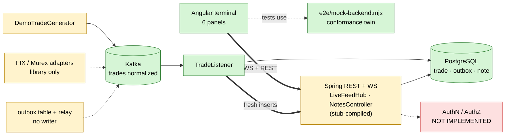

🧒 *Feynman:* In v1 the restaurant had a fully built **kitchen** and a **front door**, but no **waiter** — the door had only rehearsed with an actor. In v2 the waiter is hired and has learned the menu (the contract), and the dining room got a proper makeover. What is still missing is the **door lock** (authentication), a **second waiter who knows the whole menu** when the restaurant has several kitchens (multi-replica), and a final **health inspection** (Maven build, Docker, cluster).

[⬆️ Back to TOC](#toc)

---

<a id="big-picture"></a>

## 🗺️ §2 The Big Picture

### 2.1 The restaurant analogy (memorise this; every file maps to it)

| Restaurant | Platform | Files |
|---|---|---|
| Customers hand over **order slips** in strange handwriting | Brokers send FIX messages; Murex drops CSV files | `FixMessage`, `MurexExtractReader` |
| A **translator waiter** rewrites every slip in house format | Anti-corruption layer → `TradeEvent` | `FixExecutionMapper`, `TradeEvent` |
| A **conveyor belt** with 12 lanes; same customer → same lane | Kafka topic, keyed by `account:symbol` | `Murmur2`, `TradePublisher`, `OutboxRelay` |
| The **cook** writes each slip in the ledger once, then rings "done" | `TradeListener` + `JdbcTradeStore` + manual ack | `TradeListener`, `JdbcTradeStore`, `V1__capture.sql` |
| A **burnt dish bin** for unreadable slips | Dead-letter topic | `KafkaErrorHandlingConfig`, `BackoffPolicy` |
| A **manager's dashboard** | Lag health + Prometheus | `LagCalculator`, `LagHealthIndicator` |
| 🆕 A **scoreboard operator** and a **radio station** | `LiveBoard` numbers events; `LiveFeedHub` broadcasts them | `LiveBoard`, `FeedJson`, `LiveFeedHub`, `FeedSocketHandler` |
| 🆕 A **contracts desk** with a strict clerk | Note booking, validated and stored | `NotesController`, `NoteTerms`, `JdbcNoteStore`, `V2__notes.sql` |
| 🆕 A **trading-floor screen wall** | Angular terminal | `web/src/**` |
| The **building** | Docker, Kubernetes, OpenTofu | `docker/`, `web/Dockerfile`, `k8s/`, `infra/` |

### 2.2 System context — the whole journey in one diagram

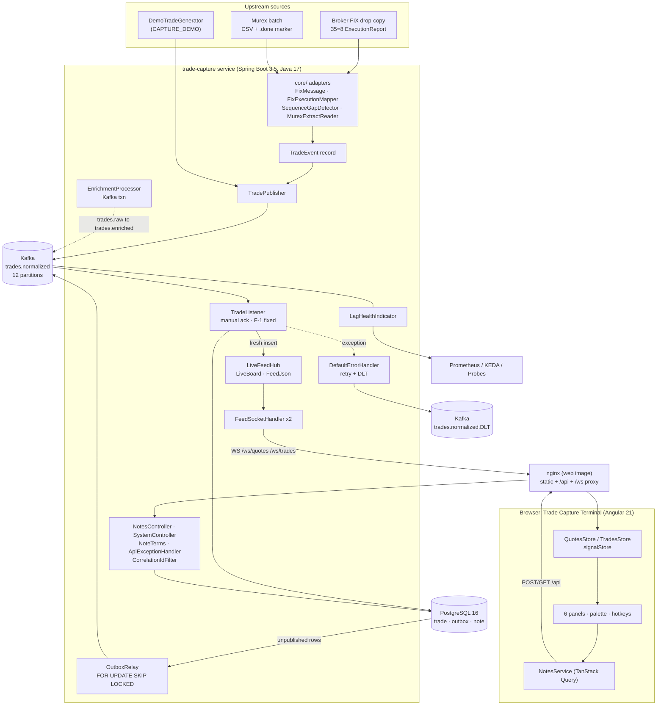

### 2.3 The same picture as an ASCII "subway map"

```text
 SOURCES               SERVICE (pod x3..12)                       DATA               CONSUMERS / OPS
┌──────────┐   ┌─────────────────────────────────────────┐   ┌─────────────┐   ┌───────────────────────────┐
│ Broker   │   │ core/ (pure Java)                       │   │             │   │ Browser: TERMINAL         │
│ FIX 4.4  ├──►│ FixMessage ─► FixExecutionMapper ─┐     │   │   KAFKA     │   │  Quote board  Trade tape  │
└──────────┘   │ SequenceGapDetector               │     │   │ trades.     │   │  Chart  Positions         │
┌──────────┐   │ MurexExtractReader ───────────────┤     │   │ normalized  │   │  Ticket  Booked notes     │
│ Murex    ├──►│ LiveBoard · FeedJson · NoteTerms  ▼     │   │ (12 parts)  │   │   ▲ WS /ws/quotes /trades │
└──────────┘   │                              TradeEvent │   │             │   │   │ REST /api/*           │
┌──────────┐   ├─────────────────────────────────────────┤   │      │      │   └───┼───────────────────────┘
│ DEMO     ├──►│ spring/                                 │   │      ▼      │       │  via nginx (web image)
│ generator│   │ TradePublisher ─────────────────────────┼──►│ ┌─────────┐ │   ┌───┴───────────────────────┐
└──────────┘   │ OutboxRelay ◄── outbox table ───────────┼──►│ │DLT topic│ │   │ Prometheus /actuator/*    │
               │ TradeListener ◄─────────────────────────┼───┤ └─────────┘ │   │ KEDA (lag) · PDB · NetPol │
               │   │ insert ON CONFLICT DO NOTHING       │   └─────────────┘   └───────────────────────────┘
               │   ├──► LiveFeedHub ──► FeedSocketHandler ──► browsers   ◄── (only for NEW inserts)
               │   ▼                                     │   ┌─────────────┐
               │ JdbcTradeStore · JdbcNoteStore ─────────┼──►│ PostgreSQL  │
               │ NotesController · SystemController      │   │ trade outbox│
               │ LagHealthIndicator ◄── Kafka Admin ─────┼───┤ note        │
               └─────────────────────────────────────────┘   └─────────────┘
```

### 2.4 Information flow, numbered (front → back and back → front)

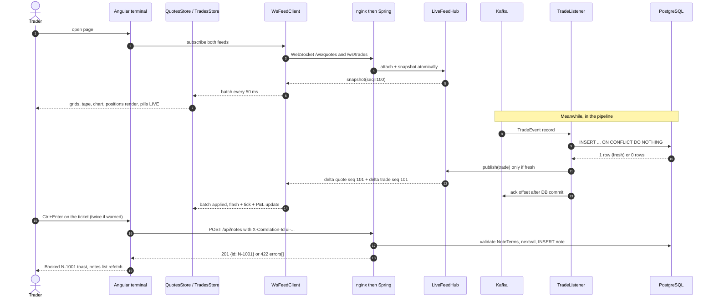

[⬆️ Back to TOC](#toc)

---

<a id="repo-map"></a>

## 📂 §3 Repository Map & File Ledger

### 3.1 Directory tree (annotated; 🆕 new · ✏️ changed)

```text
trade-capture/
├── .gitignore                          🆕 ignore target/, node_modules, dist, state
├── AGENTS.md                           house rules for humans + AI agents
├── TRADE-CAPTURE.md                    this guide (not in the ledger: it is the deliverable)
├── pom.xml                             ✏️ + websocket starter, version 2.0.0
├── docker/
│   ├── Dockerfile                      2-stage UBI 9 image, layered jar
│   └── docker-compose.yml              🆕 postgres + kafka + capture + web
├── docs/screenshots/                   🆕 8 real PNGs used in §5 and §11
├── src/
│   ├── main/
│   │   ├── java/com/example/capture/
│   │   │   ├── core/                   PURE JAVA: 13 files (🆕 LiveBoard, NoteTerms, FeedJson; ✏️ DedupStore)
│   │   │   └── spring/                 WIRING: 20 files (🆕 10; ✏️ TradeListener)
│   │   └── resources/
│   │       ├── application.yml         ✏️ + capture.demo.*
│   │       └── db/migration/           V1__capture.sql · 🆕 V2__notes.sql
│   └── test/java/com/example/capture/
│       ├── core/                       🆕 4 unit-test classes (28 tests)
│       └── spring/CaptureIntegrationTest.java
├── k8s/
│   ├── base/                           9 files (cloud-neutral)  — unchanged
│   └── overlays/aws/                   3 files (EKS/MSK/RDS)    — unchanged
├── infra/{aws,azure,gcp}/              12 .tf files             — unchanged
└── web/                                Angular app "Trade Capture Terminal"
    ├── package.json ✏️ · package-lock.json ✏️ · angular.json ✏️ · tsconfig*.json (app ✏️)
    ├── .postcssrc.json 🆕 · proxy.conf.json 🆕 · .editorconfig · .prettierrc · .gitignore · .dockerignore 🆕
    ├── Dockerfile 🆕 · nginx.conf 🆕 · README.md ✏️
    ├── playwright.config.ts · playwright.shots.config.ts 🆕
    ├── .vscode/ (extensions · launch · mcp · tasks)
    ├── public/favicon.ico
    ├── e2e/ (mock-backend.mjs ✏️ · helpers.ts 🆕 · terminal.e2e.spec.ts 🆕 · screens.shots.spec.ts 🆕)
    └── src/
        ├── index.html ✏️ · main.ts · styles.css ✏️
        └── app/
            ├── app.ts ✏️ · app.config.ts ✏️ · app.int.spec.ts ✏️
            ├── core/    12 pure files + 9 specs      🆕
            ├── feed/    2 files + 1 spec             🆕
            ├── state/   7 files + 4 specs            🆕
            ├── api/     2 files + 1 spec             🆕
            ├── ui/      8 files                      🆕
            ├── panels/  7 files                      🆕
            ├── shell/   6 files                      🆕
            └── testing/ fakes.ts                     🆕
```

### 3.2 Hexagonal ("ports and adapters") view of the back end (v2)

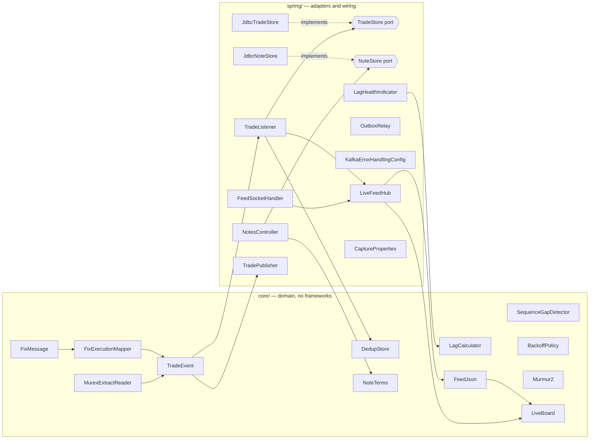

🧒 *Feynman:* **core** is the recipe book — it works in any kitchen. **spring** is the particular kitchen's stove and fridge. v2 added three new recipes (scoreboard, JSON stamp, strict cashier) to the book and left the stove-makers to plug them in.

### 3.3 File Coverage Ledger

<a id="ledger"></a>

> Every file of the enhanced project has exactly one row. The **Explained in** link jumps to its dedicated section. The 30 build-output files of v1's `target/` no longer exist in the project; they are accounted for in [Appendix A](#appendix-target).

| ID | File (relative to `trade-capture/`) | Layer | Explained in |
|---|---|---|---|
| F-001 | `.gitignore` | 🛠️ Repo | [12.6b](#f-gitignore) |
| F-002 | `AGENTS.md` | 📜 Governance | [12.1](#f-agents-md) |
| F-003 | `docker/Dockerfile` | 🐳 Docker | [D.0](#f-docker-dockerfile) |
| F-004 | `docker/docker-compose.yml` | 🐳 Docker | [D.0e](#f-docker-docker-compose-yml) |
| F-005 | `docs/screenshots/chart-maximised.png` | 🖼️ Screenshot | [11.5](#f-docs-screenshots-chart-maximised-png) |
| F-006 | `docs/screenshots/help.png` | 🖼️ Screenshot | [11.5](#f-docs-screenshots-help-png) |
| F-007 | `docs/screenshots/palette.png` | 🖼️ Screenshot | [11.5](#f-docs-screenshots-palette-png) |
| F-008 | `docs/screenshots/ticket-confirm.png` | 🖼️ Screenshot | [11.5](#f-docs-screenshots-ticket-confirm-png) |
| F-009 | `docs/screenshots/ticket-invalid.png` | 🖼️ Screenshot | [11.5](#f-docs-screenshots-ticket-invalid-png) |
| F-010 | `docs/screenshots/workspace-5000.png` | 🖼️ Screenshot | [11.5](#f-docs-screenshots-workspace-5000-png) |
| F-011 | `docs/screenshots/workspace-dark.png` | 🖼️ Screenshot | [11.5](#f-docs-screenshots-workspace-dark-png) |
| F-012 | `docs/screenshots/workspace-light.png` | 🖼️ Screenshot | [11.5](#f-docs-screenshots-workspace-light-png) |
| F-013 | `infra/aws/main.tf` | ☁️ OpenTofu | [E.1.3](#f-infra-aws-main-tf) |
| F-014 | `infra/aws/outputs.tf` | ☁️ OpenTofu | [E.1.4](#f-infra-aws-outputs-tf) |
| F-015 | `infra/aws/variables.tf` | ☁️ OpenTofu | [E.1.2](#f-infra-aws-variables-tf) |
| F-016 | `infra/aws/versions.tf` | ☁️ OpenTofu | [E.1.1](#f-infra-aws-versions-tf) |
| F-017 | `infra/azure/main.tf` | ☁️ OpenTofu | [E.2.3](#f-infra-azure-main-tf) |
| F-018 | `infra/azure/outputs.tf` | ☁️ OpenTofu | [E.2.4](#f-infra-azure-outputs-tf) |
| F-019 | `infra/azure/variables.tf` | ☁️ OpenTofu | [E.2.2](#f-infra-azure-variables-tf) |
| F-020 | `infra/azure/versions.tf` | ☁️ OpenTofu | [E.2.1](#f-infra-azure-versions-tf) |
| F-021 | `infra/gcp/main.tf` | ☁️ OpenTofu | [E.3.3](#f-infra-gcp-main-tf) |
| F-022 | `infra/gcp/outputs.tf` | ☁️ OpenTofu | [E.3.4](#f-infra-gcp-outputs-tf) |
| F-023 | `infra/gcp/variables.tf` | ☁️ OpenTofu | [E.3.2](#f-infra-gcp-variables-tf) |
| F-024 | `infra/gcp/versions.tf` | ☁️ OpenTofu | [E.3.1](#f-infra-gcp-versions-tf) |
| F-025 | `k8s/base/configmap.yaml` | ☸️ Kubernetes | [D.4](#f-k8s-base-configmap-yaml) |
| F-026 | `k8s/base/deployment.yaml` | ☸️ Kubernetes | [D.5](#f-k8s-base-deployment-yaml) |
| F-027 | `k8s/base/kustomization.yaml` | ☸️ Kubernetes | [D.10](#f-k8s-base-kustomization-yaml) |
| F-028 | `k8s/base/namespace.yaml` | ☸️ Kubernetes | [D.2](#f-k8s-base-namespace-yaml) |
| F-029 | `k8s/base/networkpolicy.yaml` | ☸️ Kubernetes | [D.8](#f-k8s-base-networkpolicy-yaml) |
| F-030 | `k8s/base/pdb.yaml` | ☸️ Kubernetes | [D.7](#f-k8s-base-pdb-yaml) |
| F-031 | `k8s/base/scaledobject.yaml` | ☸️ Kubernetes | [D.9](#f-k8s-base-scaledobject-yaml) |
| F-032 | `k8s/base/service.yaml` | ☸️ Kubernetes | [D.6](#f-k8s-base-service-yaml) |
| F-033 | `k8s/base/serviceaccount.yaml` | ☸️ Kubernetes | [D.3](#f-k8s-base-serviceaccount-yaml) |
| F-034 | `k8s/overlays/aws/endpoints.yaml` | ☸️ Kubernetes | [D.12](#f-k8s-overlays-aws-endpoints-yaml) |
| F-035 | `k8s/overlays/aws/externalsecret.yaml` | ☸️ Kubernetes | [D.13](#f-k8s-overlays-aws-externalsecret-yaml) |
| F-036 | `k8s/overlays/aws/kustomization.yaml` | ☸️ Kubernetes | [D.11](#f-k8s-overlays-aws-kustomization-yaml) |
| F-037 | `pom.xml` | 🛠️ Build | [10.3](#f-pom-xml) |
| F-038 | `src/main/java/com/example/capture/core/BackoffPolicy.java` | ☕ Back end · core | [8.7](#f-src-main-java-com-example-capture-core-backoffpolicy-java) |
| F-039 | `src/main/java/com/example/capture/core/CaptureDemo.java` | ☕ Back end · core | [8.9](#f-src-main-java-com-example-capture-core-capturedemo-java) |
| F-040 | `src/main/java/com/example/capture/core/DedupStore.java` | ☕ Back end · core | [8.8a](#f-src-main-java-com-example-capture-core-dedupstore-java) |
| F-041 | `src/main/java/com/example/capture/core/FeedJson.java` | ☕ Back end · core | [8.12](#f-src-main-java-com-example-capture-core-feedjson-java) |
| F-042 | `src/main/java/com/example/capture/core/FixExecutionMapper.java` | ☕ Back end · core | [8.3](#f-src-main-java-com-example-capture-core-fixexecutionmapper-java) |
| F-043 | `src/main/java/com/example/capture/core/FixMessage.java` | ☕ Back end · core | [8.2](#f-src-main-java-com-example-capture-core-fixmessage-java) |
| F-044 | `src/main/java/com/example/capture/core/LagCalculator.java` | ☕ Back end · core | [8.8b](#f-src-main-java-com-example-capture-core-lagcalculator-java) |
| F-045 | `src/main/java/com/example/capture/core/LiveBoard.java` | ☕ Back end · core | [8.10](#f-src-main-java-com-example-capture-core-liveboard-java) |
| F-046 | `src/main/java/com/example/capture/core/MurexExtractReader.java` | ☕ Back end · core | [8.5](#f-src-main-java-com-example-capture-core-murexextractreader-java) |
| F-047 | `src/main/java/com/example/capture/core/Murmur2.java` | ☕ Back end · core | [8.6](#f-src-main-java-com-example-capture-core-murmur2-java) |
| F-048 | `src/main/java/com/example/capture/core/NoteTerms.java` | ☕ Back end · core | [8.11](#f-src-main-java-com-example-capture-core-noteterms-java) |
| F-049 | `src/main/java/com/example/capture/core/SequenceGapDetector.java` | ☕ Back end · core | [8.4](#f-src-main-java-com-example-capture-core-sequencegapdetector-java) |
| F-050 | `src/main/java/com/example/capture/core/TradeEvent.java` | ☕ Back end · core | [8.1](#f-src-main-java-com-example-capture-core-tradeevent-java) |
| F-051 | `src/main/java/com/example/capture/spring/ApiExceptionHandler.java` | ☕ Back end · spring | [9.17](#f-src-main-java-com-example-capture-spring-apiexceptionhandler-java) |
| F-052 | `src/main/java/com/example/capture/spring/CaptureApplication.java` | ☕ Back end · spring | [9.1](#f-src-main-java-com-example-capture-spring-captureapplication-java) |
| F-053 | `src/main/java/com/example/capture/spring/CaptureProperties.java` | ☕ Back end · spring | [9.2](#f-src-main-java-com-example-capture-spring-captureproperties-java) |
| F-054 | `src/main/java/com/example/capture/spring/CorrelationIdFilter.java` | ☕ Back end · spring | [9.18](#f-src-main-java-com-example-capture-spring-correlationidfilter-java) |
| F-055 | `src/main/java/com/example/capture/spring/DemoTradeGenerator.java` | ☕ Back end · spring | [9.20](#f-src-main-java-com-example-capture-spring-demotradegenerator-java) |
| F-056 | `src/main/java/com/example/capture/spring/EnrichmentProcessor.java` | ☕ Back end · spring | [9.10](#f-src-main-java-com-example-capture-spring-enrichmentprocessor-java) |
| F-057 | `src/main/java/com/example/capture/spring/FeedSocketHandler.java` | ☕ Back end · spring | [9.12](#f-src-main-java-com-example-capture-spring-feedsockethandler-java) |
| F-058 | `src/main/java/com/example/capture/spring/JdbcNoteStore.java` | ☕ Back end · spring | [9.15](#f-src-main-java-com-example-capture-spring-jdbcnotestore-java) |
| F-059 | `src/main/java/com/example/capture/spring/JdbcTradeStore.java` | ☕ Back end · spring | [9.6](#f-src-main-java-com-example-capture-spring-jdbctradestore-java) |
| F-060 | `src/main/java/com/example/capture/spring/KafkaErrorHandlingConfig.java` | ☕ Back end · spring | [9.8](#f-src-main-java-com-example-capture-spring-kafkaerrorhandlingconfig-java) |
| F-061 | `src/main/java/com/example/capture/spring/LagHealthIndicator.java` | ☕ Back end · spring | [9.9](#f-src-main-java-com-example-capture-spring-laghealthindicator-java) |
| F-062 | `src/main/java/com/example/capture/spring/LiveFeedHub.java` | ☕ Back end · spring | [9.11](#f-src-main-java-com-example-capture-spring-livefeedhub-java) |
| F-063 | `src/main/java/com/example/capture/spring/NoteStore.java` | ☕ Back end · spring | [9.14](#f-src-main-java-com-example-capture-spring-notestore-java) |
| F-064 | `src/main/java/com/example/capture/spring/NotesController.java` | ☕ Back end · spring | [9.16](#f-src-main-java-com-example-capture-spring-notescontroller-java) |
| F-065 | `src/main/java/com/example/capture/spring/OutboxRelay.java` | ☕ Back end · spring | [9.4](#f-src-main-java-com-example-capture-spring-outboxrelay-java) |
| F-066 | `src/main/java/com/example/capture/spring/SystemController.java` | ☕ Back end · spring | [9.19](#f-src-main-java-com-example-capture-spring-systemcontroller-java) |
| F-067 | `src/main/java/com/example/capture/spring/TradeListener.java` | ☕ Back end · spring | [9.7](#f-src-main-java-com-example-capture-spring-tradelistener-java) |
| F-068 | `src/main/java/com/example/capture/spring/TradePublisher.java` | ☕ Back end · spring | [9.3](#f-src-main-java-com-example-capture-spring-tradepublisher-java) |
| F-069 | `src/main/java/com/example/capture/spring/TradeStore.java` | ☕ Back end · spring | [9.5](#f-src-main-java-com-example-capture-spring-tradestore-java) |
| F-070 | `src/main/java/com/example/capture/spring/WebSocketConfig.java` | ☕ Back end · spring | [9.13](#f-src-main-java-com-example-capture-spring-websocketconfig-java) |
| F-071 | `src/main/resources/application.yml` | ☕ Back end · resources | [10.1](#f-src-main-resources-application-yml) |
| F-072 | `src/main/resources/db/migration/V1__capture.sql` | ☕ Back end · resources | [10.2](#f-src-main-resources-db-migration-v1-capture-sql) |
| F-073 | `src/main/resources/db/migration/V2__notes.sql` | ☕ Back end · resources | [10.2b](#f-src-main-resources-db-migration-v2-notes-sql) |
| F-074 | `src/test/java/com/example/capture/core/DedupStoreTest.java` | 🧪 Back-end test | [11.1b](#f-src-test-java-com-example-capture-core-dedupstoretest-java) |
| F-075 | `src/test/java/com/example/capture/core/FeedJsonTest.java` | 🧪 Back-end test | [11.1c](#f-src-test-java-com-example-capture-core-feedjsontest-java) |
| F-076 | `src/test/java/com/example/capture/core/LiveBoardTest.java` | 🧪 Back-end test | [11.1d](#f-src-test-java-com-example-capture-core-liveboardtest-java) |
| F-077 | `src/test/java/com/example/capture/core/NoteTermsTest.java` | 🧪 Back-end test | [11.1e](#f-src-test-java-com-example-capture-core-notetermstest-java) |
| F-078 | `src/test/java/com/example/capture/spring/CaptureIntegrationTest.java` | 🧪 Back-end test | [11.1](#f-src-test-java-com-example-capture-spring-captureintegrationtest-java) |
| F-079 | `web/.dockerignore` | 🐳 Docker | [D.0d](#f-web-dockerignore) |
| F-080 | `web/.editorconfig` | 🛠️ Web tooling | [12.6](#f-web-editorconfig) |
| F-081 | `web/.gitignore` | 🛠️ Web tooling | [12.6](#f-web-gitignore) |
| F-082 | `web/.postcssrc.json` | 🛠️ Web tooling | [12.5b](#f-web-postcssrc-json) |
| F-083 | `web/.prettierrc` | 🛠️ Web tooling | [12.6](#f-web-prettierrc) |
| F-084 | `web/.vscode/extensions.json` | 🛠️ Web tooling | [12.7](#f-web-vscode-extensions-json) |
| F-085 | `web/.vscode/launch.json` | 🛠️ Web tooling | [12.8](#f-web-vscode-launch-json) |
| F-086 | `web/.vscode/mcp.json` | 🛠️ Web tooling | [12.8](#f-web-vscode-mcp-json) |
| F-087 | `web/.vscode/tasks.json` | 🛠️ Web tooling | [12.8](#f-web-vscode-tasks-json) |
| F-088 | `web/Dockerfile` | 🐳 Docker | [D.0b](#f-web-dockerfile) |
| F-089 | `web/README.md` | 🛠️ Web tooling | [12.7](#f-web-readme-md) |
| F-090 | `web/angular.json` | 🛠️ Web tooling | [12.4](#f-web-angular-json) |
| F-091 | `web/e2e/helpers.ts` | 🧪 Web test | [11.4.1](#f-web-e2e-helpers-ts) |
| F-092 | `web/e2e/mock-backend.mjs` | 🧪 Web test | [7.3](#f-web-e2e-mock-backend-mjs) |
| F-093 | `web/e2e/screens.shots.spec.ts` | 🧪 Web test | [11.4.3](#f-web-e2e-screens-shots-spec-ts) |
| F-094 | `web/e2e/terminal.e2e.spec.ts` | 🧪 Web test | [11.4.2](#f-web-e2e-terminal-e2e-spec-ts) |
| F-095 | `web/nginx.conf` | 🐳 Docker | [D.0c](#f-web-nginx-conf) |
| F-096 | `web/package-lock.json` | 🛠️ Web tooling | [12.3](#f-web-package-lock-json) |
| F-097 | `web/package.json` | 🛠️ Web tooling | [12.2](#f-web-package-json) |
| F-098 | `web/playwright.config.ts` | 🧪 Web test | [11.4.4](#f-web-playwright-config-ts) |
| F-099 | `web/playwright.shots.config.ts` | 🧪 Web test | [11.4.5](#f-web-playwright-shots-config-ts) |
| F-100 | `web/proxy.conf.json` | 🛠️ Web tooling | [12.5c](#f-web-proxy-conf-json) |
| F-101 | `web/public/favicon.ico` | 🛠️ Web tooling | [6.4](#f-web-public-favicon-ico) |
| F-102 | `web/src/app/api/notes.api.spec.ts` | 🧪 Web test | [11.2.15](#f-web-src-app-api-notes-api-spec-ts) |
| F-103 | `web/src/app/api/notes.api.ts` | 🅰️ Web app | [6.10.1](#f-web-src-app-api-notes-api-ts) |
| F-104 | `web/src/app/api/notes.queries.ts` | 🅰️ Web app | [6.10.2](#f-web-src-app-api-notes-queries-ts) |
| F-105 | `web/src/app/app.config.ts` | 🅰️ Web app | [6.5](#f-web-src-app-app-config-ts) |
| F-106 | `web/src/app/app.int.spec.ts` | 🧪 Web test | [11.3](#f-web-src-app-app-int-spec-ts) |
| F-107 | `web/src/app/app.ts` | 🅰️ Web app | [6.6](#f-web-src-app-app-ts) |
| F-108 | `web/src/app/core/cn.ts` | 🅰️ Web app | [6.7.7](#f-web-src-app-core-cn-ts) |
| F-109 | `web/src/app/core/feed.reducer.spec.ts` | 🧪 Web test | [11.2.1](#f-web-src-app-core-feed-reducer-spec-ts) |
| F-110 | `web/src/app/core/feed.reducer.ts` | 🅰️ Web app | [6.7.4](#f-web-src-app-core-feed-reducer-ts) |
| F-111 | `web/src/app/core/fuzzy.spec.ts` | 🧪 Web test | [11.2.7](#f-web-src-app-core-fuzzy-spec-ts) |
| F-112 | `web/src/app/core/fuzzy.ts` | 🅰️ Web app | [6.7.8](#f-web-src-app-core-fuzzy-ts) |
| F-113 | `web/src/app/core/hotkeys.spec.ts` | 🧪 Web test | [11.2.5](#f-web-src-app-core-hotkeys-spec-ts) |
| F-114 | `web/src/app/core/hotkeys.ts` | 🅰️ Web app | [6.7.11](#f-web-src-app-core-hotkeys-ts) |
| F-115 | `web/src/app/core/layout.spec.ts` | 🧪 Web test | [11.2.6](#f-web-src-app-core-layout-spec-ts) |
| F-116 | `web/src/app/core/layout.ts` | 🅰️ Web app | [6.7.12](#f-web-src-app-core-layout-ts) |
| F-117 | `web/src/app/core/models.ts` | 🅰️ Web app | [6.7.1](#f-web-src-app-core-models-ts) |
| F-118 | `web/src/app/core/money.spec.ts` | 🧪 Web test | [11.2.2](#f-web-src-app-core-money-spec-ts) |
| F-119 | `web/src/app/core/money.ts` | 🅰️ Web app | [6.7.2](#f-web-src-app-core-money-ts) |
| F-120 | `web/src/app/core/ohlc.spec.ts` | 🧪 Web test | [11.2.8](#f-web-src-app-core-ohlc-spec-ts) |
| F-121 | `web/src/app/core/ohlc.ts` | 🅰️ Web app | [6.7.6](#f-web-src-app-core-ohlc-ts) |
| F-122 | `web/src/app/core/positions.spec.ts` | 🧪 Web test | [11.2.3](#f-web-src-app-core-positions-spec-ts) |
| F-123 | `web/src/app/core/positions.ts` | 🅰️ Web app | [6.7.3](#f-web-src-app-core-positions-ts) |
| F-124 | `web/src/app/core/rx-utils.spec.ts` | 🧪 Web test | [11.2.9](#f-web-src-app-core-rx-utils-spec-ts) |
| F-125 | `web/src/app/core/rx-utils.ts` | 🅰️ Web app | [6.7.5](#f-web-src-app-core-rx-utils-ts) |
| F-126 | `web/src/app/core/ticket.checks.ts` | 🅰️ Web app | [6.7.9](#f-web-src-app-core-ticket-checks-ts) |
| F-127 | `web/src/app/core/ticket.machine.ts` | 🅰️ Web app | [6.7.10](#f-web-src-app-core-ticket-machine-ts) |
| F-128 | `web/src/app/core/ticket.spec.ts` | 🧪 Web test | [11.2.4](#f-web-src-app-core-ticket-spec-ts) |
| F-129 | `web/src/app/feed/feed.client.ts` | 🅰️ Web app | [6.8.1](#f-web-src-app-feed-feed-client-ts) |
| F-130 | `web/src/app/feed/ws-feed.client.spec.ts` | 🧪 Web test | [11.2.10](#f-web-src-app-feed-ws-feed-client-spec-ts) |
| F-131 | `web/src/app/feed/ws-feed.client.ts` | 🅰️ Web app | [6.8.2](#f-web-src-app-feed-ws-feed-client-ts) |
| F-132 | `web/src/app/panels/chart.adapter.ts` | 🅰️ Web app | [6.12.3](#f-web-src-app-panels-chart-adapter-ts) |
| F-133 | `web/src/app/panels/chart.panel.ts` | 🅰️ Web app | [6.12.4](#f-web-src-app-panels-chart-panel-ts) |
| F-134 | `web/src/app/panels/notes.panel.ts` | 🅰️ Web app | [6.12.7](#f-web-src-app-panels-notes-panel-ts) |
| F-135 | `web/src/app/panels/positions.panel.ts` | 🅰️ Web app | [6.12.6](#f-web-src-app-panels-positions-panel-ts) |
| F-136 | `web/src/app/panels/quote-board.panel.ts` | 🅰️ Web app | [6.12.1](#f-web-src-app-panels-quote-board-panel-ts) |
| F-137 | `web/src/app/panels/ticket.panel.ts` | 🅰️ Web app | [6.12.5](#f-web-src-app-panels-ticket-panel-ts) |
| F-138 | `web/src/app/panels/trade-tape.panel.ts` | 🅰️ Web app | [6.12.2](#f-web-src-app-panels-trade-tape-panel-ts) |
| F-139 | `web/src/app/shell/command-palette.component.ts` | 🅰️ Web app | [6.13.5](#f-web-src-app-shell-command-palette-component-ts) |
| F-140 | `web/src/app/shell/shortcut-help.component.ts` | 🅰️ Web app | [6.13.6](#f-web-src-app-shell-shortcut-help-component-ts) |
| F-141 | `web/src/app/shell/status-bar.component.ts` | 🅰️ Web app | [6.13.3](#f-web-src-app-shell-status-bar-component-ts) |
| F-142 | `web/src/app/shell/status-pill.component.ts` | 🅰️ Web app | [6.13.1](#f-web-src-app-shell-status-pill-component-ts) |
| F-143 | `web/src/app/shell/top-bar.component.ts` | 🅰️ Web app | [6.13.2](#f-web-src-app-shell-top-bar-component-ts) |
| F-144 | `web/src/app/shell/workspace.component.ts` | 🅰️ Web app | [6.13.4](#f-web-src-app-shell-workspace-component-ts) |
| F-145 | `web/src/app/state/clock.service.ts` | 🅰️ Web app | [6.9.7](#f-web-src-app-state-clock-service-ts) |
| F-146 | `web/src/app/state/commands.ts` | 🅰️ Web app | [6.9.6](#f-web-src-app-state-commands-ts) |
| F-147 | `web/src/app/state/feed-health.ts` | 🅰️ Web app | [6.9.1](#f-web-src-app-state-feed-health-ts) |
| F-148 | `web/src/app/state/quotes.store.spec.ts` | 🧪 Web test | [11.2.11](#f-web-src-app-state-quotes-store-spec-ts) |
| F-149 | `web/src/app/state/quotes.store.ts` | 🅰️ Web app | [6.9.2](#f-web-src-app-state-quotes-store-ts) |
| F-150 | `web/src/app/state/toast.store.spec.ts` | 🧪 Web test | [11.2.14](#f-web-src-app-state-toast-store-spec-ts) |
| F-151 | `web/src/app/state/toast.store.ts` | 🅰️ Web app | [6.9.5](#f-web-src-app-state-toast-store-ts) |
| F-152 | `web/src/app/state/trades.store.spec.ts` | 🧪 Web test | [11.2.12](#f-web-src-app-state-trades-store-spec-ts) |
| F-153 | `web/src/app/state/trades.store.ts` | 🅰️ Web app | [6.9.3](#f-web-src-app-state-trades-store-ts) |
| F-154 | `web/src/app/state/workspace.store.spec.ts` | 🧪 Web test | [11.2.13](#f-web-src-app-state-workspace-store-spec-ts) |
| F-155 | `web/src/app/state/workspace.store.ts` | 🅰️ Web app | [6.9.4](#f-web-src-app-state-workspace-store-ts) |
| F-156 | `web/src/app/testing/fakes.ts` | 🧪 Web test | [11.3b](#f-web-src-app-testing-fakes-ts) |
| F-157 | `web/src/app/ui/btn.directive.ts` | 🅰️ Web app | [6.11.1](#f-web-src-app-ui-btn-directive-ts) |
| F-158 | `web/src/app/ui/compact.pipe.ts` | 🅰️ Web app | [6.11.6](#f-web-src-app-ui-compact-pipe-ts) |
| F-159 | `web/src/app/ui/flash.directive.ts` | 🅰️ Web app | [6.11.4](#f-web-src-app-ui-flash-directive-ts) |
| F-160 | `web/src/app/ui/icon.component.ts` | 🅰️ Web app | [6.11.2](#f-web-src-app-ui-icon-component-ts) |
| F-161 | `web/src/app/ui/kbd.component.ts` | 🅰️ Web app | [6.11.3](#f-web-src-app-ui-kbd-component-ts) |
| F-162 | `web/src/app/ui/panel-frame.component.ts` | 🅰️ Web app | [6.11.7](#f-web-src-app-ui-panel-frame-component-ts) |
| F-163 | `web/src/app/ui/spark.component.ts` | 🅰️ Web app | [6.11.5](#f-web-src-app-ui-spark-component-ts) |
| F-164 | `web/src/app/ui/toasts.component.ts` | 🅰️ Web app | [6.11.8](#f-web-src-app-ui-toasts-component-ts) |
| F-165 | `web/src/index.html` | 🅰️ Web app | [6.1](#f-web-src-index-html) |
| F-166 | `web/src/main.ts` | 🅰️ Web app | [6.2](#f-web-src-main-ts) |
| F-167 | `web/src/styles.css` | 🅰️ Web app | [6.3](#f-web-src-styles-css) |
| F-168 | `web/tsconfig.app.json` | 🛠️ Web tooling | [12.5](#f-web-tsconfig-app-json) |
| F-169 | `web/tsconfig.json` | 🛠️ Web tooling | [12.5](#f-web-tsconfig-json) |
| F-170 | `web/tsconfig.spec.json` | 🛠️ Web tooling | [12.5](#f-web-tsconfig-spec-json) |

**Total: 170 files, all explained.**

[⬆️ Back to TOC](#toc)

---

<a id="foundations"></a>

## 🧮 §4 Foundations — The Ideas You Need (Feynman + Math)

> All maths below is GitHub-flavoured Markdown MathJax: inline `$…$`, display `$$…$$`.

### 4.1 Trade capture, FIX and Murex in plain words

- A **trade** (or *execution*, *fill*) is a record that "someone bought/sold *q* units of *symbol* at price *p* at time *t*".
- **FIX** (Financial Information eXchange) is the brokers' text protocol: `tag=value` pairs separated by an invisible character `SOH` (ASCII 1). Tag `35=8` means "ExecutionReport", `150=F` means "this report is a fill", `54=1` is Buy, `54=2` is Sell, `55` symbol, `32` quantity, `31` price, `60` time, `17` execution id, `34` message sequence number.
- **Murex** is a trading/risk system that can export files. Here it drops `*.csv` plus an empty `*.csv.done` "I finished writing" marker.
- **Capture** = reliably gather all of these, in one house format, exactly once.

### 4.2 Autocallable notes (what the form's five numbers mean)

Let the underlying's price on observation date $t_i$ be $S_{t_i}$ and the initial level $S_0$. Define performance $P_i = S_{t_i}/S_0$ (shown as a percentage). With notional $N$ and per-period coupon rate $r$:

$$\text{Autocall at } t_i \iff P_i \ge A_b \quad\Rightarrow\quad \text{pay } N\,(1 + r) \text{ and the note ends early}$$

$$\text{Coupon at } t_i \iff P_i \ge C_b \quad\Rightarrow\quad \text{pay } N\,r$$

$$\text{At maturity } T:\quad \text{redemption} = \begin{cases} N & \text{if } \min_t P_t \ge K \ \text{ or } \ P_T \ge 1 \\ N\,P_T & \text{if the knock-in barrier } K \text{ was breached and } P_T < 1 \end{cases}$$

where $A_b$ = *autocall barrier*, $C_b$ = *coupon barrier*, $K$ = *knock-in (KI) barrier*. The form's validator encodes the term-sheet ordering

$$K < C_b \le A_b \qquad (\text{e.g. } 60 < 70 \le 100)$$

🧒 *Feynman:* You lend a bank money. Every few months the bank looks at a stock. If the stock is **high enough** (autocall barrier) the bank gives your money back early with a bonus. If it is **medium** you just get interest (coupon). If it ever **crashes below the KI line** and ends below where it started, you absorb the loss. The form simply stops you from typing lines in a silly order (crash line above the bonus line).

> ⚠️ This repo **captures** these five terms; it contains **no pricing or payoff engine**. Also note a unit mix in the form: barriers are percentages (`70`, `100`, `60`) but `couponRate` is a fraction in $[0,1]$ (`0.02`).

### 4.3 Delivery guarantees and why "idempotent" saves the day

| Guarantee | Meaning | Failure mode |
|---|---|---|
| At-most-once | process, then maybe commit; never retry | **loses** data |
| At-least-once | retry until acknowledged | **duplicates** data |
| Exactly-once | each effect happens once | needs transactions across *all* systems — expensive |

This service chooses **at-least-once + idempotent write**:

$$\text{rows}(k) = \begin{cases} 1 & \text{if the key } k=(\text{source},\text{trade\_id}) \text{ was delivered}\ \ge 1 \text{ times} \\ 0 & \text{otherwise} \end{cases}$$

Delivering the same trade $n\ge1$ times therefore yields the same database state as delivering it once: the SQL `ON CONFLICT … DO NOTHING` makes the operation **idempotent**: $f(f(x)) = f(x)$.

🧒 *Feynman:* A mailman may deliver the same letter twice. You keep a guest book; if the sender's name is already written, you ignore the duplicate. The guest book (primary key) is smarter than anyone's memory.

### 4.4 Kafka partitions, keys and the Murmur2 hash

A topic is split into $P$ ordered logs called **partitions**. A message key $k$ picks the partition:

$$\text{partition}(k) = \big(\text{murmur2}(k_{\text{utf8}})\ \&\ \texttt{0x7fffffff}\big) \bmod P$$

The mask clears the sign bit so the hash is non-negative. Messages with the **same key always land in the same partition**, and within a partition order is preserved. Here $k = \texttt{account:symbol}$, so all fills for one account in one stock are processed in order — essential for positions and P&L. Verified (✅) on 400 keys over $P=12$: counts ranged 25–40 (ideal $400/12\approx33.3$), see [§8.9](#f-core-capturedemo).

Consumer parallelism is capped by partitions: with $C$ consumers in one group, useful consumers $=\min(C, P)$.

### 4.5 Exponential back-off, with the real numbers

For retry number $n\ge1$, initial delay $d_0$, multiplier $m$, cap $d_{\max}$:

$$d_n = \min\!\big(d_0\, m^{\,n-1},\ d_{\max}\big),\qquad B(R)=\sum_{n=1}^{R} d_n$$

`application.yml` sets $d_0=200\text{ ms}$, $m=2$, $d_{\max}=5000\text{ ms}$, $R=5$:

$$B(5)=200+400+800+1600+3200=6200\text{ ms}$$

(the demo with $R=6$ gives $B(6)=6200+5000=11200$ ms ✅). **Full jitter** draws $U\sim\text{Uniform}[0,d_n]$, so $\mathbb E[U]=d_n/2$, which spreads out many consumers that would otherwise retry in lock-step ("thundering herd").

### 4.6 Consumer lag

For each partition $p$ with log-end offset $E_p$ and committed offset $C_p$ (0 if none):

$$\text{lag}_p=\max(0,\ E_p-C_p),\qquad \text{totalLag}=\sum_p \text{lag}_p,\qquad \text{maxLag}=\max_p \text{lag}_p$$

Verdict: `CRITICAL` if $\text{maxLag}\ge10000$, `WARN` if $\ge1000$, else `OK`. KEDA's replica target is

$$\text{desired}=\min\!\Big(\max\!\big(\lceil \text{totalLag}/500\rceil,\ 3\big),\ 12\Big)$$

(500 = `lagThreshold`, 3 = `minReplicaCount`, 12 = `maxReplicaCount` = partition count).

### 4.7 FIX checksum

$$\text{checksum}=\Big(\sum_{b\in\text{bytes before }10=} b\Big)\bmod 256$$

Worked ✅ example from the demo: changing quantity `300`→`900` replaces ASCII `'3'` (51) by `'9'` (57), raising the byte sum by 6, so the checksum moves from 242 to 248 — and the parser reports *"bad checksum: expected 248 got 242"*.

### 4.8 Money as integers

Price in **micros**: $p_\mu = p\times10^{6}$. Example: $187.25 \to 187\,250\,000$. A Java `long` holds up to $9.22\times10^{18}$, i.e. prices up to about $9.2\times10^{12}$ — far beyond any quote. `BigDecimal.movePointRight(6).longValueExact()` throws if sub-micro digits exist, so rounding never happens silently.

🧒 *Feynman:* Counting money in **millionths of a dollar** is like counting in whole pennies instead of "0.1 + 0.2 = 0.30000000000000004" decimals; whole numbers never drift.

### 4.9 Snapshot + delta + heartbeat (wire contract v2)

State $(\ell, Q, r)$ = (last sequence, board map, needsResync). `gate(ℓ, r, s)` in [§6.7](#f-web-src-app-core-feed-reducer-ts) decides what a sequenced delta $s$ does:

$$\text{gate}(s)=\begin{cases}\text{ignore} & r=\text{true} \ \lor\ s\le \ell\\ \text{gap (set } r=\text{true, send }\{\texttt{resync}\}) & s>\ell+1\\ \text{apply: } Q[k]\leftarrow v,\ \ell\leftarrow s & s=\ell+1\end{cases}$$

A **snapshot** with sequence $s$ replaces $Q$, sets $\ell\leftarrow s$, $r\leftarrow\text{false}$. Two guarantees follow: $\ell$ never decreases through deltas, and the table never shows a silent hole.

**Batch form.** The UI reduces a *batch* $[m_1,\dots,m_n]$ (one 50 ms frame, [§4.12](#f-math-batching)) by folding `gate` left to right and **stopping applying at the first gap** — later messages in the same batch are ignored because $r$ is now true:

$$\ell_{i}=\begin{cases}s_i & \text{gate}(s_i)=\text{apply}\\ \ell_{i-1} & \text{otherwise}\end{cases}$$

**Heartbeat.** The server sends `{"type":"hb"}` every 1 s. It carries no data but refreshes `lastMsgAt`, so a quiet market is distinguishable from a dead socket:

$$\text{status}=\begin{cases}\texttt{connecting} & \text{no message yet}\\ \texttt{stale} & t_{now}-t_{last}>4000\text{ ms}\\ \texttt{resync} & r=\text{true}\\ \texttt{live} & \text{otherwise}\end{cases}$$

With a 1 s heartbeat the false-stale probability is zero until 4 consecutive beats are lost — a 4× safety margin.

🧒 *Feynman:* Every letter in the mail is numbered. If you hold letter 7 and letter 9 arrives, you *know* 8 is missing — you stop reading, phone the sender ("resend everything") and wait for the full bundle. The heartbeat is the sender tapping your window every second to say "still here".

<a id="f-math-virtual"></a>

### 4.10 Virtual scrolling

Row height $h$, viewport height $V$, scroll offset $s$, total rows $N$, overscan $o$:

$$\text{first}=\lfloor s/h\rfloor,\ \ \text{count}=\lceil V/h\rceil,\ \ \text{start}=\max(0,\text{first}-o),\ \ \text{end}=\min(N,\text{first}+\text{count}+o)$$

$$\text{padTop}=\text{start}\cdot h,\qquad \text{padBottom}=\max(0,(N-\text{end})\cdot h)$$

Worked (from the unit test): $s=2400,h=24,V=240,N=10000,o=5\Rightarrow$ first $=100$, count $=10$, start $=95$, end $=115$, padTop $=2280$, padBottom $=9885\times24=237\,240$. Only $\text{end}-\text{start}=20$ DOM rows exist for 10 000 logical rows. v2 delegates this arithmetic to the CDK virtual-scroll viewport plus TanStack Table row models; the maths is identical, the code is no longer ours.

### 4.11 Availability arithmetic in the manifests

- Replicas $=3$, spread across 3 zones (`maxSkew: 1`). Losing one zone leaves $3-1=2\ge\texttt{minAvailable}=2$. ✓
- Kafka (MSK config): replication factor $RF=3$, `min.insync.replicas` $=2$, producer `acks=all`. Tolerated broker failures while still accepting writes: $RF-\text{minISR}=1$.
- Rolling update: `maxUnavailable: 0`, `maxSurge: 1` → capacity never drops below 3 while upgrading (needs a 4th pod briefly).
- Shutdown budget: `preStop sleep 5` + Spring graceful `30 s` $=35\ \text{s}<45\ \text{s}$ `terminationGracePeriodSeconds`. ✓ (10 s slack)

<a id="f-math-batching"></a>

### 4.12 Micro-batching (why 50 ms)

Ticks arrive at rate $\lambda$ msg/s. Rendering each one costs a change-detection pass; `frameBatch` ([§6.7](#f-web-src-app-core-rx-utils-ts)) buffers for $T=50$ ms and flushes once:

$$\text{renders/s}=\min(\lambda,\ 1/T)=\min(\lambda,\ 20),\qquad \text{mean batch}=\lambda T$$

At $\lambda=5000$ msg/s that is 20 renders/s with 250 messages each instead of 5000 renders/s. Worst-case added latency is $T=50$ ms, below the ~100 ms threshold humans perceive as "instant". Empty frames are filtered, so an idle feed does zero work.

🧒 *Feynman:* A waiter who walks to the kitchen once per table-full of orders beats one who runs for every single sentence.

<a id="f-math-vwap"></a>

### 4.13 VWAP and average cost (exact, in BigInt)

For fills $(q_i, p_i)$ with $p_i$ in micros:

$$\text{VWAP}=\operatorname{round}\!\left(\frac{\sum_i q_i\,p_i}{\sum_i q_i}\right)\ \text{ computed as }\ \left\lfloor\frac{2V+Q}{2Q}\right\rfloor\ \text{ for } V=\sum q_ip_i,\ Q=\sum q_i$$

Integer floor of $(2V+Q)/(2Q)$ is round-half-up with no floating point. Worked: fills $100@187.25$ and $300@187.35$ → $V=100\cdot187\,250\,000+300\cdot187\,350\,000=74\,930\,000\,000$, $Q=400$, VWAP $=187\,325\,000$ micros ($187.325$).

**Average cost positions** (`applyFill`). Signed quantity $x$, cost basis $C$ (micros×qty). A fill $(q,p)$ with sign $\sigma=\pm1$:
- *Same direction or flat:* $x\leftarrow x+\sigma q$, $C\leftarrow C+qp$.
- *Reducing:* realised $=\sigma_{pos}\cdot \min(q,|x|)\cdot(p-C/|x|)$; $C$ shrinks proportionally; a fill larger than $|x|$ flips the side and opens the remainder at $p$.

Unrealised: $U=x\cdot\text{mark}-\operatorname{sgn}(x)\,C$ in micros. Everything is `bigint`; AGENTS rule 2 holds.

<a id="f-math-backoff"></a>

### 4.14 Reconnect back-off and stale detection

Browser reconnect ($d_0=250$ ms, $m=2$, cap $15$ s, jitter $j\in[0.5,1]$):

$$d_n=j\cdot\min(250\cdot2^{\,n-1},\ 15000)\ \text{ms}:\quad 250,\ 500,\ 1000,\ 2000,\ 4000,\ 8000,\ 15000,\dots$$

Mean cumulative wait before attempt 8 with jitter $\bar j=0.75$: $0.75\,(250+500+1000+2000+4000+8000+15000)=0.75\cdot30750\approx23.1$ s. `resilient()` wraps `retry({resetOnSuccess:true})` + `repeat`, so a socket that *succeeded then dropped* restarts the ladder at $d_0$ (finding F-11 fixed). A server that closes cleanly is also re-opened.

<a id="f-math-candle"></a>

### 4.15 OHLC candles

Bucket width $w$ s; tick $(t_{ms}, p)$ falls in bucket $b=\lfloor t_{ms}/(1000\,w)\rfloor\cdot w$. Within a bucket:

$$O=p_{first},\quad H=\max p,\quad L=\min p,\quad C=p_{last}$$

Buckets with no ticks are *absent* (a gap, not an invented flat candle). Allowed $w\in\{1,5,15,60\}$.

<a id="f-math-fuzzy"></a>

### 4.16 Fuzzy command matching

Query $q$ matches text $s$ if $q$ is an in-order subsequence of $s$ (case-folded). Score:

$$\text{score}=\sum_{i}\big[1+3\cdot\mathbb 1(\text{adjacent to previous hit})+2\cdot\mathbb 1(\text{word start})\big]-0.01\,|s|$$

so `tt` scores higher on "**T**oggle **t**heme" (two word starts) than on "Quotes", and shorter labels win ties. No match is $-1$; an empty query is $0$ (everything listed).

<a id="f-math-step"></a>

### 4.17 Notional stepping (the ticket's ↑/↓)

With step $\Delta\in\{100\,000,\ 1\,000\,000\ (\text{Shift}),\ 10\,000\,000\ (\text{Alt})\}$ and current $n$:

$$n'=\operatorname{clamp}\Big(\big(\lfloor n/\Delta\rfloor+1\big)\Delta,\ 0,\ N_{max}\Big)\ (\uparrow),\qquad n'=\operatorname{clamp}\Big(\big(\lceil n/\Delta\rceil-1\big)\Delta,\ 0,\ N_{max}\Big)\ (\downarrow)$$

The result is always an exact multiple of $\Delta$: from $250\,000$, ↑ gives $300\,000$ and ↓ gives $200\,000$; from exactly $300\,000$, ↑ gives $400\,000$ (never a no-op).

<a id="f-math-skew"></a>

### 4.18 Round-trip time and clock skew

The status poll records browser send time $t_s$, receive time $t_r$, and the server's `serverTime` $T$:

$$\text{RTT}=t_r-t_s,\qquad \text{skew}=T-\frac{t_s+t_r}{2}$$

This is the classic NTP midpoint estimate: assume the server stamped $T$ halfway through the round trip. Error is bounded by $\pm\text{RTT}/2$, so a 40 ms RTT cannot mislead skew by more than 20 ms. Positive skew means the browser clock is *behind*.

### 4.19 Payoff-ladder geometry and cents × bps cash

The ticket previews the coupon cash with **no division and no rounding**. With notional $N_{\text{c}}$ in cents and coupon $c_{bp}$ in basis points, one cent × one bp is $0.01\cdot0.0001=10^{-6}$ dollars = exactly **one micro**:

$$\text{coupon}_{\mu}=N_{\text{c}}\cdot c_{bp}\quad(\text{BigInt}),\qquad \text{displayed via fmtMicros}(\cdot,2)$$

Example: $N=\$1{,}000{,}000=10^{8}$¢, $c=200$ bp → $2\cdot10^{10}\,\mu$ = $\$20{,}000.00$.

The SVG ladder uses axis top $T=\max(130,\ A_b+15)$ and maps a level $b\%$ to $y=106-\min(b,T)/T\cdot100$. Rungs (AC, CPN, INIT 100, KI) are sorted by $y$ and their *labels* pushed down so consecutive labels are at least 10 px apart; equal barriers therefore never overprint.

[⬆️ Back to TOC](#toc)

---

<a id="ux"></a>

## 🖼️ §5 UI/UX — Before, After and Why

> The screenshots under [§11.5](#f-docs-screenshots-workspace-dark-png) are **real Chromium captures** of the production build served by the mock backend; the wireframes below are redrawn from them.

### 5.1 Design principles (what "institutional" means here)

| Principle | What it looks like in the UI | Where it lives |
|---|---|---|
| **Density over decoration** | 12 px type, 24 px rows (30 px "cozy"), no card shadows, 1 px hairlines | `--row-h`, `data-density` in [§6.3](#f-web-src-styles-css) |
| **Numbers never jitter** | tabular mono digits, fixed decimals, right-aligned | `.num` class |
| **Colour means one thing** | green/red = direction only; amber = warning; blue = focus/selection | tokens `--up --down --warn --accent` |
| **Keyboard first** | every action has a key; mouse optional | [§5.6](#ux-keys), `resolveHotkey` |
| **Truth about the feed** | status pill says LIVE / STALE / RESYNC; never a frozen table that looks live | `FeedHealth`, [§5.5](#ux-feed) |
| **Layout is yours** | drag panels, resize, maximise, theme & density persisted | `WorkspaceStore`, [§5.4](#ux-grid) |
| **No silent failure** | server 422s land on the exact field; toasts for the rest | `rejected` ticket state, toast store |

### 5.2 Component tree

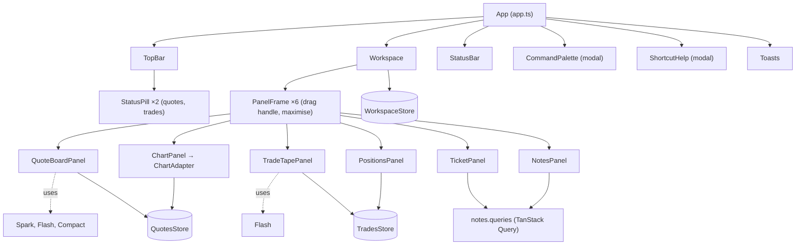

Rule: **panels never talk to each other**. They read stores and the `WorkspaceStore.sym` signal. That is why any panel can be moved, maximised or removed without breaking the rest.

### 5.3 Wireframe A — before (v1, the screenshot you rejected)

```text
┌──────────────────────────────────────────────────┐
│ Trade Blotter            ● connected             │  ← plain heading + text pill
├──────────────────────────────────────────────────┤
│ symbol │ price │ qty │ time                      │  ← one unstyled table
│ AAPL   │ 187.2 │ 100 │ 12:00:01                  │
│ ...                                              │
├──────────────────────────────────────────────────┤
│ Structured-note form                             │  ← stacked inputs, default
│  [barrier  ] [coupon   ] [ KI ] [ Book ]         │     browser styling,
│  error text under form                           │     no layout, no keys
└──────────────────────────────────────────────────┘
```

Problems: one table, one form, no hierarchy, no chart, no positions, no hotkeys, no themes, no resize, a feed pill that could lie (F-11), and sorting/filter missing.

### 5.4 Wireframe B — after (v2, from `workspace-dark.png`)

<a id="ux-grid"></a>

```text
┌ TOP BAR ───────────────────────────────────────────────────────────────────────────────┐
│ ◆ TRADE-CAPTURE [DEMO]  ⌕ Search or run…  Ctrl K   QUOTES ●LIVE  TRADES ●LIVE  14:02:11Z  ◐ ▤ │
├───────────────────────┬──────────────────────────────┬─────────────────────────────────┤
│ QUOTES        ⤢       │ TRADE TAPE            ⤢      │ NOTE TICKET                 ⤢   │
│ filter /___           │ time  sym  side qty  px      │ Underlying [NVDA ▾]  Notional   │
│ SYM   LAST  CHG% ▁▃▅█ │ 14:02 NVDA B   300 118.2     │ AC [100] CPN [70] KI [60]       │
│ NVDA 118.2 +0.4 ▁▂▅   │ 14:02 AAPL S   100 187.2     │ coupon [2.00 %]  ladder ┤AC     │
│ AAPL 187.2 −0.1 ▃▂▁   │  … (virtual, 5 000 rows ok)  │ ✓ KI < CPN ≤ AC  ⚠ size ≥ 25M   │
│  … (28 rows)          │ ▓▓▓▓▓▓░░░░ buy/sell imbalance│ [ Book note  Ctrl↵ ]            │
├───────────────────────┼──────────────────────────────┼─────────────────────────────────┤
│ POSITIONS & P&L   ⤢   │ CHART  NVDA  [candles|area] 1s 5s 15s 1m                       │
│ acct sym  qty avg  uP&L │  ▂▃▅▇▆▅▃  candlesticks + crosshair                           │
│ A1   NVDA +300 118 +… │                                                               │
│                       │                                    NOTES  (booked notes list)   │
├───────────────────────┴──────────────────────────────┴─────────────────────────────────┤
│ STATUS  seq 18423 · 212 msg/s · rtt 3 ms · skew −2 ms · clients 1                        │
└─────────────────────────────────────────────────────────────────────────────────────────┘
```

Exact slot order and default sizes come from `DEFAULT_LAYOUT`: order `quotes, tape, chart, positions, ticket, notes` over three columns (widths 32/40/28 %), rows 58/42, 58/42, 64/36. Slot index = `col*2 + row`, so *swap* is a pure array operation (`swapPanels`).

### 5.5 State machines

<a id="ux-feed"></a>

**Feed status** (one pill per feed):

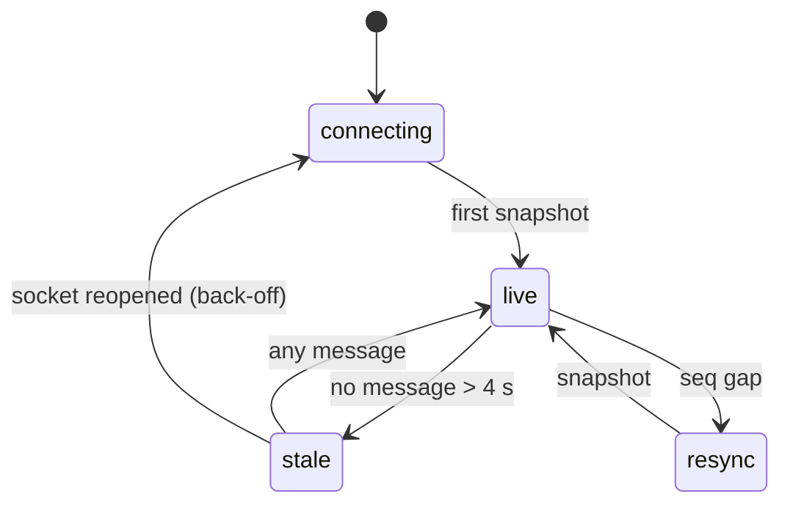

**Ticket** (`ticketReducer`, pure):

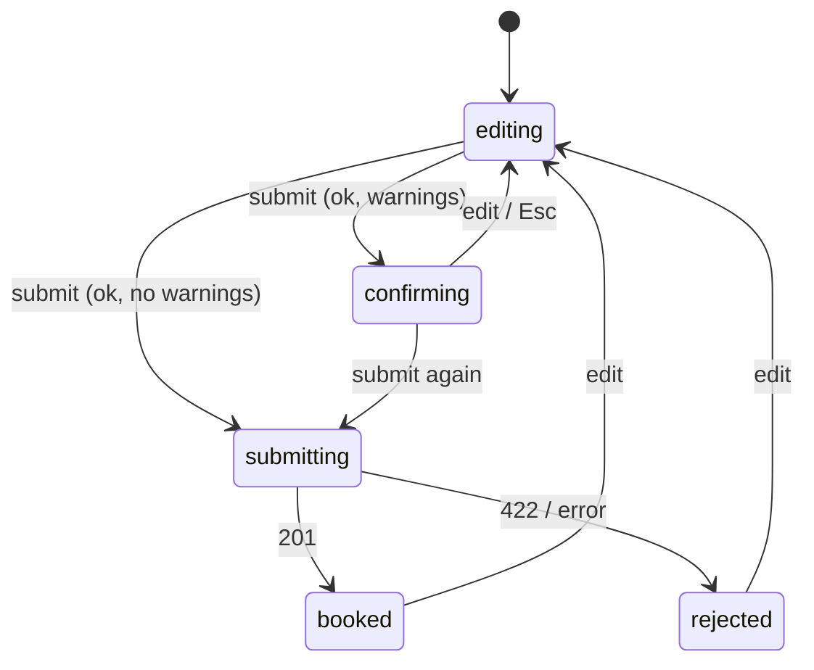

`submitting` ignores every event, so a double **Ctrl+Enter** cannot book twice. The notes endpoint has no idempotency key, so this client guard is the only protection.

Pre-trade checks are tiered: `error` blocks, `warn` forces the two-step confirm (notional ≥ 25 M, coupon > 5 % per period, KI < 50 %), `ok` is silent. The server repeats the *error* rules (`NoteTerms`) so a hand-crafted POST cannot bypass them.

### 5.6 Keyboard map

<a id="ux-keys"></a>

| Keys | Action | Notes |
|---|---|---|
| `Ctrl/⌘ K` | command palette | works while typing |
| `?` | shortcut help | bare keys ignored while typing |
| `/` | focus quote filter | |
| `J` / `K` | next / previous symbol | drives chart, ticket, positions highlight |
| `Alt T` | focus the ticket | works while typing |
| `Ctrl/⌘ Enter` | book (twice when a warning shows) | works while typing |
| `Shift ↑↓` / `Alt ↑↓` | notional ±1 M / ±10 M (plain ±100 K) | [§4.17](#f-math-step) |
| `T` / `D` | theme / density | persisted |
| `M` | maximise panel under pointer | `Esc` restores |
| `Esc` | close dialogs, cancel confirm | |

Resolution order inside `resolveHotkey`: palette → Escape → (modal open ⇒ stop) → submit → focus-ticket → (typing or modifier ⇒ stop) → bare keys. This is why `?` typed into the filter box inserts a character instead of opening help.

### 5.7 Accessibility and robustness notes

- Every icon-only button has an `aria-label`; resize handles are labelled "Resize column N / rows in column N".
- Status is never colour-only: the pill carries text (`LIVE`, `STALE`, `RESYNC`).
- `prefers-reduced-motion` disables flash and spark transitions (see [§6.3](#f-web-src-styles-css)).
- Dialogs trap focus through the CDK; `Esc` always closes.
- Light theme exists and is test-captured, because trading floors are not all dark rooms.
- Zoneless + OnPush + signals: nothing re-renders unless a signal it read changed; with 50 ms batching the UI holds 5 000 symbols (`workspace-5000.png`).
- Known gaps are tracked as F-23 (maximise remounts the panel), F-24 (web fonts are system-stack fallbacks) and F-29 (no auth) in [§14](#findings).

### 5.8 Before vs after at a glance

| Aspect | v1 | v2 |
|---|---|---|
| Panels | 1 table + 1 form | 6, draggable/resizable/maximisable |
| Data tables | `<table>` | TanStack Table + CDK virtual scroll |
| Charts | none | lightweight-charts candles/area behind a seam |
| Positions/P&L | none | exact BigInt average-cost book |
| Input | mouse | full keyboard + command palette |
| Themes | none | dark/light × compact/cozy, persisted |
| Server state | hand-rolled fetch | TanStack Query with correlation ids |
| Failure UX | generic error text | per-field 422 mapping, stale/resync pill, toasts |

[⬆️ Back to TOC](#toc)

---


<a id="part-a"></a>

# 🅰️ PART A — The Front End: the Trade-Capture Terminal (follow the data from the wire to the pixel)

<a id="frontend"></a>

## §6 Front-End Files in Flow Order

> v2 replaced the old two-widget scaffold (a raw form + a raw table) with a **six-panel trading workspace**. The files are now grouped into nine folders, and this section walks them in the order a message travels: **config → pure core → feed (wire) → state (signals) → api (HTTP) → ui kit → panels → shell → app root**.

### 6.0 The front end in one picture

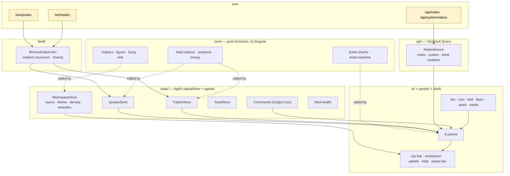

🧒 *Feynman:* Think of a **newsroom**. The *wire* brings raw stories; the *feed* desk makes sure the wire is never dead; the *state* desk keeps the latest version of every story; the *core* is the style guide (pure rules that never touch the printing press); the *panels* are the pages; the *shell* is the front-page layout; the *ui kit* is the font and ink.

**The layering rule (enforced by imports, not by tooling):** `core/` imports nothing from Angular; `state/` imports `core/` and `feed/`; `panels/` import `state/`, `api/`, `core/`, `ui/`; `shell/` imports everything below; nothing imports `shell/` except `app.ts`.

**Folder census (non-test files):**

| Folder | Files | Role |
|---|---:|---|
| `src/` | 3 (+favicon in `public/`) | HTML page, bootstrap, global CSS |
| `src/app/` | 2 | root component and providers |
| `core/` | 12 | pure, framework-free logic |
| `feed/` | 2 | wire transport |
| `state/` | 7 | reactive state |
| `api/` | 2 | HTTP + server-state cache |
| `ui/` | 8 | design-system primitives |
| `panels/` | 7 | the six workspace panels + chart adapter |
| `shell/` | 6 | chrome around the panels |
| `testing/` | 1 | fakes shared by specs |

---

<a id="f-web-src-index-html"></a>

### 6.1 `web/src/index.html` — the only HTML page

🎯 **Purpose:** the document the browser loads; hosts `<app-root>` and pre-declares the theme so there is no flash of the wrong palette.

| Element | What it does |
|---|---|
| `<html lang="en" data-theme="dark">` | Default theme **before any JS runs**. `WorkspaceStore` later mirrors the user's choice onto the same attribute. |
| `<title>Trade Capture Terminal</title>` | Browser tab name (was “Blotter”). |
| `<base href="/">` | Lets the router-less app resolve `favicon.ico` and assets from the site root; also what nginx's SPA fallback assumes. |
| `meta color-scheme="dark light"` | Tells the browser to draw native scrollbars/form controls in both schemes. |
| `meta theme-color="#07090d"` | Colours the mobile browser chrome to match `--bg`. |
| `<app-root>` | Mount point of [`app.ts`](#f-web-src-app-app-ts). |

🧒 *Feynman:* the empty stage with the lights already dimmed; the actors (Angular) walk on later.

⚠️ Fonts: `styles.css` names *Inter* and *JetBrains Mono* but **no `<link>` or `@font-face` loads them**; they silently fall back to system fonts. 🔧 bundle them with `@fontsource` for pixel-identical desks.

---

<a id="f-web-src-main-ts"></a>

### 6.2 `web/src/main.ts` — ignition

🎯 Calls `bootstrapApplication(App, appConfig)` and logs a bootstrap failure with `console.error`. No `NgModule`, no zone: Angular 21 is **zoneless**, so change detection runs only when a **signal** changes, an event fires, or `markForCheck` is called.

📥 `App`, `appConfig` · 📤 a running application.

---

<a id="f-web-src-styles-css"></a>

### 6.3 `web/src/styles.css` — design tokens and the few things utilities cannot say

🎯 The whole visual language lives here as **CSS variables**; components use Tailwind utilities that point at them.

| Block | Content | Why it matters |
|---|---|---|
| `@import 'tailwindcss'` | Tailwind v4 (compiled by `@tailwindcss/postcss`, see [`.postcssrc.json`](#f-web-postcssrc-json)) | No `tailwind.config.js` in v4; configuration is CSS. |
| `@custom-variant dark` | `dark:` matches `[data-theme=dark]` | Theme is an attribute, not the OS media query. |
| `:root` dark tokens | `--bg #07090d`, `--surface #0d1117`, `--raised #131a24`, `--line #1c2533`, `--fg #d7dfeb`, `--muted`, `--faint`, `--up #2ee6a6`, `--down #ff5470`, `--accent #5b8cff`, `--warn #ffb454`, `--flash-*`, `--row-h 24px`, `--shadow` | Near-black blue-grey, **two** semantic colours for price direction (mint / coral), one accent. |
| `:root[data-theme='light']` | same names, light values | Switch = change one attribute, zero component code. |
| `:root[data-density='cozy']` | `--row-h: 30px` | Compact (24 px) vs cozy (30 px) rows without touching templates. |
| `@theme inline` | `--color-bg: var(--bg)` … | Makes `bg-surface`, `text-up`, `border-line`, `ring-accent` utilities that follow the live variables. `inline` is essential: it keeps the *reference* instead of freezing the value. |
| `html, body` | 12 px base, no page scroll (`overflow:hidden`) | A terminal is one fixed viewport; panels scroll inside. |
| `.num` | mono font + `tabular-nums` | **Digits never jitter** while prices tick. |
| `[data-panel-group]`, `.rz-handle` | flex layout and 4 px drag handles | The spartan resizable primitives are *unstyled*; this is their entire skin. |
| `.cdk-drag-*`, `.slot-target` | drag placeholder/preview/drop-target outline | CDK drag has no look of its own. |
| scrollbars | 8 px themed thumbs | Dense UI, no chunky OS bars. |
| keyframes + `.anim-*` | `row-buy`, `row-sell` (0.9 s fade), `slide-in`, `pulse-dot` | Price/trade flashes and toast entry. |
| `prefers-reduced-motion` | all animation/transition → 0.001 ms | Accessibility. |
| `:focus-visible` | 1 px accent outline | Keyboard users always see focus. |
| `.seg`, `.seg-item[data-state='on']` | segmented control skin | spartan toggle-group sets `data-state`; CSS does the rest. |
| `.field` | 24 px mono input, red border when `aria-invalid='true'` | One input style for the whole ticket. |
| `.quote-row.selected`, `.tape-row.selected` | accent tint + inset bar | Selected symbol is visible in every panel. |
| `[brnCommandItem][data-hidden]` | `display:none` | **Bug fix inherited from the palette work:** spartan *flags* non-matching rows with `data-hidden` but does not hide them. |

🧒 *Feynman:* a paint-by-numbers box. The templates say “colour this region *up*”; this file decides whether *up* is mint on black or green on white.

⚠️ Everything is `px`-sized at a 12 px root; browser zoom works but the OS “large text” setting does not scale it. 🔧 move to `rem` if desk accessibility policies demand it.

---

<a id="f-web-public-favicon-ico"></a>

### 6.4 `web/public/favicon.ico` — tab icon (binary, 15 086 bytes)

🎯 Copied verbatim to the site root by the Angular build (`angular.json → assets`). Not text, so there is nothing to read; the browser requests it on first load (`index.html` links it). Unchanged from v1.

---

<a id="f-web-src-app-app-config-ts"></a>

### 6.5 `web/src/app/app.config.ts` — the dependency-injection switchboard

🎯 Registers every app-wide service **once**.

| Provider | Purpose |
|---|---|
| `provideBrowserGlobalErrorListeners()` | Routes uncaught errors/rejections into Angular's `ErrorHandler` (required in zoneless apps, where no zone catches them). |
| `provideHttpClient(withInterceptors([correlationInterceptor]))` | Every HTTP call carries `X-Correlation-Id` ([`notes.api.ts`](#f-web-src-app-api-notes-api-ts)). |
| `provideTanStackQuery(new QueryClient({...}))` | Server-state cache. Defaults: `retry:1`, `refetchOnWindowFocus:false` (a terminal is always focused somewhere), `staleTime:2 s`. |
| `FEED_CLIENT` → `new WsFeedClient<QuoteMsg>('/ws/quotes')` | Production quote transport. Tests swap this token for a fake. |
| `TRADE_FEED_CLIENT` → `new WsFeedClient<TradeMsg>('/ws/trades')` | Production trade transport. |

🧒 *Feynman:* the wall of labelled sockets: when a component asks for “the quote feed”, this file decides which real plug is behind the label.

🔗 Consumed by [`main.ts`](#f-web-src-main-ts); overridden in [`app.int.spec.ts`](#f-web-src-app-app-int-spec-ts) via `testing/fakes.ts`.

---

<a id="f-web-src-app-app-ts"></a>

### 6.6 `web/src/app/app.ts` — root component and global keyboard

🎯 Lays out the terminal (`top-bar` / `main > workspace` / `status-bar`, plus three overlays) and owns the **single `document:keydown` listener**.

| Member | Behaviour |
|---|---|
| `host: {'(document:keydown)': 'onKey($event)', class: 'block h-dvh'}` | One global handler; the root fills the dynamic viewport height. |
| `inject(QuotesStore)`, `inject(TradesStore)` | Injected only so both stores (and therefore both WebSockets) **start at boot**, whichever panel is visible. |
| `onKey(event)` | Computes `typing` (INPUT/TEXTAREA/SELECT/contenteditable) and `modalOpen`, calls the pure [`resolveHotkey`](#f-web-src-app-core-hotkeys-ts), then `preventDefault()` + `perform(action)`. |
| `perform(action)` | A `switch` over the `HotkeyAction` union: `palette` (toggle), `help`, `escape` (closes palette → help → un-maximises → else cancels the ticket), `focusTicket`/`submitTicket`/`focusFilter` (emit on [`Commands`](#f-web-src-app-state-commands-ts)), `nextSym`/`prevSym` (`ws.stepSym`), `toggleTheme`, `toggleDensity`, `maximize` (the panel under the pointer). |

🧒 *Feynman:* the building's single doorman: every key press arrives here, he asks the rulebook (`resolveHotkey`) what it means, then rings the right bell.

⚠️ Because the handler lives on `document`, a focused `<input>` still receives its own keys; `resolveHotkey` is what prevents “typing `d`” from toggling density.

🔧 `perform` is exhaustively switched; adding a `HotkeyAction` without a case compiles but does nothing—add a `default: assertNever(action)` for a compile-time guard.

---


<a id="core-web"></a>

### 6.7 `web/src/app/core/` — the pure rule book (no Angular imports)

> Twelve files, each a set of **pure functions** (same input → same output, no clock, no DOM, no network). That is why they carry 86 of the project's 130 unit tests and why they could be developed test-first.

<a id="f-web-src-app-core-models-ts"></a>

#### 6.7.1 `core/models.ts` — the vocabulary (types only)

🎯 The nouns every other file shares.

| Export | Meaning |
|---|---|
| `Sym` + `sym(raw)` | **Branded string** (`string & {brand:'Sym'}`): the compiler refuses a plain string where a symbol is required; `sym()` trims and upper-cases. Zero runtime cost. |
| `Quote` | `sym, px (number, display only), qty (cumulative), seq, ts?` — one row of the quote board. |
| `Side` | `'BUY' \| 'SELL'` as the server sends it. |
| `Trade` | `id, source, account, sym, side, qty, pxMicros, seq, ts` — one fill; price stays in **integer micros**. |
| `QuoteMsg` / `TradeMsg` | **Discriminated unions** on `kind`: `snapshot`, `delta`, `heartbeat`. A Java *sealed interface* in TypeScript clothes. |
| `Msg` | Alias of `QuoteMsg` kept for readability. |
| `assertNever(x: never)` | Exhaustiveness guard: if someone adds a message kind and forgets a `case`, **the build fails**. |
| `FeedStatus` | `'connecting' \| 'live' \| 'resync' \| 'stale'` — `stale` is now real (v1 declared it but nothing set it; see [`feed-health.ts`](#f-web-src-app-state-feed-health-ts)). |

🧒 *Feynman:* the dictionary. “Quote”, “Trade” and “Message” mean exactly one thing everywhere.

⚠️ `Quote.px` is a JS `number` because the **server** sends the price as a JSON number (the Java side keeps micros and prints an exact decimal—see [`FeedJson`](#f-src-main-java-com-example-capture-core-feedjson-java)). Accounting never uses it; it is for display and charting.

---

<a id="f-web-src-app-core-money-ts"></a>

#### 6.7.2 `core/money.ts` — fixed-point formatting with BigInt

🎯 All number formatting for money and quantity, with **no floating point in the arithmetic**.

| Function | What it does | Example |
|---|---|---|
| `MICROS` | `1_000_000` | scale |
| `toMicros(px)` | `BigInt(Math.round(px·10⁶))` | `187.25 → 187250000n` |
| `fmtMicros(v, dp=2)` | exact decimal formatting; **half away from zero** using integer division; thousands separators | `-1234500000n → "-1,234.50"` |
| `fmtSigned(v, dp)` | same, with `+` for positives, plain `0.00` for zero | P&L columns |
| `fmtQty(q)` | grouped integer | `12500 → "12,500"` |
| `notionalMicros(q, p)` | `BigInt(q)·BigInt(p)` | exact |
| `vwapMicros(fills)` | $\displaystyle \frac{2\sum q_i p_i + \sum q_i}{2\sum q_i}$ in BigInt = round-half-up of the VWAP; `null` for zero quantity | see [§4.13](#f-math-vwap) |
| `compact(n)` | `1_250_000 → "1.25M"` (K/M/B, `—` for null/NaN) | replaces the old pipe's logic |
| `fmtClock(ms)` | UTC `HH:MM:SS.mmm` | tape timestamps |
| `microsToNumber(v)` | micros → double | **charting only** |

How rounding works in `fmtMicros` (the only subtle bit): let $s = 10^{6-dp}$. Then $m' = \lfloor (|v| + s/2) / s \rfloor$ with integer division, whole $=\lfloor m'/10^{dp}\rfloor$, fraction $= m' \bmod 10^{dp}$, left-padded with zeros. A negative that rounds to zero prints **`0.00`, not `-0.00`**.

🧒 *Feynman:* count money in millionths so you never get “0.1 + 0.2 = 0.30000000000000004”; this file is the till that turns millionths back into the numbers people read.

⚠️ `toMicros` goes through a `double` (`px*MICROS`), so it is only for *UI input*. Server prices arrive already as micros on the trades feed.

---

<a id="f-web-src-app-core-positions-ts"></a>

#### 6.7.3 `core/positions.ts` — average-cost positions in exact integers

🎯 Fold fills into a per-`(account, symbol)` **position** with realised P&L, no floats.

| Export | Role |
|---|---|
| `Position` | `netQty` (signed), `boughtQty`, `soldQty`, `costMicros` (signed cost basis of the open quantity), `realizedMicros`, `fills`. |
| `positionKey(account, sym)` | `"account\|sym"` map key. |
| `applyFill(pos, trade)` | One fill → new `Position` (see below). |
| `bookFill(book, trade)` | Copy the map, apply one fill. |
| `bookFromTape(tape)` | Replay a newest-first tape **oldest → newest**. |
| `avgPriceMicros(pos)` | $\lfloor(2\lvert c\rvert + n)/(2n)\rfloor$ — rounded average open price, `null` when flat. |
| `unrealizedMicros(pos, mark)` | $n\cdot m - c$. |

`applyFill` has two branches (d = ±1 direction, n = current net):

- **Adding** (`n = 0` or `sign(n) = d`): $n' = n + d q$, $c' = c + d q p$.
- **Reducing/crossing:** closing $k=\min(|n|,q)$; cost released $c_k = \lfloor c\,k/|n|\rfloor$; realised $+= \operatorname{sign}(n)\,k\,p - c_k$; if $q>k$ the remainder **opens the opposite side at the fill price**: $n' = d(q-k)$, $c' = d(q-k)p$.

Worked: buy 100 @ 10, sell 150 @ 12 → close 100 for $+200$ realised, open short 50 @ 12 (`netQty = -50`, `costMicros = -600`).

🧒 *Feynman:* a shopkeeper's stock card. Buying adds to the pile at today's price; selling takes from the pile at the pile's *average* price and any difference is profit; selling more than you have starts a new IOU pile.

⚠️ **Caveat shown in the UI:** positions are computed from the **500-trade tape window** the client holds, not from the database. After a long session older fills fall off. 🔧 add a `GET /api/positions` backed by `SUM(...) GROUP BY account, symbol` when the book must be authoritative.

---

<a id="f-web-src-app-core-feed-reducer-ts"></a>

#### 6.7.4 `core/feed.reducer.ts` — the sequence rule book (batch reducers)

🎯 Turns an ordered batch of wire messages into the next immutable state, for **both** feeds.

| Export | Role |
|---|---|
| `gate(lastSeq, needsResync, seq)` | `'ignore'` if waiting for a snapshot or `seq ≤ last`; `'apply'` if `seq = last+1`; else `'gap'`. |
| `Tick`, `TICKS_MAX=600` | price history point; ring-trimmed per symbol. |
| `QuoteBook` / `initialBook` | `lastSeq`, `needsResync`, `quotes`, `prev` (previous price → flash colour), `open` (first price seen → change column), `ticks`, `applied`. |
| `reduceQuotes(book, msgs, now)` | Batch reducer: **copies the maps once per batch**, applies messages in order, returns the **same reference** when nothing changed (so signals do not fire). |
| `reduceQuote` | one-message wrapper for tests. |
| `TAPE_MAX=500`, `TapeBook`, `initialTape` | trade-tape state: `trades` newest first, `positions`, `applied`. |
| `reduceTrades(tape, msgs)` | Same discipline for the tape; fresh fills are collected oldest-first then `reverse()`d in front of the old tape and sliced to 500. |

Message rules (identical in both reducers):

| Message | Effect |
|---|---|
| `snapshot` | replace the state, `lastSeq ← seq`, `needsResync ← false` (tape: positions rebuilt with `bookFromTape`). |
| `delta` | by `gate`: ignore / apply / gap → `needsResync ← true`. |
| `heartbeat` | if `seq > lastSeq` and not already resyncing ⇒ **a delta was lost silently** ⇒ `needsResync ← true`. |

Why *batches*: at 5,000 symbols and a delta per few ms, copying a 5,000-entry `Map` per message is $O(N)$ per message. Copying once per 50 ms batch is $O(N)$ per **frame**.

🧒 *Feynman:* a librarian numbering pages. If the next page is the one she expects she files it; an old page she throws away; a *missing* page makes her ring the printer and wait for a full fresh copy.

⚠️ After a `gap` the reducer **keeps old data on screen** (flagged `resync`) rather than blanking it—traders prefer stale-and-labelled to empty.

---

<a id="f-web-src-app-core-rx-utils-ts"></a>

#### 6.7.5 `core/rx-utils.ts` — reusable RxJS operators

| Operator | Used on the live path? | Behaviour |
|---|:-:|---|
| `frameBatch(ms, scheduler)` | ✅ | `bufferTime` + drop empties; **lossless and ordered**. Used with `FLUSH_MS=50`. `ms ≤ 0` ⇒ one-by-one. |
| `resilient(cfg)` | ✅ | `retry{count, delay: timer(backoff), resetOnSuccess:true}` then `repeat{delay: timer(backoff)}`: reconnects after an **error** *and* after a **clean completion**. Fixes finding **F-11** (a server-side normal close completed the observable and the UI went silently dead). |
| `backoffMs(cfg, n)` | ✅ | $\min(\text{cap},\ \text{base}\cdot2^{n-1})\cdot j$, $j\in[0.5,1)$ by default. |
| `retryWithBackoff(cfg)` | ❌ (specs only) | plain `retry` with that delay; kept as the minimal variant. |
| `conflateBySymbol(ms)` | ❌ (specs only) | last-write-wins per symbol per frame — **lossy**; correct for pure display, wrong for a sequenced feed, hence unused. |

🧒 *Feynman:* `frameBatch` is a postman who delivers a *bundle* every 50 ms instead of one letter at a time; `resilient` is the redial button that keeps pressing itself.

⚠️ `repeat` without `resetOnSuccess` would let the retry counter climb forever across good sessions; that is why the retry inside has `resetOnSuccess:true`.

---

<a id="f-web-src-app-core-ohlc-ts"></a>

#### 6.7.6 `core/ohlc.ts` — ticks → candles

🎯 Aggregate a symbol's tick history into **OHLC** (open-high-low-close) candles for the chart.

| Member | Behaviour |
|---|---|
| `Candle` | `time` (bucket start, **epoch seconds**, as Lightweight Charts wants), `open`, `high`, `low`, `close`. |
| `toCandles(ticks, bucketSec)` | Walks ticks oldest→newest; bucket $b=\lfloor t/1000/w\rfloor\cdot w$. Same bucket ⇒ keep `open`, widen `high/low`, replace `close`. A later bucket ⇒ push a new candle. An **older** bucket ⇒ tick dropped (charts demand strictly ascending time). |

Quiet minutes simply have **no candle** (a gap), never an invented price. See [§4.15](#f-math-candle).

🧒 *Feynman:* every second (or 5 s, 15 s, 60 s) you note the first price, the highest, the lowest and the last one; a candle is that four-number summary drawn as a bar with wicks.

---

<a id="f-web-src-app-core-cn-ts"></a>

#### 6.7.7 `core/cn.ts` — class-name merger

🎯 `cn(...inputs) = twMerge(clsx(inputs))`. `clsx` flattens conditionals (`cond && 'x'`, arrays, objects); `tailwind-merge` then removes **conflicting Tailwind classes** so the *last* wins (`'px-4' + 'px-2' → 'px-2'`). Same helper shadcn/ui and spartan/ui ship; used by [`btn.directive.ts`](#f-web-src-app-ui-btn-directive-ts) and several templates.

🧒 *Feynman:* two people shouted different paint colours for the same wall; `cn` listens only to the last one.

---

<a id="f-web-src-app-core-fuzzy-ts"></a>

#### 6.7.8 `core/fuzzy.ts` — command-palette matching

🎯 Subsequence fuzzy search with a ranking score.

| Function | Behaviour |
|---|---|
| `fuzzyScore(query, text)` | Empty query ⇒ `0`. Otherwise every query char must appear **in order** in `text` (case-insensitive) or the result is `-1`. Each matched char `+1`; **adjacent** to the previous match `+3`; at index 0 or after one of ` -_/:` (a *word start*) `+2`; final `score − 0.01·len(text)` so shorter labels win ties. |
| `fuzzyMatch(value, search)` | `fuzzyScore(search, value) ≥ 0`; plugged into spartan's `brnCommand` `filter` input. |

Example: `"tt"` vs `"Toggle theme"` scores the two word-start `t`s; vs `"Maximise"` is `-1`. See [§4.16](#f-math-fuzzy).

🧒 *Feynman:* typing `ft` finds “**F**ocus **t**icket” because the letters appear in order, and finds it *better* than “af**t**er **f**all” because the letters start words.

---

<a id="f-web-src-app-core-ticket-checks-ts"></a>

#### 6.7.9 `core/ticket.checks.ts` — the instant pre-trade risk gate

🎯 Everything the ticket validates, **before** any network call, mirroring the server's `NoteTerms` ([§8.11](#f-src-main-java-com-example-capture-core-noteterms-java)) so the server's 422 is a safety net, not the user experience.

| Export | Meaning |
|---|---|
| `Terms` | `underlying, notional, couponRate, couponBarrier, autocallBarrier, kiBarrier` (the v1 form had no underlying). |
| `MAX_NOTIONAL = 1e9`, `LARGE_NOTIONAL = 25e6` | hard ceiling / second-confirmation threshold. |
| `Check`, `CheckLevel` | `{id, level: ok\|warn\|error, label, detail, field?}`. |
| `decimals(x)` | counts decimals **without float surprises** (handles `1e-7` notation). |
| `preTradeChecks(terms)` | returns the whole checklist, **errors first, then warnings, then ok**, stable within a level. |
| `canBook(checks)` | no `error`. |
| `needsConfirm(checks)` | at least one `warn`. |
| `StepMods`, `stepNotional(cur, dir, mods)` | hotkey/wheel size nudging. |

The rule table (identical to the server except the *warnings*, which are UI-only):

| Field | Error when | Warning when |
|---|---|---|
| underlying | not `^[A-Z0-9][A-Z0-9.\-]{0,11}$` | — |
| notional | missing/≤ 0, `> 1e9`, or > 2 decimals | `≥ 25 000 000` ("second confirmation") |
| couponRate | outside $[0,1]$ or > 4 decimals | `> 0.05` per period |
| each barrier | missing, ≤ 0, `> 200`, or > 2 decimals | — |
| order | $K \ge C_b$ (`order-ki`) or $C_b > A_b$ (`order-coupon`), checked only when all three barriers are individually valid | $K < 50$ (`deep-ki`) |

`stepNotional` **snaps to a grid**, it is not additive: step $=100\,000$ plain, $1\,000\,000$ with Shift, $10\,000\,000$ with Alt; up $=(\lfloor x/\text{step}\rfloor+1)\cdot\text{step}$, down $=(\lceil x/\text{step}\rceil-1)\cdot\text{step}$, clamped to $[0,\ 10^9]$. So `1 234 567` + Shift-up ⇒ `2 000 000`, not `2 234 567`. See [§4.17](#f-math-step).

🧒 *Feynman:* the airport checklist at the gate. Red = you cannot board; amber = a human must look you in the eye (second Ctrl+Enter); green = go.

⚠️ Barrier percentages (e.g. `70`) and the coupon rate (a fraction, `0.02`) keep the **unit mix** from v1; the ticket labels show `%` for barriers and `per period` for the rate so the trader never has to guess.

---

<a id="f-web-src-app-core-ticket-machine-ts"></a>

#### 6.7.10 `core/ticket.machine.ts` — the ticket's state machine

🎯 A pure reducer `ticketReducer(state, event)` that makes **double-booking impossible by construction**.

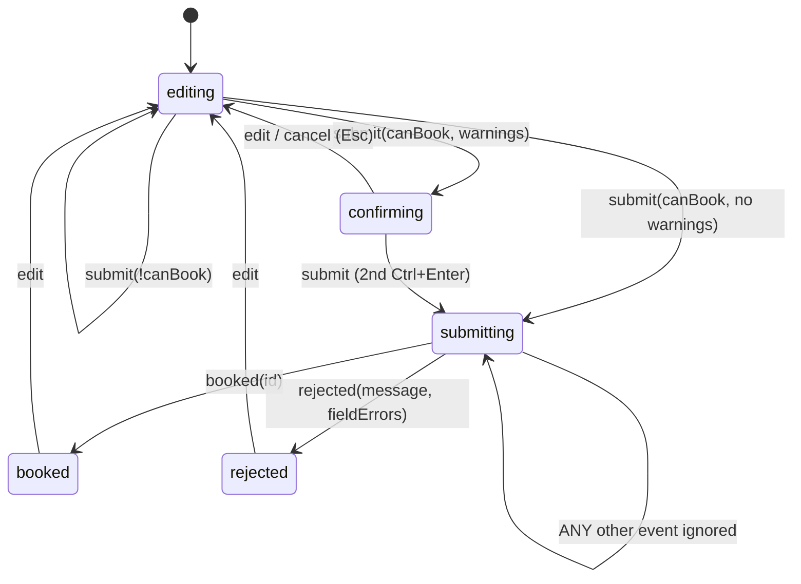

| State | Payload | UI |
|---|---|---|
| `editing` | — | inputs live, Book enabled iff `canBook` |
| `confirming` | — | amber confirm banner, "Ctrl+Enter again to book" |
| `submitting` | — | button disabled, spinner |
| `booked` | `id` | green receipt, e.g. `N-1001` |
| `rejected` | `message`, `fieldErrors` | red banner, field-level messages from the 422 |

While `submitting`, only `booked`/`rejected` are accepted; **every other event returns the same state object** — a double Ctrl+Enter or a click on a disabled button cannot send a second POST.

🧒 *Feynman:* a turnstile: once it has let you in it ignores pushes until you have walked through.

---

<a id="f-web-src-app-core-hotkeys-ts"></a>

#### 6.7.11 `core/hotkeys.ts` — keyboard-first, as a pure function

🎯 `resolveHotkey(event, {typing, modalOpen}) → HotkeyAction | null`; no DOM access, so all 7 rules are unit-tested.

Priority order inside the function:

1. `Ctrl/⌘+K` → `palette` (works even while typing and even inside a modal—so it can toggle).
2. `Escape` → `escape` (always).
3. If a modal is open → `null` (swallow everything else).
4. `Ctrl/⌘+Enter` → `submitTicket` (works while typing in the ticket).
5. `Alt+T` → `focusTicket`.
6. If typing, or any command/alt modifier remains → `null`.
7. Bare keys: `?` help · `/` focus filter · `j` next · `k` prev · `t` theme · `d` density · `m` maximise.

`HOTKEY_HELP` is the data behind [`shortcut-help.component.ts`](#f-web-src-app-shell-shortcut-help-component-ts): *Ctrl/⌘ K, ?, /, J/K, Alt T, Ctrl/⌘ Enter, Shift ↑↓, T, D, M, Esc*. (Shift ↑↓ is handled locally by the ticket's own `keydown`, see [`ticket.panel.ts`](#f-web-src-app-panels-ticket-panel-ts).)

🧒 *Feynman:* a bouncer with a short rule list; the rules are written on paper (a function), so you can test them without a nightclub.

---

<a id="f-web-src-app-core-layout-ts"></a>

#### 6.7.12 `core/layout.ts` — the persisted workspace layout

🎯 The shape, defaults, validation and repair of everything the workspace remembers.

| Export | Meaning |
|---|---|
| `PANEL_IDS` | `quotes, tape, chart, positions, ticket, notes`; `PANEL_TITLES` gives human names. |
| `Theme`, `Density`, `ChartKind` | `dark\|light`, `compact\|cozy`, `candles\|area`. |
| `Layout` | `{v:1, order, cols[3], rows[3][2], theme, density, sym, chartKind, frameSec}` |
| `LAYOUT_KEY` | `'trade-capture.layout.v1'` (bump the suffix when the shape changes). |
| `DEFAULT_LAYOUT` | cols `[32,40,28]`, rows `[[58,42],[58,42],[64,36]]`, dark, compact, candles, 1 s. |
| `FRAMES` | `[1,5,15,60]` seconds. |
| `normalizeSizes(sizes, n, fallback)` | requires an array of $n$ positive finite numbers, **rescales to sum 100**, else returns the fallback. |
| `parseLayout(json)` | `JSON.parse` in `try/catch`; **each field repaired independently**: bad `order` ⇒ default order; bad `cols` ⇒ default cols; unknown theme ⇒ dark; … A corrupt entry can never stop start-up. |
| `swapPanels(order, a, b)` | exchange two slots; no-op if equal/missing. |

The 3×2 grid: `order[0..1]` is column 0 top/bottom, `order[2..3]` column 1, `order[4..5]` column 2. Dragging one panel onto another **swaps** them; the splitters change `cols`/`rows`.

🧒 *Feynman:* the seating chart of the trading floor, plus a janitor who fixes torn pages instead of refusing to open the book.

⚠️ Version `v1` is baked into the key; a future shape change should write `…v2` and migrate rather than silently reuse bad data.

---

<a id="feed-web"></a>

### 6.8 `web/src/app/feed/` — the wire

<a id="f-web-src-app-feed-feed-client-ts"></a>

#### 6.8.1 `feed/feed.client.ts` — the transport contract and four injection tokens

🎯 Everything above the socket depends on **this interface**, never on `WebSocket`.

| Export | Meaning |
|---|---|
| `FeedClient<M>` | `messages$: Observable<M>` and `requestSnapshot(): void`. Generic so one contract serves both feeds. |
| `FEED_CLIENT`, `TRADE_FEED_CLIENT` | `InjectionToken`s for the quote / trade transports (provided in [`app.config.ts`](#f-web-src-app-app-config-ts), replaced in specs by [`fakes.ts`](#f-web-src-app-testing-fakes-ts)). |
| `FLUSH_MS` | root token, default **50 ms**: the micro-batch frame. |
| `STALE_MS` | root token, default **4000 ms**: silence after which a feed is “stale” (the server heartbeats every 1 s, so 4 s = four missed beats). |
| `NOW` | `() => number` clock seam (`Date.now`); tests inject a controllable clock. |

🧒 *Feynman:* a wall socket standard. The lamp (store) does not care whether the power comes from the grid (real WebSocket) or a battery pack (fake in tests).

---

<a id="f-web-src-app-feed-ws-feed-client-ts"></a>

#### 6.8.2 `feed/ws-feed.client.ts` — the real WebSocket client

🎯 A `FeedClient` over RxJS `webSocket`, which **never stays dead**.

| Member | Behaviour |
|---|---|
| `wsUrl(path, origin)` | `http→ws`, `https→wss` on the page origin (same-origin, matches the server's origin check). |
| `constructor(path, url=wsUrl)` | `messages$ = defer(() => this.socket = webSocket(url(path))).pipe(resilient({baseMs:250, capMs:15000, maxAttempts: MAX_SAFE_INTEGER}), share())`. |
| `defer` | creates a **new socket per (re)subscription**—that is what makes `repeat` reconnect. |
| `share()` | many subscribers, **one** socket. |
| `requestSnapshot()` | sends `{"type":"resync"}` on the current socket. |

Reconnect timeline (jitter 0.5–1 of each value): 250 ms → 500 → 1 s → 2 s → 4 s → 8 s → 15 s cap, resetting after any successful message. See [§4.14](#f-math-backoff).

🧒 *Feynman:* a phone that auto-redials with growing pauses so it does not hammer a busy line, and on every pick-up the server first reads you the whole newspaper (snapshot) before reading new headlines (deltas).

⚠️ If `requestSnapshot()` is called while reconnecting, `this.socket` is the old closed one and the message is dropped—harmless, because a reconnect always begins with a fresh snapshot anyway.

---

<a id="state-web"></a>

### 6.9 `web/src/app/state/` — reactive state (NgRx `signalStore`)

> A `signalStore` is a class generated from composable features: `withState` (data), `withProps` (injected dependencies and constants), `withComputed` (derived signals, memoised), `withMethods` (the only writers, via `patchState`), `withHooks` (lifecycle). Components read signals and call methods; nothing else mutates state.

<a id="f-web-src-app-state-feed-health-ts"></a>

#### 6.9.1 `state/feed-health.ts` — “is the feed alive?”

🎯 `createFeedHealth(now, staleMs, needsResync)` returns signals `lastMsgAt`, `perSec`, `status` and mutators `noteMessages(n)`, `tick()`.

| Rule | Result |
|---|---|
| `lastMsgAt = 0` | `connecting` |
| `clock − lastMsgAt > staleMs` | `stale` |
| else `needsResync()` | `resync` |
| else | `live` |

`noteMessages(n)` (called per flushed batch) adds to a counter and stamps `lastMsgAt`; `tick()` (every 1 s, from the store's `setInterval`) publishes the counter as **msgs/sec** and refreshes the `clock` signal that makes `stale` re-evaluate even when no message arrives. Heartbeats count as messages, so a quiet but healthy feed stays `live`.

🧒 *Feynman:* a heart-rate monitor: it only needs to know *when the last beat was* and *how many beats this second*.

---

<a id="f-web-src-app-state-quotes-store-ts"></a>

#### 6.9.2 `state/quotes.store.ts` — the quote board's brain

| Part | Detail |
|---|---|
| State | `book: QuoteBook`, `filter: string`, `sorting: SortingState` (TanStack format, default `sym asc`). |
| Props | `feed` (token), `now`, `health`. |
| Computed | `status`, `lastSeq`, `symbols` (sorted keys; **custom `equal`** so the array signal does not re-fire unless the set really changed), `maxQty` (scales volume bars), `rows: QuoteRow[]` (`px`, `prev`, `chgPct = (px−open)/open·100`, `qty`, `ts`, `seq`, `spark` = last 48 ticks). |
| Methods | `applyBatch(batch)` (reduce → `noteMessages` → `patchState` only if the reference changed → `requestSnapshot()` **only on the live→resync edge**), `setFilter`, `setSorting(updater)` (accepts TanStack's value-or-function), `ticksFor(sym)`. |
| Hook | `onInit`: `feed.messages$ → frameBatch(FLUSH_MS) → applyBatch`, plus a 1 s health `setInterval`; both cleaned via `DestroyRef`. |

`SPARK_POINTS = 48`. The “one snapshot request per gap” rule is what keeps a server flood of out-of-order deltas from becoming a flood of resync requests.

🧒 *Feynman:* the clerk with the master price sheet: he takes the post in bundles, files it using the librarian's rules, and phones the printer **once** when pages are missing.

---

<a id="f-web-src-app-state-trades-store-ts"></a>

#### 6.9.3 `state/trades.store.ts` — the tape and the positions

| Part | Detail |
|---|---|
| State | `book: TapeBook`, `side: 'ALL'\|'BUY'\|'SELL'`, `onlySym`. |
| Computed | `status`, `lastSeq`, `positions` (values of the book's map), `visible` (tape filtered by side and symbol), `stats` (`count`, `buyQty`, `sellQty`, exact `notionalMicros` BigInt over the tape). |
| Methods | `applyBatch`, `setSide`, `setOnlySym`. |
| Hook | identical wiring to quotes, on `TRADE_FEED_CLIENT`. |

Positions are therefore **derived from the same stream** as the tape and cost nothing extra on the wire.

---

<a id="f-web-src-app-state-workspace-store-ts"></a>

#### 6.9.4 `state/workspace.store.ts` — layout, theme, selection, dialogs

| Part | Detail |
|---|---|
| Seam | `LayoutStorage` interface + `LAYOUT_STORAGE` token; the default wraps `localStorage` in `try/catch` (private windows or a full quota just mean “forgets”). |
| State | the whole `Layout` (restored via `parseLayout`) + transient `maximized`, `hover`, `paletteOpen`, `helpOpen`. |
| Computed | `modalOpen = paletteOpen \|\| helpOpen`. |
| Methods | `setTheme/toggleTheme`, `setDensity/toggleDensity`, `selectSym`, `stepSym(symbols, ±1)` (wraps; no selection ⇒ first), `swap(a,b)`, `setCols`, `setRows(column, sizes)`, `setMaximized/toggleMaximize`, `setHover`, `setChartKind`, `setFrame`, `openPalette/closePalette/openHelp/closeHelp` (opening one closes the other), `resetLayout()` (keeps theme/density). |
| Hook | **Effect 1** serialises the `LAYOUT_FIELDS` slice to storage on change. **Effect 2** mirrors `theme`/`density` to `document.documentElement.dataset`, which is how the CSS tokens switch. |

⚠️ Effect 1 re-runs on *any* state change (including `hover`), so it writes the same JSON again while the mouse moves between panels. Cheap, but 🔧 `computed` the slice and write only when it changes.

🧒 *Feynman:* the janitor's notebook of how you like the room arranged, which he re-reads each morning and repairs if coffee was spilled on a page.

---

<a id="f-web-src-app-state-toast-store-ts"></a>

#### 6.9.5 `state/toast.store.ts` — notifications

State `toasts[]` (max 4: `slice(-3)` + the new one). `push(kind, title, detail?)` returns an id and schedules removal after **4 s** (`success`, `info`) or **8 s** (`error`); `dismiss(id)`. Rendered by [`toasts.component.ts`](#f-web-src-app-ui-toasts-component-ts). Module-level `nextId` makes ids unique across the app.

---

<a id="f-web-src-app-state-commands-ts"></a>

#### 6.9.6 `state/commands.ts` — the command bus

Four `Subject<void>`s: `focusTicket$`, `submitTicket$`, `cancelTicket$`, `focusFilter$`. The root component and the palette **emit**; the ticket and quote panels **subscribe**. It removes every `ViewChild`/parent-reference between unrelated panels.

🧒 *Feynman:* an intercom: the doorman says “focus the ticket” into it; whoever owns the ticket hears it.

---

<a id="f-web-src-app-state-clock-service-ts"></a>

#### 6.9.7 `state/clock.service.ts` — a ticking clock signal

`ClockService.ms` is a read-only signal refreshed every **250 ms** by a `setInterval` (cleared on destroy) from the injected `NOW`; the top bar formats it as UTC time. Tests inject a fixed `NOW`.

---

<a id="api-web"></a>

### 6.10 `web/src/app/api/` — HTTP and server state (TanStack Query)

<a id="f-web-src-app-api-notes-api-ts"></a>

#### 6.10.1 `api/notes.api.ts` — typed HTTP client, correlation id, error mapping

🎯 Everything that speaks REST, in one file (replaces v1's `terms.api.ts`).

| Export | Meaning |
|---|---|
| `NoteRow` | `{id, bookedAt, terms}` from `GET /api/notes`. |
| `SystemStatus` | `{service, serverTime, quoteSeq, tradeSeq, quoteClients, tradeClients, inserted, duplicates, demo}` from `GET /api/system/status`. |
| `TermsApi` (injectable) | `getTerms(id)` → `GET /api/notes/{id}/terms` (id `encodeURIComponent`-ed); `book(terms)` → `POST /api/notes`; `list(limit=50)` → `GET /api/notes?limit=`; `status()` → `GET /api/system/status`. All return `Observable`s. |
| `correlationInterceptor` | functional `HttpInterceptorFn` adding **`X-Correlation-Id: ui-<uuid>`** (`crypto.randomUUID()`, fallback random base-36). The server's [`CorrelationIdFilter`](#f-src-main-java-com-example-capture-spring-correlationidfilter-java) puts it into the log MDC, so one click is greppable across browser → API → log. |
| `BookingFailure`, `toBookingFailure(err)` | maps `HttpErrorResponse`: **422 with `errors[]`** ⇒ `{message:'The server rejected the terms', fieldErrors:{field→message}}`; status `0` ⇒ `'Cannot reach the server'`; other ⇒ `'Server error <status>'`; non-HTTP ⇒ `'Unexpected error'`. |

🧒 *Feynman:* the mail room: it stamps every envelope with a tracking number and translates the post office's rejection slip into words the trader understands.

---

<a id="f-web-src-app-api-notes-queries-ts"></a>

#### 6.10.2 `api/notes.queries.ts` — `NotesService` (TanStack Query)

🎯 **Server state** (data owned by the server, fetched, cached, refreshed) lives here; **client state** lives in the signal stores. Mixing the two is the classic source of stale-data bugs.

| Member | Mechanism | Detail |
|---|---|---|
| `notes` | `injectQuery({queryKey:['notes'], refetchInterval:15 s})` | list of the 50 newest booked notes. |
| `system` | `injectQuery({queryKey:['system'], refetchInterval:5 s})` | calls `status()` and measures **RTT** `= t_recv − t_sent` and **clock skew** `= serverTime − (t_sent + t_recv)/2`, returning a `SystemSample`. Feeds the status bar's latency and skew. |
| `book` | `injectMutation({mutationFn: terms ⇒ POST})` | `onSuccess` does `void client.invalidateQueries(['notes'])` — **fire-and-forget** so the ticket shows *Booked* immediately instead of waiting for the list refetch (an integration test caught the delayed variant). |

The `QueryClient` defaults (`retry:1`, `staleTime:2 s`, no refocus refetch) come from `app.config.ts`. See [§4.18](#f-math-skew).

🧒 *Feynman:* a smart fridge-door note: it re-checks the shop every few seconds, tells you how long the trip took, and the moment you buy something it marks the “shopping list” out of date.

---

<a id="ui-web"></a>

### 6.11 `web/src/app/ui/` — the design-system primitives

> Spartan/ng's *model*: copy small, owned components into the repo (so you can edit them), built on unstyled **brain** primitives + Tailwind + `cva`. Here the kit is eight files.

<a id="f-web-src-app-ui-btn-directive-ts"></a>

#### 6.11.1 `ui/btn.directive.ts` — `HlmBtn` and `btnVariants`

`cva(base, {variants, defaultVariants})` declares *style as data*:

| Axis | Values |
|---|---|
| `variant` | `primary` (accent fill), `buy` (mint tint), `sell` (coral tint), `warn` (amber tint), `outline` (default), `ghost` |
| `size` | `sm` h-6, `md` h-7, `icon` 24 px square |

`@Directive({selector:'button[hlmBtn], a[hlmBtn]', host:{'[class]':'classes()'}})` exposes `variant`, `size` and `class` (alias of `extra`) as signal inputs; `classes = computed(() => cn(btnVariants({...}), extra()))`, so a caller's `class="w-full"` wins conflicts. Usage: `<button hlmBtn variant="buy" size="sm">`.

🧒 *Feynman:* one button mould, six colours of plastic.

---

<a id="f-web-src-app-ui-icon-component-ts"></a>

#### 6.11.2 `ui/icon.component.ts` — inline SVG icons

A `const ICONS = {...} as const` map of **30 icons** (Lucide-style 24×24 stroke paths: `search sun moon command keyboard maximize minimize grip x check alert info activity up down rotate candles area zap layers list briefcase send trend plus minus layout` + others). `IconName = keyof typeof ICONS` makes a misspelt icon a **compile error**. `<app-icon name size>` renders `<svg stroke="currentColor">` so icons inherit the text colour. A tiny `circle()` helper builds circle *paths* because `<circle>` cannot be created from a path string. No icon font, no network, no extra dependency (a deliberate choice against pulling a whole icon library for 30 glyphs).

---

<a id="f-web-src-app-ui-kbd-component-ts"></a>

#### 6.11.3 `ui/kbd.component.ts`

`<app-kbd>⌘K</app-kbd>` — a keycap-styled `inline-flex` box (host classes only; the template is just `<ng-content/>`). Used by the top bar, palette rows and the help dialog so shortcuts look identical everywhere.

---

<a id="f-web-src-app-ui-flash-directive-ts"></a>

#### 6.11.4 `ui/flash.directive.ts` — price-tick flash

`[appFlash]="price" [appFlashKey]="symbol"`: an `effect` compares the new value with the last; if the **key is unchanged** and the value moved, it calls `el.animate([{backgroundColor: up/down}, {backgroundColor:'transparent'}], {duration:650, easing:'ease-out'})` (**Web Animations API**: compositor-driven, no class toggling, no timers, nothing to clean up). A key change (virtual scroll recycled the DOM row for another symbol) resets the baseline silently, so scrolling never causes false flashes.

🧒 *Feynman:* a camera flash that only fires if *this exact stock's* price moved, not when the shelf slid a different stock under the lamp.

---

<a id="f-web-src-app-ui-spark-component-ts"></a>

#### 6.11.5 `ui/spark.component.ts` — sparkline

A 64×16 inline SVG `<polyline>`; points scaled to the series' own min/max: $x_i = i\cdot\frac{W}{n-1}$, $y_i = H-1-\frac{v_i-\min}{\max-\min}(H-2)$ (`span || 1` avoids ÷0); fewer than 2 values draws a flat middle line. Stroke is `var(--up)`/`var(--down)` per the `up` input. No chart library for a 48-point trend.

---

<a id="f-web-src-app-ui-compact-pipe-ts"></a>

#### 6.11.6 `ui/compact.pipe.ts` — `{{ qty | compact }}`

A pure pipe delegating to `compact()` in `money.ts` (`1_250_000 → 1.25M`; null → `—`). It replaces v1's `money-compact.pipe.ts`.

---

<a id="f-web-src-app-ui-panel-frame-component-ts"></a>

#### 6.11.7 `ui/panel-frame.component.ts` — chrome around every panel

`<app-panel-frame [panel]="'quotes'" [icon]="'activity'">` renders a 28 px header (`cdkDragHandle`, grip + icon + upper-case title, projected `[panel-actions]`, a maximise/restore button) over the projected body. `pointerenter/leave` set `ws.hover(panel)` — that is how the **M** hotkey knows “the panel under the pointer”. The actions wrapper stops `pointerdown` propagation so clicking a toggle in the header never starts a drag.

---

<a id="f-web-src-app-ui-toasts-component-ts"></a>

#### 6.11.8 `ui/toasts.component.ts`

Fixed bottom-right stack (`aria-live="polite"`, `role="status"`, `data-testid="toast"`), border colour by kind (mint success, coral error, neutral info), icon `check`/`alert`/`info`, dismiss button; entry animation `.anim-slide-in`. Reads [`ToastStore`](#f-web-src-app-state-toast-store-ts).

---

<a id="panels-web"></a>

### 6.12 `web/src/app/panels/` — the six workspace panels (+ chart adapter)

> Every panel is a standalone, `OnPush` component wrapped in [`<app-panel-frame>`](#f-web-src-app-ui-panel-frame-component-ts). Panels **read signals, call store methods, never talk to each other** (they use [`Commands`](#f-web-src-app-state-commands-ts) and the `selected symbol` in `WorkspaceStore`).

<a id="f-web-src-app-panels-quote-board-panel-ts"></a>

#### 6.12.1 `panels/quote-board.panel.ts` — the live quote board

🎯 A sortable, filterable, virtualised grid with price flashes, % change, volume bars and sparklines.

```text
┌ ⌁ QUOTE BOARD ─────────────── [🔍 Filter  /] 24   ⛶ ┐
│ SYMBOL▲   LAST     CHG %    VOLUME     TREND    TIME │ ← sortable headers (aria-sort)
│ AAPL     187.25   +0.42%  ▒▒▒▒ 1.2M   ╱╲╱▔▔    07:42:11 │
│ AMZN     178.10   -0.18%  ▒▒   640K   ╲╱╲▁     07:42:11 │ ← row selected = accent bar
└──────────────────────────────────────────────────────┘
```

| Concern | Implementation |
|---|---|
| **Grid engine** | `@tanstack/angular-table`: `createAngularTable(() => ({data: store.rows(), columns, state:{sorting, globalFilter}, getCoreRowModel, getSortedRowModel, getFilteredRowModel, getRowId: r => r.id}))`. Headless: it supplies *what* rows in *what* order; the template decides pixels. The options function is re-evaluated when its signals change. |
| **Columns** | `sym`, `px` (“Last”), `chgPct`, `qty` (“Volume”), `spark` (not sortable), `ts` (“Time”, HH:MM:SS). |
| **Header render** | `*flexRender` directive renders each column's `header`/`cell` definition (string or function). |
| **Sorting** | header click ⇒ `toggleSorting(undefined, false)` ⇒ `onSortingChange` ⇒ `store.setSorting(updater)`; `enableSortingRemoval:false` keeps a sort always active; `aria-sort` mapped by `ariaSort()`. |
| **Filtering** | `globalFilterFn`: `row.sym.includes(trim(upper(text)))`. The `/` hotkey reaches the input through `Commands.focusFilter$`. |
| **Virtualisation** | `cdk-virtual-scroll-viewport` with `itemSize = rowH()` (24 or 30 by density), `minBufferPx 300`, `maxBufferPx 700`, `*cdkVirtualFor … trackBy: row.id`. Only the visible rows exist in the DOM (see [§4.10](#f-math-virtual)). |
| **Price flash** | `[appFlash]="row.px" [appFlashKey]="row.sym"`. |
| **Volume bar** | per-cell `linear-gradient(90deg, accent 22% … pct%, transparent)` where $\text{pct}=\max(2,\ \text{round}(100\,q/q_{\max}))$. |
| **Selection** | click ⇒ `ws.selectSym(sym)`; the row is highlighted when it equals `ws.sym() ?? firstSymbol`. |
| **Grid template** | one `grid-template-columns` string shared by header and rows so they align. |
| **Empty state** | “Waiting for the first snapshot…” while `connecting`, else “No symbols match”. |
| **A11y** | `role=grid/row/columnheader/gridcell`, labelled filter input. |

🧒 *Feynman:* the engine decides the *order of the cards* (TanStack), the escalator shows only the cards in front of you (CDK), and a flash bulb fires when a card's number changes (Web Animations).

⚠️ The 5,000-symbol screenshot ([`workspace-5000.png`](#f-docs-screenshots-workspace-5000-png)) was taken with this panel: DOM rows stay ≈ 30 while the counter shows 5000.

---

<a id="f-web-src-app-panels-trade-tape-panel-ts"></a>

#### 6.12.2 `panels/trade-tape.panel.ts` — time & sales

```text
┌ ☰ TRADE TAPE ──────── B 12K · S 9K · $4.2M  [ALL|BUY|SELL] ⛶ ┐
│ ▬▬▬▬▬▬▬▬▬▬▬▬▬▬▬▬▬▬▬▬▬▬▬░░░░░░░░░░░░  ← buy/sell imbalance bar │
│ TIME          SIDE SYMBOL   QTY     PRICE    ACCOUNT          │
│ 07:42:11.382  BUY  AAPL     1,000   187.25   ACC-7            │
└────────────────────────────────────────────────────────────────┘
```

| Concern | Detail |
|---|---|
| Source | `TradesStore.visible()` (side/symbol filter applied to the newest-first tape). |
| Toggle | **spartan brain** `brnToggleGroup` + `brnToggleGroupItem` give single-select semantics, roving focus and `data-state="on"`; `.seg-item[data-state=on]` (in `styles.css`) paints it. |
| Stats | header text `B <buyQty> · S <sellQty> · $<notional>` (`compact`); notional = $\lfloor \sum q p /10^6\rfloor$ via BigInt division. |
| **Imbalance bar** | 2 px strip: red base, green overlay of width $\text{buy}/(\text{buy}+\text{sell})\cdot100\,\%$ (50 % when empty), animated width. |
| Price | `fmtMicros(pxMicros, 2)` — exact. Time `fmtClock` (UTC ms). |
| New-print flash | `flashClass(trade)`: if `trade.seq > lastSeq − 2` apply `.anim-row-buy` / `.anim-row-sell` (0.9 s CSS fade). |
| Click | selects the symbol workspace-wide (chart and positions follow). |

🧒 *Feynman:* the ticker tape on a trading-floor wall: newest at the top, green for buyers, red for sellers, a thin bar showing who is winning.

---

<a id="f-web-src-app-panels-chart-adapter-ts"></a>

#### 6.12.3 `panels/chart.adapter.ts` — the chart-library seam

🎯 Keep **TradingView Lightweight Charts v5** behind a three-method interface so the panel can be unit-tested without a canvas and the library swapped without touching the panel.

| Export | Meaning |
|---|---|
| `ChartColors` | `up, down, accent, line, muted` — resolved colour strings. |
| `ChartHandle` | `setData(candles, kind)`, `applyTheme(colors)`, `follow()`, `destroy()`. |
| `ChartFactory` | `(el, colors) ⇒ ChartHandle`. |
| `readColors(el)` | `getComputedStyle(el).getPropertyValue('--up')…` with hard-coded fallbacks → the chart uses **the same tokens as the CSS**, so light/dark stay in sync. |
| `lightweightChartFactory` | `createChart(el, {autoSize:true, layout:{background transparent, attributionLogo:false}, grid, rightPriceScale, timeScale:{timeVisible, secondsVisible, barSpacing 9, maxBarSpacing 14, rightOffset 4}, crosshair Normal})`. Builds a `CandlestickSeries` or an `AreaSeries` lazily; switching kind removes the old series first. `applyTheme` updates chart options, then **drops the series** (series colours are series options) so the next `setData` rebuilds it. `follow()` = `timeScale().scrollToRealTime()`. `destroy()` = `chart.remove()`. |
| `CHART_FACTORY` | root `InjectionToken` defaulting to the real factory; specs provide a recorder. |

`maxBarSpacing: 14` fixes the “one giant candle” look when only a few bars exist.

🧒 *Feynman:* a power-socket adapter: the panel has a plug shape (`ChartHandle`); whichever chart brand is behind the wall, the plug fits.

⚠️ `lightweight-charts` is statically imported, so it is in the main bundle (budgets are set accordingly in `angular.json`). 🔧 `import()` it inside `afterNextRender` to lazy-load.

---

<a id="f-web-src-app-panels-chart-panel-ts"></a>

#### 6.12.4 `panels/chart.panel.ts` — candles / area for the selected symbol

```text
┌ 🕯 CHART ───────────── [AAPL ▾] [🕯|⌇] [1s|5s|15s|1m]  ⛶ ┐
│ AAPL  187.25  +0.31%  84 bars                          │
│                         ┃  ┃ ╻                         │
│                      ┃ ╻┃ ╻┃ ┃  ← LW candles           │
│                      ┃ ┃╹ ┃ ┃                          │
│ ────────────────────────────────────────── time axis    │
└──────────────────────────────────────────────────────────┘
```

| Mechanism | Detail |
|---|---|
| Data | `symbol = ws.sym() ?? firstSymbol`; `candles = toCandles(store.book().ticks.get(symbol), ws.frameSec())` (a `computed`; tick history is already in the quote book, **no extra feed**). |
| Header controls | symbol `<select>`; chart-type and candle-width segmented controls (`brnToggleGroup`), writing to `WorkspaceStore` so they persist. |
| Readout | overlay: symbol, last close, `(last.close − first.open)/first.open` %, bar count. |
| Lifecycle | `afterNextRender` creates the chart (needs a laid-out DOM element) and registers `destroy` on `DestroyRef`. |
| Effect | re-runs when handle/candles/kind/theme/symbol/frame change: on a **theme change** `applyTheme(readColors(host))`; then `setData`; when the `symbol\|frame` key changed and there are candles, `follow()` to the newest bar. |
| Empty | “Waiting for ticks…”. |

🧒 *Feynman:* a camera pointed at the price history; flip a switch and it shows bars (candles) or a filled hill (area); change the shutter (1 s … 1 m) and the picture is re-composed from the same raw ticks.

⚠️ The theme colours are read when the effect runs; the order relative to the store's `dataset` effect is not formally guaranteed (it works in practice and is exercised by the screenshots, but is unverified by a dedicated test). Maximising the panel **remounts** it, which recreates the chart (the zoom/scroll position is lost).

---

<a id="f-web-src-app-panels-ticket-panel-ts"></a>

#### 6.12.5 `panels/ticket.panel.ts` — the execution ticket (the “sexy” part)

🎯 Book an autocallable note with **instant pre-trade checks, a payoff ladder, size hotkeys and a state machine**; the v1 form (five raw inputs and a button) is gone.

```text
┌ ➤ NOTE TICKET ─────────────────────────────── [READY] ⛶ ┐
│ UNDERLYING  [ AAPL            ▾ datalist of live symbols ]│
│ NOTIONAL  $1,000,000 [−] [        1000000 ] [+]           │
│ COUPON/PERIOD 2.00 %   COUPON BARRIER %                   │
│ [ 0.02 ]               [ 70 ]                             │
│ AUTOCALL BARRIER %     KI BARRIER %                       │
│ [ 100 ]                [ 60 ]                             │
│ ┌ladder┐  ✗ Barrier order: KI barrier must be below…      │
│ │AC 100━━│ ⚠ Notional: Large ticket: second confirmation   │
│ │CPN 70┈┈│ ✓ Underlying: AAPL                              │
│ │INIT 100│                                                 │
│ │KI  60┈┈│                                                 │
│ └──────┘                                                   │
│ [Coupon/period $20,000.00][Autocall at ≥100 %][Risk <60 %] │
│ [ Book note  Ctrl ↵ ]                                      │
└──────────────────────────────────────────────────────────┘
```

| Piece | Detail |
|---|---|
| **Form** | Typed Reactive Form via `fb.nonNullable.group({underlying, notional=1e6, couponRate=0.02, couponBarrier=70, autocallBarrier=100, kiBarrier=60}, {validators: barrierOrder})`. |
| `barrierOrder` (exported) | group validator returning `{kiNotBelowCoupon:true}` and/or `{couponAboveAutocall:true}`; `null` when any barrier is missing. Keeps `form.invalid` truthful for code that ignores the checklist. |
| **Live value** | `value = toSignal(form.valueChanges.pipe(startWith(raw)))` — the bridge from the forms world into signals. |
| **Checklist** | `checks = computed(() => preTradeChecks({...value, underlying: upper(trim)}))`; `ok = canBook(checks)`. Each field shows `fieldMessage(field)` = server error first, else the first *error*-level check for that field; `aria-invalid` is bound to it. |
| **Notional nudging** | `[−]`/`[+]` buttons and **↑/↓ in the field** call `nudge(dir, event)` → `stepNotional` (plain 100 K, **Shift** 1 M, **Alt** 10 M). |
| **KPI strip** | *Coupon / period* in cash, **exact**: $\text{cents}\times\text{bps}$ is already in micros ⇒ `$` + `fmtMicros(cents*bps)`; e.g. 1 000 000 × 2 % ⇒ `$20,000.00`. Plus “Autocall at ≥ A %” and “Capital at risk < K %”. |
| **Barrier ladder (SVG)** | Four rungs (AC solid green, CPN dashed amber, INIT dotted grey, KI dashed red). With $T=\max(130,\ A_b+15)$ the rung height is $y=106-\frac{\min(p,T)}{T}\cdot100$. Rungs are sorted by $y$ and each label baseline is forced $\ge 10$ px below the previous (`ly = max(y, prev+10)`) so equal barriers never overprint. |
| **State machine** | `state = signal(TICKET_START)`; `submit()` runs `ticketReducer` with `{canBook, needsConfirm}`; only when the result is `submitting` **and the previous state was not** does it call `notes.book.mutate(...)`; `onSuccess` ⇒ `booked(id)` + success toast; `onError` ⇒ `toBookingFailure` ⇒ server field errors shown under the inputs + `rejected` + error toast. |
| **Edit clears** | any `valueChanges` dispatches `edit` (leaves booked / rejected / confirming) and clears server errors. |
| **Prefill** | an `effect` sets `underlying` to the selected/first symbol *until the control is dirty* (so a click on the board fills the ticket but never overwrites typing); wrapped in `untracked` to avoid a loop. |
| **Commands** | subscribes `focusTicket$` (focus underlying), `submitTicket$` (`submit()`), `cancelTicket$` (`cancel()`), all `takeUntilDestroyed`. |
| **Chip** | header badge: `Ready`/`Blocked` while editing, else the state name; colour by state. |
| **Button** | text `Book note` → `Confirm & book` (amber) → `Booking…`; disabled when `!ok` or submitting; shows `<app-kbd>Ctrl ↵</app-kbd>`; a Cancel (Esc) appears while confirming. |

Interaction trace for a **large** ticket (notional 30 M): Ctrl+Enter → `confirming` (amber, “Confirm & book”) → Ctrl+Enter → `submitting` → 201 → `booked` “Booked N-1001” + toast + notes list refetch.

🧒 *Feynman:* a pilot's pre-flight card. Red lines stop the plane; an amber line makes you say “yes, I mean it” a second time; the little ladder drawing shows where the safety lines are.

⚠️ Local ticket state is component-local: **maximising the ticket remounts it** and the half-typed values are lost (documented limitation). Both Ctrl+Enter and Enter-in-a-field submit (`(ngSubmit)`), and both go through the same state machine.

---

<a id="f-web-src-app-panels-positions-panel-ts"></a>

#### 6.12.6 `panels/positions.panel.ts` — positions and P&L (exact)

```text
┌ ≋ POSITIONS & P&L ───────────────────── Σ P&L +1,204.50 ⛶ ┐
│ ACCOUNT SYMBOL     NET     AVG      LAST   UNREALISED  REALISED │
│ ACC-1   AAPL     1,500  186.9000  187.25     +525.00    +120.00 │
│ ACC-2   MSFT      -300  412.4000  411.80     +180.00      0.00  │
└─────────────────────────────────────────────────────────────────┘
```

| Item | Computation (all BigInt micros) |
|---|---|
| Source | `TradesStore.positions()` (average-cost positions from [`positions.ts`](#f-web-src-app-core-positions-ts)). |
| `last` | `toMicros(quote.px)` from the **quote board** (`QuotesStore.book().quotes`); `null` if the symbol has no quote. |
| `unrealised` | $n\cdot m - c$ (0 when there is no mark). |
| `realised` | the position's `realizedMicros`. |
| `total` | `unrealised + realised`; header **Σ P&L** = sum of totals. |
| Sort | by account then symbol (`localeCompare`). |
| Tone | `text-up` > 0, `text-down` < 0, `text-muted` = 0. |

This is the only panel that joins two feeds (quotes for the mark, trades for the cost).

🧒 *Feynman:* a bakery's stock sheet: how many loaves you hold, the average price you paid, today's shelf price, and two profit columns—“still on the shelf” (unrealised) and “already sold” (realised).

⚠️ Caveat visible in the data: it covers the **last 500 fills** the client has seen (see §6.7.3).

---

<a id="f-web-src-app-panels-notes-panel-ts"></a>

#### 6.12.7 `panels/notes.panel.ts` — booked notes (TanStack Query UI states)

A table of `NotesService.notes` with **all four states** handled explicitly—exactly what TanStack Query makes cheap:

| Query state | UI |
|---|---|
| `isPending()` | 4 pulsing skeleton bars (`aria-busy`) |
| `isError()` | “Could not load notes” + **Retry** (`refetch()`) |
| data empty | “No notes booked yet. Use the ticket.” |
| data | table: ID (accent), underlying, notional (`compact`), coupon %, `KI / Cpn / AC`, booked time (UTC `HH:mm:ss` via `DatePipe`) |

Header: count and a refresh button whose icon **pulses while `isFetching()`**. Rows appear within ≈ 1 refetch after a booking (the ticket invalidates `['notes']`).

---

<a id="shell-web"></a>

### 6.13 `web/src/app/shell/` — the chrome around the panels

<a id="f-web-src-app-shell-status-pill-component-ts"></a>

#### 6.13.1 `shell/status-pill.component.ts`

`<app-status-pill label="Quotes" [status]="quotes.status()">` — a 6 px dot + label + status word. A `TONE` map picks colours: `live` mint, `resync` amber, `stale` coral, `connecting` grey; the dot **pulses** while `live`/`connecting`. The status word carries `data-status` for tests and screen readers (colour is never the only signal).

---

<a id="f-web-src-app-shell-top-bar-component-ts"></a>

#### 6.13.2 `shell/top-bar.component.ts` — brand, palette launcher, health, clock, toggles

```text
┌ ▣ TRADE CAPTURE [DEMO] │ 🔍 Search symbols, run commands…  Ctrl K │ ● QUOTES LIVE ● TRADES LIVE 07:42:11.382 UTC ☰ ☀ ⌨ ┐
```

| Element | Data / action |
|---|---|
| Logo + wordmark | inline SVG (accent rounded square with a rising line). |
| **Environment badge** | from `NotesService.system`: error ⇒ `OFFLINE` (red), `status.demo` ⇒ `DEMO` (amber), else `LIVE` (green), `…` while loading. |
| Search button | opens the palette (`ws.openPalette()`), shows `Ctrl K`. |
| Two status pills | `QuotesStore.status()`, `TradesStore.status()`. |
| Clock | `ClockService.ms \| date:'HH:mm:ss.SSS':'UTC'`. |
| Buttons | density (D), theme (T; icon shows the *target* theme), keyboard help (?). |

---

<a id="f-web-src-app-shell-status-bar-component-ts"></a>

#### 6.13.3 `shell/status-bar.component.ts` — the engineer's footer

`Quotes seq N · x msg/s │ Trades seq M · y msg/s │ tape count · $notional ───── rtt 4 ms │ skew +2 ms │ clients 1/1 │ stored 1,204 · dup 3 │ v2.0`. The left half reads the stores' `lastSeq` and `health.perSec`; the right half is the **server's own view** from `GET /api/system/status` (RTT and clock skew measured in [`notes.queries.ts`](#f-web-src-app-api-notes-queries-ts), counts from `LiveFeedHub` and `TradeListener`). When the status call fails it prints “server status unavailable”. This footer is what turns “is it working?” into a one-second glance.

---

<a id="f-web-src-app-shell-workspace-component-ts"></a>

#### 6.13.4 `shell/workspace.component.ts` — the dockable grid

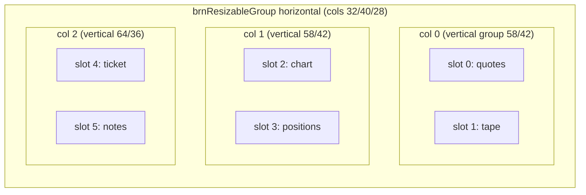

| Mechanism | Detail |
|---|---|
| **Resizing** | `@spartan-ng/brain/resizable`: `brnResizableGroup` (+ `direction`, `[layout]`, `(layoutChanged)`), `brnResizablePanel` (`[id] [defaultSize] [minSize]`), `brnResizeHandle` (keyboard-accessible separator). Column min 14 %, row min 16 %. Changes flow to `ws.setCols` / `ws.setRows(col, sizes)` and are persisted. |
| **Panel template** | one `<ng-template #panelTpl>` renders the right panel for an id inside a `cdkDrag` wrapper; used both for each slot and for the maximised view. |
| **Drag to swap** | The panel-frame header is a `cdkDragHandle`; `(cdkDragMoved)` computes the slot under the pointer with `document.elementsFromPoint` (`[data-ws-slot]`) and highlights it (`.slot-target`); `(cdkDragEnded)` calls `event.source.reset()` (snaps the preview back) and `ws.swap(dragged, target)`. A custom `*cdkDragPreview` shows only the panel title while dragging. |
| **Maximise** | `ws.maximized()` set ⇒ the grid is replaced by one panel full-size; otherwise the grid. (`@if … @else` ⇒ the panel **remounts**, a documented limitation.) |
| Helper | `slotAt(x, y)` — pure DOM hit-test returning slot 0–5 or `null`. |

🧒 *Feynman:* a magnetic whiteboard: grab a card by its title bar and drop it on another to swap; drag the thin gaps to resize; the board remembers how you left it.

---

<a id="f-web-src-app-shell-command-palette-component-ts"></a>

#### 6.13.5 `shell/command-palette.component.ts` — Ctrl/⌘ K

```text
┌─────────────────────────────────────────────┐
│ 🔍 Type a command or a symbol…          Esc │
├─────────────────────────────────────────────┤
│ SYMBOLS                                      │
│ ▶ 📈 Go to AAPL                              │
│ TICKET                                       │
│   ➤ Focus note ticket                  Alt T │
│   ✓ Book note                         Ctrl ↵ │
│ VIEW   ☀ Toggle dark / light theme        T  │
│ PANELS ⛶ Maximise Chart …                    │
└─────────────────────────────────────────────┘
```

| Concern | Detail |
|---|---|
| Primitive | **spartan brain `command`**: `brnCommand [filter] [search] (searchChange)`, `brnCommandInput`, `brnCommandList`, `brnCommandGroup`, `brnCommandItem [value] (selected)`, `*brnCommandEmpty`. Brain supplies keyboard navigation (↑/↓/Enter) and `aria-selected`; the template supplies every pixel. |
| Filter | `[filter]="fuzzyMatch"` (subsequence matching, see §6.7.8). |
| Actions | ~30 commands in groups **Ticket · View · Panels · Help**, each `{label, group, icon, hint?, run}`; *Symbols* group (top 12 fuzzy matches, `Go to AAPL`) is prepended only when the query is non-empty. |
| Focus | `cdkTrapFocus` + `cdkTrapFocusAutoCapture` keep Tab inside the dialog; an effect clears the query and focuses the input after render on open. |
| Fixes baked in (found by the browser tests) | (1) input focus after the dialog renders, (2) the `[brnCommandItem][data-hidden]{display:none}` rule in `styles.css` because brain only *flags* filtered rows, (3) after each query change an `afterNextRender` calls `keyManager.setFirstItemActive()` because symbol rows are added after brain's own “reset to first” ran, (4) selected style keyed to `aria-selected`, which is what brain sets. |
| Run | `run(action)` closes the palette first, then executes. |

🧒 *Feynman:* a magic search bar for the whole terminal: type three letters of anything—“thm”, “AAP”, “max ch”—and press Enter.

---

<a id="f-web-src-app-shell-shortcut-help-component-ts"></a>

#### 6.13.6 `shell/shortcut-help.component.ts`

A modal (`role="dialog" aria-modal`, `cdkTrapFocus`) rendering `HOTKEY_HELP` as a definition list of `<app-kbd>` caps; backdrop click or ✕ closes it. Because the data is the same array `hotkeys.ts` exports, **the help can never drift from the real shortcuts**.

---

<a id="contract"></a>

## §7 The Front↔Back Contract (v2) and the Mock Backend

> v1 documented a contract that **only a Node mock** implemented. v2 implements it **twice, identically**: in Spring (`LiveFeedHub`, `FeedSocketHandler`, `NotesController`, …) and in `e2e/mock-backend.mjs`. The mock is now a *conformance twin* used by Playwright and the screenshots.

### 7.1 The wire protocol

| Endpoint | Direction | Message |
|---|---|---|
| `WS /ws/quotes` | server → client | `{"kind":"snapshot","seq":N,"quotes":[{"sym","px","qty","seq","ts"}]}` — **always first** after connect |
| | server → client | `{"kind":"delta","seq":N+1,"quote":{…}}` |
| | server → client | `{"kind":"heartbeat","seq":N}` every **1 s** |
| | client → server | `{"type":"resync"}` ⇒ server answers with a fresh snapshot |
| `WS /ws/trades` | server → client | snapshot `{"kind":"snapshot","seq","trades":[{"id","source","account","sym","side","qty","pxMicros","seq","ts"}]}` (newest first), `delta` `{"trade":{…}}`, `heartbeat` |
| `POST /api/notes` | client → server | `{underlying, notional, couponRate, couponBarrier, autocallBarrier, kiBarrier}` ⇒ **201** `{"id":"N-1001"}` + `Location: /api/notes/N-1001/terms`, or **422** problem `{title,status,detail,errors:[{field,message}]}` |
| `GET /api/notes?limit=50` | | `[{id, bookedAt, terms}]` newest first |
| `GET /api/notes/{id}/terms` | | the terms, or 404 |
| `GET /api/system/status` | | `{service, serverTime, quoteSeq, tradeSeq, quoteClients, tradeClients, inserted, duplicates, demo}` |
| header `X-Correlation-Id` | both | `ui-<uuid>` from the browser; `srv-<uuid>` if absent; echoed on responses |

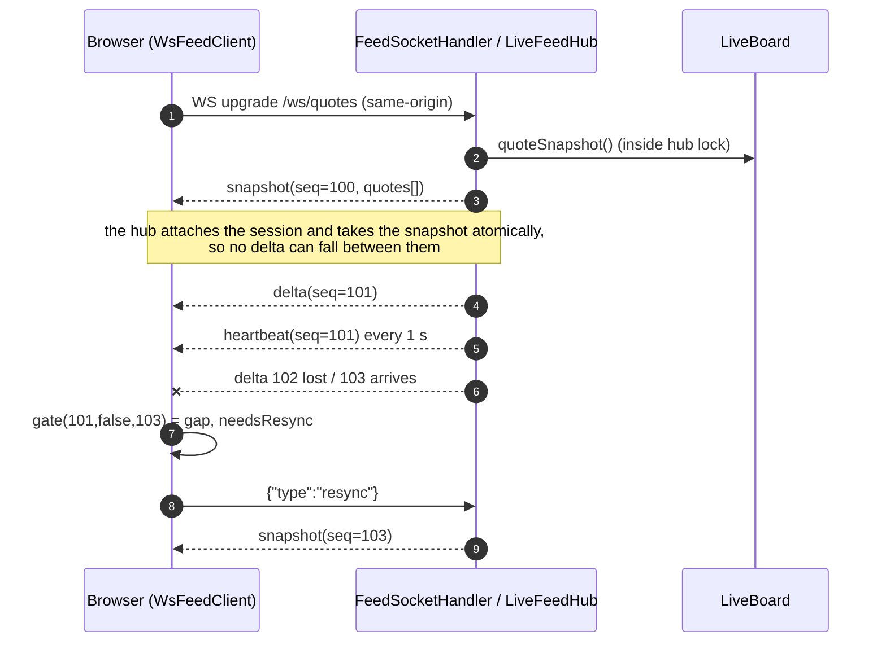

**Why the snapshot-then-delta ordering is safe:** the hub holds one lock while it (a) registers the session and (b) asks `LiveBoard` for its snapshot, and publishers take the same lock to broadcast. Sequence $s$ in the snapshot ⇒ the first delta the client can receive is $s+1$.

### 7.2 The client's obligations (all implemented)

1. Apply a snapshot unconditionally. 2. Apply a delta only if `seq = last+1`. 3. Ignore `seq ≤ last`. 4. On a gap **or** a heartbeat ahead of `last`, ask for **one** snapshot. 5. Reconnect with back-off; the new connection starts with a snapshot. 6. Mark the feed `stale` after 4 s of silence.

<a id="f-web-e2e-mock-backend-mjs"></a>

### 7.3 `web/e2e/mock-backend.mjs` — the conformance twin (Node ESM, 486 lines)

🎯 A single-file server that serves the **built** Angular app and speaks contract v2, plus a scripting surface for tests.

| Part | What it does |
|---|---|
| Config | `PORT` (default 4300); static root `dist/blotter/browser`; 8 default symbols, a 28-name “big” universe, or `SYM0001…` generated names for N symbols. |
| `prng(seed)` | **mulberry32** deterministic random numbers (seed 42) so screenshots and live mode are repeatable. |
| `state` | feed sequences, quote map, volume, tape (≤ 500), mid prices, connection counters, resync counters, bookings, notes, heartbeat flag. |
| `onTrade(t)` | mirrors `LiveBoard.onTrade`: `tradeSeq++`, push to the tape, `quoteSeq++`, cumulative volume, returns the stamped quote + trade. |
| `reset(count)` | clears everything and seeds one trade per symbol (so the first snapshot is non-empty). |
| `validate(body)` | JS port of `NoteTerms.parse`; **all** failing rules are returned (422 `errors[]`). |
| REST | `/api/system/status`, `POST /api/notes` (assigns `N-1001…`, echoes `X-Correlation-Id`, records the booking), `GET /api/notes`, `GET /api/notes/:id/terms`. |
| WebSocket | `ws` library in `noServer` mode; on upgrade registers the client, sends the snapshot, answers `{"type":"resync"}` with another snapshot and counts it. |
| Heartbeat | every 1 s unless disabled. |
| `startLive(ms)` | random-walk generator (±0.1 % per print, random side/qty/account) broadcasting through the same path as real trades. |
| **Control surface** | `GET /__control/stats` (connections, resync counts, bookings, seqs) · `POST /__control/reset {symbols}` · `/trade {sym,side,qty,px,account}` · `/gap {sym,px,feed}` (skips 3 sequence numbers) · `/drop` (terminate sockets = crash) · `/close` (code-1000 clean close = F-11) · `/heartbeats {on}` (to provoke *stale*) · `/live {on,intervalMs}`. |
| Static files | path-traversal-safe (`normalize` + strip `..`), SPA fallback to `index.html`. |

🧒 *Feynman:* a film-set double of the real server with a remote control: the director (test) can press “drop the connection”, “lose three messages” or “stop the heartbeat” and watch the actor (the UI) cope.

⚠️ Dev/test only; it listens on `127.0.0.1` and has no auth. The real server's equivalents are [`LiveFeedHub`](#f-src-main-java-com-example-capture-spring-livefeedhub-java) and friends.

[⬆️ Back to TOC](#toc)

---


<a id="part-b"></a>

# ☕ PART B — The Back End (follow the trade from the broker inward)

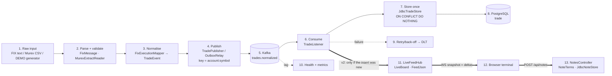

<a id="core"></a>

## §8 The Java `core/` Package — Pure Logic (no Spring)

> Rule from [`AGENTS.md`](#f-agents-md): *"`core/` pure logic (no Spring)."* Everything here is plain Java 17, unit-testable with `javac` alone — I compiled all thirteen files (the original ten plus `LiveBoard`, `NoteTerms`, `FeedJson`) and ran `CaptureDemo` and the four new unit-test classes (✅ output in [§8.9](#f-core-capturedemo)).

<a id="f-src-main-java-com-example-capture-core-tradeevent-java"></a>

### 8.1 `core/TradeEvent.java` — the canonical trade (the unit that flows everywhere)

🎯 One normalised execution. Every source (FIX, Murex) is converted into this shape; every downstream consumer reads this shape.

```java
public record TradeEvent(String tradeId, String account, String symbol, Side side,
                         long quantity, long priceMicros, String source, long sourceSeq,
                         Instant executedAt) { … }
```

| Component | Meaning | DB column |
|---|---|---|
| `tradeId` | id unique **within a source** (FIX ExecID, Murex trade number) | `trade_id` |
| `account` | booking account | `account` |
| `symbol` | instrument | `symbol` |
| `side` | `BUY`/`SELL` enum | `side` (CHECK) |
| `quantity` | strictly positive `long` | `quantity` |
| `priceMicros` | price × 10⁶, strictly positive | `price_micros` |
| `source` | `FIX:BROKER1`, `MUREX`, … | `source` |
| `sourceSeq` | per-source sequence (for gap detection) | `source_seq` |
| `executedAt` | execution time (`Instant`, UTC) | `executed_at` |

- **Java `record`** = immutable data carrier; the compiler writes constructor, accessors, `equals/hashCode/toString`.
- **Compact constructor** (L37-L47): `Objects.requireNonNull` on all reference fields; `quantity <= 0 || priceMicros <= 0 → IllegalArgumentException`. *"A malformed event can never reach the topic."* It also runs when Jackson deserialises a JSON message, so a bad message fails *before* it reaches business code.
- `partitionKey()` = `account + ":" + symbol` → the Kafka key ([§4.4](#foundations)).
- `dedupKey()` = `source + "/" + tradeId` → the key for the in-memory `DedupStore` (mirrors the DB composite key).

🧒 *Feynman:* A **standard shipping label**. Whatever weird label the sender used, we re-print it on our own label so every warehouse worker reads it the same way. The label refuses to print if the weight (quantity) or price is zero or negative.
⚠️ `Instant` equality includes nanoseconds; Postgres `timestamptz` keeps microseconds — don't compare round-tripped values with `equals`.

---

<a id="f-src-main-java-com-example-capture-core-fixmessage-java"></a>

### 8.2 `core/FixMessage.java` — parse and checksum-validate a FIX message

Wire format (`␁` = SOH, ASCII 1):

```text
8=FIX.4.4␁9=<bodyLen>␁35=8␁34=101␁49=BROKER1␁17=EX-9001␁150=F␁39=2␁1=ACC7␁55=AAPL␁54=1␁32=300␁31=187.25␁60=20261012-14:30:05.123␁10=242␁
└ BeginString ┘└ BodyLength ┘└────────────────────── body fields ─────────────────────────────────────────────────────┘└ CheckSum ┘
```

| Member | Behaviour |
|---|---|
| `SOH` constant | `'\u0001'`. |
| `parse(raw)` | (1) find `lastIndexOf(SOH+"10=")`, else *"missing checksum field"*. (2) `body = idx+1` (keeps the SOH before `10=`). (3) `expected = checksum(raw.substring(0, body))`. (4) split on SOH; each piece needs `=` at position > 0 else *"malformed field"*; store `Integer.parseInt(tag) → value` in a `HashMap`. (5) compare `Integer.parseInt(parsed.get(10))` with `expected`, else *"bad checksum: expected X got Y"*. |
| `checksum(s)` | sum of bytes (`ISO_8859_1`, `b & 0xff` → unsigned) mod 256 — [§4.7](#foundations). |
| `build(begin, fields…)` | **Test helper**: appends each `tag=value␁`, writes `8=…␁9=<body.length()>␁`, then `10=%03d␁`. |
| `get(tag)` / `require(tag)` | nullable vs. mandatory read (*"missing tag N"*). |

🧒 *Feynman:* Like a **parcel's seal number**: add up every letter's code, keep the remainder when dividing by 256. If a single digit changed in transit, the remainder almost surely differs → reject.
⚠️ `BodyLength (9)` is written by `build` but **never validated** by `parse`; repeating groups (e.g., multiple legs) overwrite each other in the `HashMap`; a duplicate tag silently keeps the last value. 🔧 Validate tag 9 and tag 8, keep an ordered list for repeating groups — or use QuickFIX/J in production and keep this class for teaching/tests.

---

<a id="f-src-main-java-com-example-capture-core-fixexecutionmapper-java"></a>

### 8.3 `core/FixExecutionMapper.java` — the anti-corruption layer

🎯 Convert a validated FIX `ExecutionReport` fill into a `TradeEvent`; keep every vendor quirk on this side of the boundary.

| Step | Code | FIX meaning |
|---|---|---|
| Filter | `35 == "8"` **and** `150 == "F"` else `Optional.empty()` | ExecutionReport + ExecType=Fill |
| Side | `switch(54)`: `"1"→BUY`, `"2"→SELL`, else `IllegalArgumentException` | Side |
| Quantity | `new BigDecimal(32).longValueExact()` | LastQty |
| Price | `new BigDecimal(31).movePointRight(6).longValueExact()` | LastPx → micros |
| Time | `LocalDateTime.parse(60, "yyyyMMdd-HH:mm:ss[.SSS]")` → `toInstant(UTC)` | TransactTime |
| Build | `tradeId=17`, `account=1`, `symbol=55`, `source="FIX:"+senderCompId`, `sourceSeq=34` | ExecID, Account, Symbol, MsgSeqNum |

- The `senderCompId` comes from the **constructor** (one mapper per counterparty session), *not* from tag 49 of the message.
- `[.SSS]` in the formatter makes milliseconds optional.
- ✅ Demo: `35=8,150=F,54=1,32=300,31=187.25` → `TradeEvent[tradeId=EX-9001, account=ACC7, symbol=AAPL, side=BUY, quantity=300, priceMicros=187250000, source=FIX:BROKER1, sourceSeq=101, executedAt=2026-10-12T14:30:05.123Z]`.

🧒 *Feynman:* A **customs officer**: only genuine "goods delivered" paperwork passes; everything else (acknowledgements, rejects, cancels) is politely ignored.
⚠️ `longValueExact()` throws `ArithmeticException` (not `IllegalArgumentException`) on fractional quantity or sub-micro price. Because `KafkaErrorHandlingConfig` marks only `IllegalArgumentException` as non-retryable, such a record would be retried before the DLT. ⚠️ Cancel (`150=H`) and correct (`150=G`) reports are dropped, so busts never reach the store. 🔧 Map them to `TradeEvent` variants (add `eventType`/`version`).

---

<a id="f-src-main-java-com-example-capture-core-sequencegapdetector-java"></a>

### 8.4 `core/SequenceGapDetector.java` — did we miss messages?

FIX sessions number messages `34=MsgSeqNum` consecutively. The detector holds `expected`:

| `seq` vs `expected` | Result | Action |
|---|---|---|
| `==` | `IN_ORDER` | `expected++` |
| `>` | `GAP(resendFrom=expected, resendTo=seq-1)` | `expected = seq+1`; caller sends `ResendRequest (35=2)` for the range |
| `<` | `DUPLICATE` | possible replay; ignore (or check PossDup `43=Y`) |

✅ Demo with start 100 and input `100,101,105,105,106`: IN_ORDER, IN_ORDER, **GAP 102–104**, DUPLICATE, IN_ORDER. `gapRange()` converts a GAP into an optional `[from,to]` pair. Not thread-safe (one session = one thread).
🧒 *Feynman:* Page numbers in a book: if you read page 105 after 101, pages 102–104 are missing — go ask for them.
⚠️ After a gap `expected` jumps ahead, so *resent* messages (lower numbers) will classify as `DUPLICATE`; the caller must handle resend traffic using PossDupFlag rather than trusting this class blindly.

---

<a id="f-src-main-java-com-example-capture-core-murexextractreader-java"></a>

### 8.5 `core/MurexExtractReader.java` — batch-file ingestion

Contract: a file `extract_N.csv` is **ready only when `extract_N.csv.done` exists** (the producer writes the marker last → no half-written reads). `drain()`:

1. list `*.csv` in `inbox` having a sibling `.done`, sorted by name;
2. read all lines; for lines 1…n−1 (skip the header) `parseLine`;
3. **atomically move** the CSV to `archive`, then delete the `.done`.

CSV columns (assumed): `tradeId,account,symbol,side,qty,price,ts` → `TradeEvent(source="MUREX", sourceSeq=<data line number>)`; price via `BigDecimal.movePointRight(6).longValueExact()`; time via `Instant.parse`. `split(",", -1)` keeps empty trailing cells so the 7-column check is exact.
✅ Demo: `extract_1.csv` (+`.done`) yields MX1 BUY 100 AAPL and MX2 SELL 50 MSFT; `extract_2.csv` with no marker **stays in the inbox**.
🧒 *Feynman:* A **"wet paint" sign**: don't touch the painting until the owner hangs "dry" next to it.
⚠️ `sourceSeq` is the line number *within a file*, so it repeats across files (fine for dedup because `tradeId` is unique, wrong for gap detection). ⚠️ If file 2 throws after file 1 was archived, the already-parsed trades of file 1 are lost (the method never returns them). ⚠️ `ATOMIC_MOVE` fails across file systems; no quoted-CSV support; `Side.valueOf` is case-sensitive. 🔧 Return per-file results, move failures to a `rejected/` folder.

---

<a id="f-src-main-java-com-example-capture-core-murmur2-java"></a>

### 8.6 `core/Murmur2.java` — which partition will this key hit?

A faithful re-implementation of the 32-bit **murmur2** hash that Kafka's default partitioner uses. Constants: seed `0x9747b28c`, multiplier `M=0x5bd1e995`, shift `R=24`.

$$h_0=\text{seed}\oplus \text{len};\quad \text{for each 4-byte little-endian block } k:\ k\!\leftarrow\!kM;\ k\!\leftarrow\!k\oplus(k\ggg 24);\ k\!\leftarrow\!kM;\ h\!\leftarrow\!hM;\ h\!\leftarrow\!h\oplus k$$

then fold the 1–3 leftover bytes (`switch`-style cascade, final `h *= M`), and finish with the **avalanche**: $h\!\leftarrow\!h\oplus(h\ggg13);\ h\!\leftarrow\!hM;\ h\!\leftarrow\!h\oplus(h\ggg15)$. Java `int` multiplication wraps modulo $2^{32}$, exactly what the algorithm assumes; `>>>` is the unsigned shift. `partitionFor(key, P)` masks with `0x7fffffff` then `% P`.
✅ The demo reproduces four **test vectors copied from Kafka's own `UtilsTest`** (e.g., `"21" → -973932308`, `"foobar" → -790332482`) and shows 400 keys over 12 partitions.
🧒 *Feynman:* A **blender**: whatever you toss in (a key), it comes out as a thoroughly scrambled number, always the same for the same input; dividing by the number of lanes picks the lane.
🔧 Use it to *predict hot partitions* (e.g., one mega-account:symbol key), not to route in production — let the Kafka client do that.

---

<a id="f-src-main-java-com-example-capture-core-backoffpolicy-java"></a>

### 8.7 `core/BackoffPolicy.java` — the retry schedule, written down

Immutable policy: `initialMillis`, `multiplier`, `maxMillis`, `maxRetries`.
Constructor guard: `initial>0`, `multiplier>=1`, `max>=initial`, `retries>=0`.

| Method | Formula |
|---|---|
| `delayMillis(n)` | $\min(d_0 m^{n-1},\,d_{\max})$ (as `long`) |
| `jitteredDelayMillis(n, rnd)` | uniform in $[0,\,d_n]$ via `RandomGenerator.nextLong(d_n+1)` (Java 17 `java.util.random`) |
| `totalBlockingMillis()` | $\sum_{n=1}^{R} d_n$ — worst time a poison/transient record **blocks its partition** before DLT |

✅ Demo (200, ×2, cap 5000, R=6): 200, 400, 800, 1600, 3200, 5000 → worst case **11 200 ms**. With production values (R=5) it is 6 200 ms ([§4.5](#foundations)).
⚠️ This class is **not used by the Spring wiring**; `KafkaErrorHandlingConfig` builds Spring's own `ExponentialBackOffWithMaxRetries` from the same four numbers. It exists to reason about, document and unit-test the schedule. 🔧 Either delete it or have Spring's `BackOff` delegate to it so there is one source of truth.

---

<a id="f-src-main-java-com-example-capture-core-dedupstore-java"></a>

### 8.8a `core/DedupStore.java` — "have I seen this key recently?" *(changed in v2: finding F-1 fix)*

A bounded `LinkedHashMap<String,Boolean>` (insertion-order mode, `removeEldestEntry` returns `size() > capacity`). All methods are `synchronized`.

| Method | v1? | Behaviour |
|---|:-:|---|
| `firstTime(key)` | ✅ kept | `put(...) == null`: records **and** reports newness in one step. |
| `contains(key)` | 🆕 | read-only membership test. |
| `remember(key)` | 🆕 | record a key **after** the guarded work succeeded. |
| `size()` | ✅ kept | count. |

Why two new methods: `firstTime` couples *checking* and *recording*, which is exactly what caused **F-1** — the listener recorded the key, then the insert threw, and the retry was mis-classified as a duplicate and dropped. The split lets the listener do `contains → insert → remember` ([§9.7](#f-src-main-java-com-example-capture-spring-tradelistener-java)).

✅ Demo (capacity 2) with keys `a,b,a,c,a`: `a true, b true, a false, c true, a true` — the last `a` is *new again* because `c` evicted it: **FIFO** eviction, not LRU.
✅ New unit test [`DedupStoreTest`](#f-src-test-java-com-example-capture-core-dedupstoretest-java) pins `contains` not recording, `remember` recording, and capacity eviction.

🧒 *Feynman:* a **sticky-note wall**. v1 wrote the note *before* you finished the job, so a failed job still left a note saying “done”. v2 writes the note only **after** the job is finished.

---

<a id="f-src-main-java-com-example-capture-core-lagcalculator-java"></a>

### 8.8b `core/LagCalculator.java` — how far behind are we?

Implements $\text{lag}_p=\max(0,E_p-C_p)$ ([§4.6](#foundations)). `Lag(totalLag,maxLag,verdict)` is a nested `record`; `Verdict` enum `OK|WARN|CRITICAL`. Thresholds compare against the **max single-partition lag** (`>= critical` first, then `>= warn`). Missing committed offset ⇒ `getOrDefault(key,0)` ⇒ whole log counts as lag.
✅ Demo: ends `t-0:5000, t-1:20000, t-2:100`; committed `t-0:4900, t-1:5000` ⇒ lags 100, 15 000, 100 ⇒ `Lag[totalLag=15200, maxLag=15000, verdict=CRITICAL]`.
🧒 *Feynman:* Three checkout lanes; the verdict looks at the **longest** queue because one stuck lane hurts customers even when the others are empty.

---

<a id="f-src-main-java-com-example-capture-core-capturedemo-java"></a>
<a id="f-core-capturedemo"></a>

### 8.9 `core/CaptureDemo.java` — runnable proof (has a `main`)

🎯 Exercises all framework-free pieces and prints evidence (it is the "executable documentation" of the core). Six sections: `partitioning()`, `backoff()`, `lag()`, `dedup()`, `fix()` (mapper + corruption check + sequence gaps), `murex()` (creates temp dirs, writes two CSVs and a `.done`, drains).

Run it with **no Maven** (✅ I did):

```bash
cd trade-capture
javac -d /tmp/out src/main/java/com/example/capture/core/*.java
java  -cp /tmp/out com.example.capture.core.CaptureDemo
```

Real output (JVM banner lines removed):

```text
== murmur2 vectors from Kafka's own UtilsTest ==
21                             -973932308 expected   -973932308 true
foobar                         -790332482 expected   -790332482 true
a-little-bit-long-string       -985981536 expected   -985981536 true
a-little-bit-longer-string    -1486304829 expected  -1486304829 true
400 keys over 12 partitions: [35, 33, 38, 33, 40, 29, 40, 27, 29, 36, 25, 35]
== back-off ==
retry 1: 200 ms, jittered 27 ms
retry 2: 400 ms, jittered 126 ms
retry 3: 800 ms, jittered 387 ms
retry 4: 1600 ms, jittered 401 ms
retry 5: 3200 ms, jittered 2688 ms
retry 6: 5000 ms, jittered 945 ms
worst-case blocking before DLT: 11200 ms
== lag ==
Lag[totalLag=15200, maxLag=15000, verdict=CRITICAL]
== dedup (capacity 2) ==
a first=true
b first=true
a first=false
c first=true
a first=true
== FIX drop-copy ==
TradeEvent[tradeId=EX-9001, account=ACC7, symbol=AAPL, side=BUY, quantity=300, priceMicros=187250000, source=FIX:BROKER1, sourceSeq=101, executedAt=2026-10-12T14:30:05.123Z]
corrupted message rejected: bad checksum: expected 248 got 242
seq 100 -> Observation[kind=IN_ORDER, resendFrom=0, resendTo=0]
seq 101 -> Observation[kind=IN_ORDER, resendFrom=0, resendTo=0]
seq 105 -> Observation[kind=GAP, resendFrom=102, resendTo=104]
seq 105 -> Observation[kind=DUPLICATE, resendFrom=0, resendTo=0]
seq 106 -> Observation[kind=IN_ORDER, resendFrom=0, resendTo=0]
== Murex extract ==
TradeEvent[tradeId=MX1, account=ACC7, symbol=AAPL, side=BUY, quantity=100, priceMicros=187250000, source=MUREX, sourceSeq=1, executedAt=2026-10-12T14:30:05Z]
TradeEvent[tradeId=MX2, account=ACC7, symbol=MSFT, side=SELL, quantity=50, priceMicros=410500000, source=MUREX, sourceSeq=2, executedAt=2026-10-12T14:31:00Z]
extract_2 (no .done marker) still in inbox: true
```

(The jittered column used `new SplittableRandom(42)` re-created per call, so it is repeatable.) 🔧 v2 added JUnit tests for the three new classes and `DedupStore` ([§11.1b–e](#tests)); the *original* parsers (`FixMessage`, `FixExecutionMapper`, `MurexExtractReader`, …) are still covered only by this demo — converting it to JUnit remains a recommended task.


<a id="f-src-main-java-com-example-capture-core-liveboard-java"></a>

### 8.10 `core/LiveBoard.java` 🆕 — the sequenced, in-memory view the browser reads

🎯 Turn *stored trades* into the two feeds the Angular terminal expects: a **quote board** (last price + cumulative volume per symbol) and a **trade tape** (newest ≤ capacity fills), each with its **own monotonically increasing sequence**. Pure Java, no Spring.

| Member | Meaning |
|---|---|
| `QuoteView(sym, pxMicros, qty, seq, ts)` | one board row; **price is a `long` of micros** (AGENTS rule 2). |
| `TradeView(id, source, account, sym, side, qty, pxMicros, seq, ts)` | one tape row. `id` is the trade's `dedupKey`. |
| `Update(quote, trade)` | the two rows produced by one trade. |
| `Snapshot<T>(seq, items)` | a consistent copy stamped with the sequence it is valid at. |
| `LiveBoard(tapeCapacity)` | positive capacity (500 in production) or `IllegalArgumentException`. |
| `synchronized onTrade(trade, nowMillis)` | `tradeSeq++`; push to the front of an `ArrayDeque`, trim the back to capacity; `quoteSeq++`; cumulative volume via `volume.merge(sym, qty, Long::sum)`; `quotes.put(sym, QuoteView(...))` in a `TreeMap` (sorted by symbol). Returns the stamped `Update`. |
| `synchronized quoteSnapshot()` / `tradeSnapshot()` | copies **under the same lock**, so a snapshot and its `seq` can never disagree. |
| `quoteSeq()` / `tradeSeq()` | current sequences (used by heartbeats and `/api/system/status`). |

Invariant (tested): after $n$ trades, `tradeSeq = quoteSeq = n`, and a client that applies snapshot($s$) then deltas $s+1,\dots$ reconstructs exactly the board. The quote row's `ts` is the **server clock at ingest** (`nowMillis`), the trade row's `ts` is the **execution time** from the event.

```text
 onTrade(TradeEvent t, now)
   tradeSeq++ ──► tape.addFirst(TradeView seq=tradeSeq) ──► trim to capacity
   quoteSeq++ ──► volume[t.sym] += t.qty ──► quotes[t.sym] = QuoteView(px=t.priceMicros, qty=volume, seq=quoteSeq, ts=now)
```

🧒 *Feynman:* the **scoreboard operator**. Every goal (trade) increments the “event number” and updates the board; if you walk in late he hands you a photo of the board *with the event number written on it*, then calls out only the events after that number.

⚠️ State lives **in this JVM only** — see the multi-replica caveat in [§1](#reality). 🔧 Warm it from `SELECT … FROM trade ORDER BY executed_at DESC LIMIT 500` at start-up so a restarted pod shows history.

✅ Verified by [`LiveBoardTest`](#f-src-test-java-com-example-capture-core-liveboardtest-java) (8 tests, including `pxMicros()==187_500_000L`).

---

<a id="f-src-main-java-com-example-capture-core-noteterms-java"></a>

### 8.11 `core/NoteTerms.java` 🆕 — the autocallable terms, validated in fixed point

🎯 The **server-side twin** of `ticket.checks.ts`. Never trusts the browser: every `POST /api/notes` goes through `NoteTerms.parse`, which converts decimals to integers *exactly* and collects **every** failure, not just the first.

| Member | Meaning |
|---|---|
| `record NoteTerms(underlying, notionalCents, couponRateBps, couponBarrierBps, autocallBarrierBps, kiBarrierBps)` | money in **cents** (`long`), rates and barriers in **basis points** (`int`). No `double` anywhere. |
| `MAX_NOTIONAL = 1_000_000_000` | hard limit (same as the UI). |
| `FieldError(field, message)` | one failure. |
| `Invalid extends RuntimeException` | carries the immutable `errors()` list; thrown by `parse`. |
| `parse(String, BigDecimal ×5)` | the validator (below). |
| accessors `notional()`, `couponRate()`, `couponBarrier()`, … | rebuild `BigDecimal.valueOf(unscaled, scale)` for JSON output. |

Rules (messages are identical to the browser and the mock):

| Field | Rule | Conversion |
|---|---|---|
| underlying | regex `[A-Z0-9][A-Z0-9.\-]{0,11}` | — |
| notional | $0<n\le 10^9$, ≤ 2 decimals | $\text{cents}=n\cdot10^2$ via `movePointRight(2).longValueExact()` |
| couponRate | $0\le r\le 1$, ≤ 4 decimals | $\text{bps}=r\cdot10^4$ |
| each barrier | $0<b\le200$, ≤ 2 decimals | $\text{bps}=b\cdot10^2$ (70 % ⇒ 7000) |
| order (only if nothing else failed) | $K<C_b$ **and** $C_b\le A_b$ | — |

`longValueExact()` throws `ArithmeticException` on a fractional remainder; `exact()` catches it and adds “allows at most *d* decimal places”, so **rounding never happens silently**.

🧒 *Feynman:* a **strict cashier**: she will not round your 12.345 to 12.35 behind your back; she tells you “two decimals only”, and she lists *all* the mistakes on your slip at once.

✅ 9 tests in [`NoteTermsTest`](#f-src-test-java-com-example-capture-core-notetermstest-java).

---

<a id="f-src-main-java-com-example-capture-core-feedjson-java"></a>

### 8.12 `core/FeedJson.java` 🆕 — a 60-line hand-written JSON encoder

🎯 Serialise the wire contract ([§7.1](#contract)) without reflection or Spring, so it can be unit-tested with `javac` alone and its output is *exactly* what the TypeScript `QuoteMsg`/`TradeMsg` types expect.

| Method | Output |
|---|---|
| `quoteSnapshot(Snapshot<QuoteView>)` | `{"kind":"snapshot","seq":S,"quotes":[…]}` |
| `quoteDelta(QuoteView)` | `{"kind":"delta","seq":N,"quote":{…}}` |
| `tradeSnapshot(Snapshot<TradeView>)` / `tradeDelta(TradeView)` | same shapes with `trades` / `trade` |
| `heartbeat(seq)` | `{"kind":"heartbeat","seq":N}` |
| `string(text)` | JSON string literal with escapes for `" \ \n \r \t` and `\u00XX` for control chars; `null` ⇒ `null` |
| private `price(micros)` | `BigDecimal.valueOf(micros, 6).stripTrailingZeros().toPlainString()` ⇒ `187250000 → 187.25`, never `1.8725E+2` |

Design choice: the **quote price is sent as a decimal number** (`px`, convenient for the UI) but is *computed from the long micros*, so it is exact; the **trade price is sent as integer `pxMicros`** (accounting-grade). 

🧒 *Feynman:* a rubber-stamp: the shape of every message is fixed, so a stamp is safer than a general printing press.

✅ 7 tests in [`FeedJsonTest`](#f-src-test-java-com-example-capture-core-feedjsontest-java), including `roundPricesDropTrailingZerosButStayExact` and escaping.

---

[⬆️ Back to TOC](#toc)

---


<a id="spring"></a>

## §9 The `spring/` Package — Wiring, Kafka, Database

> Reading order follows the life of a trade: **boot → settings → publish → (outbox) → consume → store → fail safely → observe**.

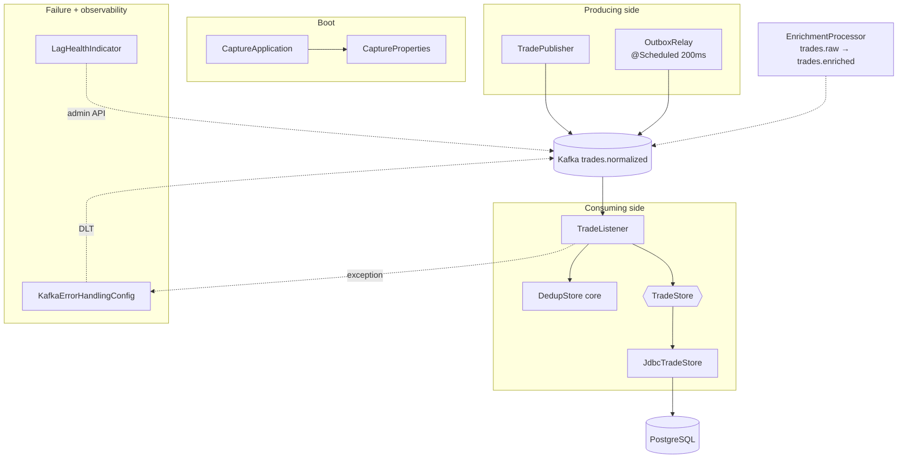

---

<a id="f-src-main-java-com-example-capture-spring-captureapplication-java"></a>

### 9.1 `spring/CaptureApplication.java` — `main()`

| Annotation | Effect |
|---|---|
| `@SpringBootApplication` | = `@Configuration` + `@EnableAutoConfiguration` + `@ComponentScan` of **this package and below** (`com.example.capture.spring.*`). `core/` is a sibling package, so it is *not* scanned — its classes are plain objects created with `new`, which is exactly the hexagonal intent. |
| `@ConfigurationPropertiesScan` | Finds `@ConfigurationProperties` types (here the `CaptureProperties` record) without listing them. |
| `@EnableScheduling` | Turns on `@Scheduled` processing (needed by `OutboxRelay`, and in v2 by `LiveFeedHub.heartbeat` and `DemoTradeGenerator.tick`). |

`SpringApplication.run(...)` starts the context, auto-configures Kafka/JDBC/Flyway/Actuator, starts embedded Tomcat on 8080, launches the listener containers. 🧒 *Feynman:* The **power switch**.

---

<a id="f-src-main-java-com-example-capture-spring-captureproperties-java"></a>

### 9.2 `spring/CaptureProperties.java` — typed settings

A `record` bound to the `capture.*` YAML subtree (relaxed binding: `dead-letter-suffix` ↔ `deadLetterSuffix`). Eight fields: `topic`, `deadLetterSuffix`, `maxRetries`, `retryInitialMillis`, `retryMultiplier`, `retryMaxMillis`, `lagWarn`, `lagCritical`. Immutable; injected into `TradePublisher`, `OutboxRelay`, `KafkaErrorHandlingConfig`, `LagHealthIndicator`.
🧒 *Feynman:* A **labelled settings drawer** instead of loose numbers scattered across the code.
⚠️ The Javadoc promises "fail at startup on a typo". In practice Boot ignores unknown keys, and a *missing* primitive binds as `0`/`null` (e.g., a mistyped `max-retries` ⇒ **0 retries**). 🔧 Add `@Validated` with `@NotBlank`, `@Min`, `@Positive` on the record components to make that promise true.

---

<a id="f-src-main-java-com-example-capture-spring-tradepublisher-java"></a>

### 9.3 `spring/TradePublisher.java` — send one trade to Kafka

- Dependencies: `KafkaTemplate<String,TradeEvent>`, `CaptureProperties`, `MeterRegistry`.
- `publish(trade)` → `template.send(topic, trade.partitionKey(), trade)` returns a `CompletableFuture<SendResult>` completing when the broker has acknowledged (`acks=all`); `whenComplete` increments `capture.publish{outcome=ok|error}` (Prometheus names `capture_publish_total`).
- Durability/ordering come from configuration, not code: `acks=all`, `enable.idempotence=true`, key = `account:symbol` ([§10.1](#f-src-main-resources-application-yml)).

🧒 *Feynman:* Dropping a letter in the mailbox **and** getting a signed receipt (the future) before you walk away.
⚠️ Only `CaptureIntegrationTest` calls this class — no production code path does (see [§1](#reality)). The returned future is not awaited by anyone in main code, so fire-and-forget callers would lose the failure signal except for the metric.

---

<a id="f-src-main-java-com-example-capture-spring-outboxrelay-java"></a>

### 9.4 `spring/OutboxRelay.java` — the transactional outbox relay

**Problem it solves (dual-write):** "save to DB *and* publish to Kafka" cannot be one atomic action. If you do both in code, a crash between them leaves them disagreeing. **Outbox pattern:** the business transaction writes its state *and* an `outbox` row in **one DB transaction**; a separate relay later publishes unpublished rows.

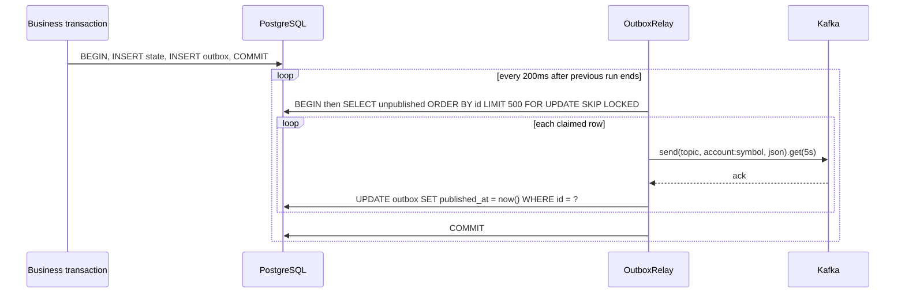

| Detail | Explanation |
|---|---|
| `@Scheduled(fixedDelay = 200)` | Next run starts 200 ms **after the previous finished** (no overlap on one instance). |
| `@Transactional` | The claim lock, the sends' bookkeeping and the marks commit together. A send failure/timeout throws → **rollback** → rows become claimable again. |
| `FOR UPDATE SKIP LOCKED` | Other relay instances (other pods) skip rows already locked → no blocking, no double-claim *concurrently*. |
| `ORDER BY id LIMIT ?` (500) | Oldest first, bounded batch. |
| Key | `account + ":" + symbol` recomputed from two columns → same partition rule as `TradeEvent.partitionKey()` (`keyFor(TradeEvent)` states the rule but is unused). |
| Delivery | **At-least-once**: crash after `send` but before `COMMIT` ⇒ re-send; the idempotent consumer absorbs it. |

🧒 *Feynman:* A **"to-be-posted" tray** next to the ledger. Writing the letter and putting it in the tray is one indivisible act; a postman (the relay) empties the tray repeatedly and ticks each letter off.
⚠️ (1) **Nothing writes outbox rows** in this repository — the table and relay are ready but unfed. (2) With several relay instances, `SKIP LOCKED` lets pod A take ids 1-500 and pod B 501-1000; **per-key ordering is not guaranteed across instances.** (3) Sends are sequential (`send().get()` per row) — throughput ≈ batch ÷ round-trip. (4) The injected template is `KafkaTemplate<String,String>` but `application.yml` configures `JsonSerializer` as the producer value serializer, so the pre-serialised JSON text would likely be **encoded a second time** as a JSON string — the consumer's `JsonDeserializer<TradeEvent>` would then reject it. *(Code-read analysis; prove with a test.)* (5) Published rows are never deleted. 🔧 Use a `StringSerializer` template for the relay, send the whole batch then await all futures, shard the outbox by key hash or run a single elected relay, and purge old rows.

---

<a id="f-src-main-java-com-example-capture-spring-tradestore-java"></a>

### 9.5 `spring/TradeStore.java` — the persistence **port**

One method: `boolean insertIfAbsent(TradeEvent)` → `true` = new row, `false` = duplicate. An *interface* so the listener never imports JDBC; tests/in-memory fakes can stand in (hexagonal "port").
🧒 *Feynman:* The wall socket's shape — the listener plugs in without knowing what's behind the wall.

<a id="f-src-main-java-com-example-capture-spring-jdbctradestore-java"></a>

### 9.6 `spring/JdbcTradeStore.java` — the PostgreSQL **adapter**

```sql
INSERT INTO trade (source, trade_id, account, symbol, side, quantity, price_micros, source_seq, executed_at)
VALUES (?,?,?,?,?,?,?,?,?)
ON CONFLICT (source, trade_id) DO NOTHING
```

- A Java 17 **text block** holds the SQL; `JdbcTemplate.update` binds 9 positional parameters (`side.name()`, `Timestamp.from(executedAt)`).
- Returns `rows == 1`: **1** = inserted; **0** = conflict (duplicate) — the key is Postgres' atomic arbiter even if 10 pods race.
- `@Transactional`: each call is its own transaction (the listener is not transactional) ⇒ the row is **committed before** the caller acks the offset.
- `captured_at` is filled by the DB default `now()`.

🧒 *Feynman:* "Write this name in the guest book **unless it's already there**" — and the book tells you whether it wrote anything.
🔧 For throughput use a *batch* listener plus `jdbc.batchUpdate` (and return per-row counts); keep one transaction per poll.

---

<a id="f-src-main-java-com-example-capture-spring-tradelistener-java"></a>

### 9.7 `spring/TradeListener.java` — the consumer (heart of the system) *(changed in v2: F-1 fixed + live publish)*

```java
public TradeListener(TradeStore store, LiveFeedHub hub, MeterRegistry registry)

@KafkaListener(id="trade-capture", topics="${capture.topic}", groupId="trade-capture",
               containerFactory="tradeListenerFactory")
public void onTrade(ConsumerRecord<String,TradeEvent> record, Acknowledgment ack) {
  TradeEvent trade = record.value();
  String key = trade.dedupKey();
  if (recent.contains(key)) {
    duplicates.increment();
  } else {
    boolean fresh = store.insertIfAbsent(trade);   // may throw: key is then NOT remembered
    recent.remember(key);
    if (fresh) { inserted.increment(); hub.publish(trade); }
    else       { duplicates.increment(); }
  }
  ack.acknowledge();
}
```

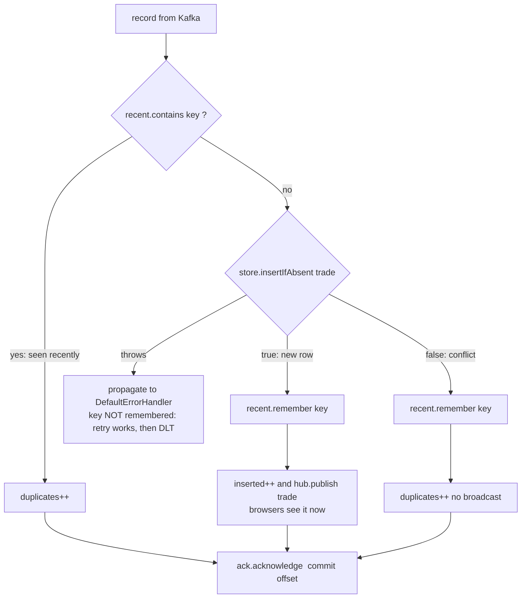

| Mechanic | Why |
|---|---|
| Manual ack (`AckMode.MANUAL`) | Offset is committed **after** the DB commit ⇒ at-least-once. |
| `contains` → insert → `remember` | **F-1 fixed.** A failed insert leaves no trace in memory, so the container's retry really retries. |
| `hub.publish(trade)` **only when `fresh`** | A redelivery must not create a second tick on every screen (consumers are idempotent — AGENTS rule 5 — and so are the *views*). |
| Metrics | `capture.consume{outcome=inserted\|duplicate}` ⇒ Prometheus `capture_consume_total`; the same counters feed `/api/system/status` (`inserted`, `duplicates`). |
| Constructor | `(TradeStore, LiveFeedHub, MeterRegistry)` — a new collaborator, so `CaptureIntegrationTest` (unchanged) still compiles because Spring injects it. |

🧒 *Feynman:* the **cook** now writes “done” on the wall only *after* the ink is dry, and rings the dining-room bell (publish) only for a *new* dish.

✅ F-1 is proved by the new `DedupStoreTest` (contains does not record) plus the corrected call order; a Spring-level “store fails once” test remains a recommended addition ([§14](#findings)).

---

<a id="f-src-main-java-com-example-capture-spring-kafkaerrorhandlingconfig-java"></a>

### 9.8 `spring/KafkaErrorHandlingConfig.java` — retry, back-off, dead-letter

Two `@Bean`s:

1. **`tradeErrorHandler`** (`DefaultErrorHandler`)
   - `DeadLetterPublishingRecoverer(dltTemplate, (record,error) -> new TopicPartition(record.topic()+".DLT", record.partition()))` — failed record goes to `trades.normalized.DLT`, **same partition number** (keeps ordering info for a replay tool; the DLT needs ≥ as many partitions).
   - `ExponentialBackOffWithMaxRetries(5)` with initial 200 ms, ×2, cap 5000 ms (values from `CaptureProperties`).
   - `addNotRetryableExceptions(IllegalArgumentException.class)` — **poison messages skip retries** (validation failures can never succeed on retry).
   - `setCommitRecovered(true)` — after dead-lettering, commit the offset so the partition moves on.
2. **`tradeListenerFactory`** (`ConcurrentKafkaListenerContainerFactory<String,TradeEvent>`): Boot's consumer factory + the handler, `AckMode.MANUAL`, `setConcurrency(3)` (3 consumer threads per pod).

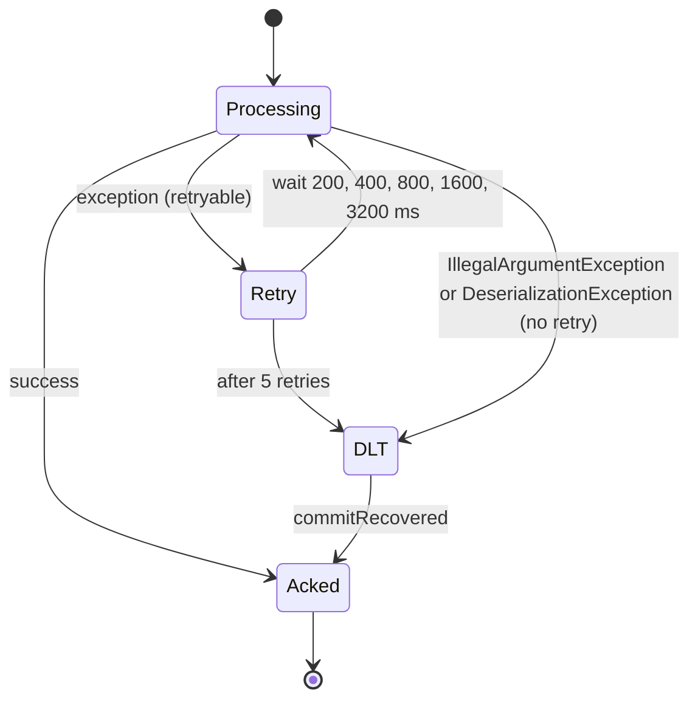

🧒 *Feynman:* A **mail-sorting room**: if a letter jams the machine, try again after short, growing pauses; if it's plainly unreadable, drop it in the "returned mail" bin straight away so the belt keeps moving.
⚠️ (a) The partition is **blocked** while retrying (≤ 6.2 s per bad record — [§4.5](#foundations)). (b) `concurrency=3` per pod interacts with scaling — see [§14 F-6](#findings). (c) No DLT topic is created by any IaC in the repo (MSK has `auto.create.topics.enable=false`). (d) The recoverer publishes through a `JsonSerializer` template; Spring's guidance for deserialisation failures is a byte-array-capable template map. (e) `ArithmeticException` from the FIX mapper is retryable by default.

---

<a id="f-src-main-java-com-example-capture-spring-lag-health"></a>
<a id="f-src-main-java-com-example-capture-spring-laghealthindicator-java"></a>

### 9.9 `spring/LagHealthIndicator.java` — consumer lag on `/actuator/health`

Bean name `consumerLag`. `health()`:

1. `admin.listConsumerGroupOffsets("trade-capture")` → committed offsets (3 s timeout).
2. `admin.listOffsets({tp→latest})` → log-end offsets.
3. Convert keys with `TopicPartition.toString()` and feed `LagCalculator`.
4. `CRITICAL` ⇒ `Health.down()`, else `up()`; details `totalLag`, `maxPartitionLag`, `verdict`. Timeouts/errors ⇒ `Health.unknown()`; `InterruptedException` re-sets the interrupt flag (correct practice).

🧒 *Feynman:* The **manager walks the queues with a clipboard** and writes "OK / busy / jammed".
⚠️ (1) The group id is hard-coded `"trade-capture"` instead of using the property. (2) Only partitions that *have* a committed offset are examined, so a never-consumed partition is invisible. (3) Probes: Boot's `liveness`/`readiness` groups contain only their own state indicators by default; this indicator affects `/actuator/health` (and `show-details: when-authorized` hides the details unless security is added). To gate readiness, set `management.endpoint.health.group.readiness.include=readinessState,consumerLag`. (4) **Verify at start-up:** Boot auto-configures a `KafkaAdmin`, and the constructor needs a raw `org.apache.kafka.clients.admin.Admin`; if the context fails with `NoSuchBeanDefinitionException: Admin`, add `@Bean Admin admin(KafkaAdmin a){ return Admin.create(a.getConfigurationProperties()); }`.

---

<a id="f-src-main-java-com-example-capture-spring-enrichmentprocessor-java"></a>

### 9.10 `spring/EnrichmentProcessor.java` — Kafka consume-transform-produce transaction

```java
@KafkaListener(id="trade-enricher", topics="trades.raw", groupId="trade-enricher")
@Transactional("kafkaTransactionManager")
public void enrich(ConsumerRecord<String,TradeEvent> record) { template.send("trades.enriched", key, trade); }
```

Idea: the **output record** and the **consumed offset** commit atomically ⇒ *exactly-once inside Kafka*. Downstream consumers must use `isolation.level=read_committed` (already set). It does **not** make a DB write atomic with Kafka — that is what the outbox is for.
🧒 *Feynman:* Moving a parcel from tray A to tray B and crossing it off list A **in a single stroke**.
⚠️ It is a live `@Component`. `spring.kafka.producer.transaction-id-prefix` is commented out in `application.yml`, so no `kafkaTransactionManager` bean exists and the first message would fail; topic names `trades.raw`/`trades.enriched` are hard-coded and are not created by IaC. 🔧 Gate it with `@ConditionalOnProperty` until enabled; read topic names from `CaptureProperties`.


<a id="spring-live"></a>

### 9.11–9.20 The v2 additions: live feeds, notes API, demo flow

> Ten new classes make the back end *serve* the terminal. They sit entirely in `spring/` (adapters); the logic they delegate to (`LiveBoard`, `FeedJson`, `NoteTerms`) is in pure `core/`.

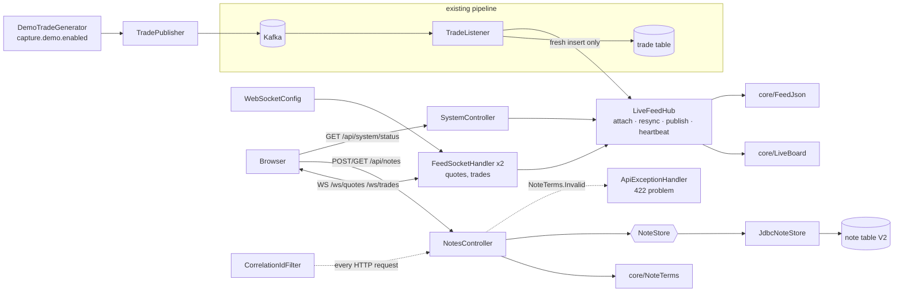

<a id="f-src-main-java-com-example-capture-spring-livefeedhub-java"></a>

#### 9.11 `spring/LiveFeedHub.java` 🆕 — fan-out between the pipeline and the browsers

| Member | Behaviour |
|---|---|
| `enum Channel {QUOTES, TRADES}` | the two independent feeds. |
| fields | a `LiveBoard(500)`, a `Clock`, and `EnumMap<Channel, LinkedHashMap<sessionId, WebSocketSession>>`. A package-private constructor takes a board and clock for tests. |
| `attach(channel, session)` | **`synchronized`**: send the snapshot, *then* register the session. |
| `resync(channel, session)` | `synchronized`: send a fresh snapshot to one session (answers `{"type":"resync"}`). |
| `detach(channel, id)` | remove a session. |
| `publish(trade)` | `synchronized`: `board.onTrade(trade, clock.millis())`, then broadcast `quoteDelta` and `tradeDelta`. |
| `@Scheduled(fixedRate=1000) heartbeat()` | broadcast each channel's current sequence → clients detect a lost delta within ~1 s. |
| `broadcast(channel, json)` | iterate sessions with `removeIf`; any `IOException`/`RuntimeException` ⇒ log a WARN, close the session quietly, **drop it** (a slow consumer must never stall the pipeline). |
| `sessionCount`, `quoteSeq`, `tradeSeq` | for `/api/system/status`. |

**The atomicity argument:** `attach` and `publish` share the monitor. So either the new delta is broadcast *before* the attach (and is already inside the snapshot), or *after* (and the session receives it as the first delta). No third possibility ⇒ **no missed or double-applied delta at attach time**.

🧒 *Feynman:* a **radio station**: new listeners are handed the day's programme so far and are tuned in *in the same instant*, so they never miss a song or hear one twice; once a second a pip says “we are on song #N”, so a listener whose signal dropped knows to ask for a replay.

⚠️ Global `synchronized` means one slow `sendMessage` delays everyone — mitigated by the decorator's 2 s send limit ([§9.12](#f-src-main-java-com-example-capture-spring-feedsockethandler-java)). The hub is **per pod**.

---

<a id="f-src-main-java-com-example-capture-spring-feedsockethandler-java"></a>

#### 9.12 `spring/FeedSocketHandler.java` 🆕 — one WebSocket endpoint

| Hook | Behaviour |
|---|---|
| ctor `(hub, channel)` | one instance per channel. |
| `afterConnectionEstablished(raw)` | wraps the session in `ConcurrentWebSocketSessionDecorator(raw, 2000 ms, 512 KB)` — it **serialises concurrent sends** and *closes* a consumer whose send buffer exceeds 512 KB or takes > 2 s. The decorated session is stored in `raw.getAttributes().put("decorated", …)` and passed to `hub.attach`. |
| `handleTextMessage` | the only accepted client message: payload containing `"resync"` ⇒ `hub.resync(channel, decorated ?? raw)`. Everything else is ignored. |
| `afterConnectionClosed`, `handleTransportError` | `hub.detach`. |

🧒 *Feynman:* a **bouncer** who gives each guest a private phone line with a timer, so a guest who never picks up gets hung up on instead of blocking the switchboard.

---

<a id="f-src-main-java-com-example-capture-spring-websocketconfig-java"></a>

#### 9.13 `spring/WebSocketConfig.java` 🆕

`@Configuration @EnableWebSocket` implementing `WebSocketConfigurer`: registers `new FeedSocketHandler(hub, QUOTES)` at **`/ws/quotes`** and `…TRADES` at **`/ws/trades`**. **No `setAllowedOrigins("*")`**: Spring's default is *same-origin only*, which is correct because the `web` container's nginx proxies `/ws/` to the service ([§D.1](#f-web-nginx-conf)), so the browser's `Origin` equals the page host.

---

<a id="f-src-main-java-com-example-capture-spring-notestore-java"></a>

#### 9.14 `spring/NoteStore.java` 🆕 — the notes **port**

Interface: `record Booked(id, terms, bookedAt)`; `book(NoteTerms)`, `find(String)` → `Optional`, `recent(int)` → newest first. The controller depends on this interface only (hexagonal, like `TradeStore`).

<a id="f-src-main-java-com-example-capture-spring-jdbcnotestore-java"></a>

#### 9.15 `spring/JdbcNoteStore.java` 🆕 — the PostgreSQL **adapter** for notes

| Method | SQL |
|---|---|
| `@Transactional book(t)` | `SELECT nextval('note_no')` ⇒ id `"N-" + n`; then `INSERT INTO note (...) VALUES (...) RETURNING booked_at` (one round-trip returns the DB timestamp). Values are the integer cents/bps. |
| `find(id)` | `SELECT … FROM note WHERE id = ?`. |
| `recent(limit)` | `… ORDER BY booked_at DESC, id DESC LIMIT ?`. |

All SQL is parameterised (`?`): **no string-concatenated user input**. A `RowMapper` rebuilds `NoteTerms` from the integer columns.

⚠️ The secondary sort `id DESC` is **lexicographic** (`'N-999' > 'N-1000'`); harmless because `booked_at` differs in practice. 🔧 sort by a numeric sequence column.

---

<a id="f-src-main-java-com-example-capture-spring-notescontroller-java"></a>

#### 9.16 `spring/NotesController.java` 🆕 — REST for notes

| Endpoint | Behaviour |
|---|---|
| `POST /api/notes` body `TermsDto` | `NoteTerms.parse(...)` (throws `Invalid` → 422), `store.book`, **201 Created** with `Location: /api/notes/{id}/terms` and body `{"id":"N-1001"}`. |
| `GET /api/notes?limit=` | `limit` clamped to 1..200; `NoteDto{id, bookedAt, terms}` newest first. |
| `GET /api/notes/{id}/terms` | 200 `TermsDto` or 404. |

`TermsDto` fields are `BigDecimal` (Jackson reads JSON numbers into exact decimals — never `double`).

---

<a id="f-src-main-java-com-example-capture-spring-apiexceptionhandler-java"></a>

#### 9.17 `spring/ApiExceptionHandler.java` 🆕 — RFC 9457 problems

`@RestControllerAdvice`: `NoteTerms.Invalid` ⇒ `ProblemDetail` **422** “Validation failed” with property `errors: [{field,message}]` (this is what [`toBookingFailure`](#f-web-src-app-api-notes-api-ts) maps onto form fields); `HttpMessageNotReadableException` ⇒ **400** “Malformed request body”.

<a id="f-src-main-java-com-example-capture-spring-correlationidfilter-java"></a>

#### 9.18 `spring/CorrelationIdFilter.java` 🆕

`OncePerRequestFilter` at `HIGHEST_PRECEDENCE`: take `X-Correlation-Id` if it matches `[A-Za-z0-9._-]{1,64}` (else generate `srv-<uuid>`), `MDC.put("correlationId", id)`, echo it on the response, and `MDC.remove` in `finally`. The sanity check prevents **log injection** via a hostile header.

<a id="f-src-main-java-com-example-capture-spring-systemcontroller-java"></a>

#### 9.19 `spring/SystemController.java` 🆕

`GET /api/system/status` ⇒ `Status{service, serverTime, quoteSeq, tradeSeq, quoteClients, tradeClients, inserted, duplicates, demo}`: sequences and socket counts from the hub, the counters from Micrometer (`capture.consume{outcome=inserted|duplicate}`), `demo` from `capture.demo.enabled`, `service` from `spring.application.name`. Feeds the terminal's status bar and the `DEMO/LIVE` badge.

---

<a id="f-src-main-java-com-example-capture-spring-demotradegenerator-java"></a>

#### 9.20 `spring/DemoTradeGenerator.java` 🆕 — a living terminal on a fresh checkout

`@Component @ConditionalOnProperty("capture.demo.enabled"="true")` — absent in production unless switched on. Every `capture.demo.interval-millis` (default **250 ms**, `@Scheduled(fixedDelayString)`) it publishes one random fill **through `TradePublisher` → Kafka → `TradeListener` → PostgreSQL → hub**, so the demo exercises the *real* pipeline.

| Detail | Value |
|---|---|
| Universe | 24 instruments with mid prices in **micros** (`AAPL 187_250_000` …). |
| Account | random of `ACC7, ACC9, DESK-A, DESK-B`. |
| Quantity | `100 × [1,49]`. |
| Price | $\text{mid}+\lfloor \text{mid}\cdot d/10\,000\rfloor$ with $d\in[-20,20]$ bps — **integer arithmetic only** (AGENTS rule 2; a first draft used `double` and was corrected). |
| Id | `DEMO-<run>-<seq>` with `run` = base-36 start time: unique across restarts, so reruns do not collide in the DB. |

🧒 *Feynman:* a **stage actor** that plays brokers when the real ones are asleep — but he walks through the same door as everyone else, so the rehearsal is a true test.

---

[⬆️ Back to TOC](#toc)

---

<a id="dbconfig"></a>

## §10 Database & Configuration Files

<a id="f-src-main-resources-application-yml"></a>

### 10.1 `src/main/resources/application.yml` — every runtime knob

Rule: *every value that differs per environment is an `${ENV:default}` placeholder* ⇒ **one image, many environments** (12-factor).

| Key | Value | Why |
|---|---|---|
| `spring.application.name` | `trade-capture` | Metric tag `application`. |
| `spring.lifecycle.timeout-per-shutdown-phase` | `30s` | Finish in-flight records on SIGTERM. |
| `spring.datasource.url/username/password` | `${DB_URL:jdbc:postgresql://localhost:5432/capture}` · `${DB_USER:capture}` · `${DB_PASSWORD:}` | Password injected from a Secret; **never committed** (Hard rule 1). |
| `hikari.maximum-pool-size` | `10` | ≥ listener concurrency (3) + relay + health; small on purpose. |
| `spring.kafka.bootstrap-servers` | `${KAFKA_BOOTSTRAP:localhost:9092}` | Broker list. |
| `properties.security.protocol` / `sasl.mechanism` / `sasl.jaas.config` | `${KAFKA_SECURITY_PROTOCOL:PLAINTEXT}` etc. | Cloud overlays switch to `SASL_SSL` + `AWS_MSK_IAM`. |
| **producer** `acks: all` | wait for all in-sync replicas | durability |
| `key-serializer` String · `value-serializer` `JsonSerializer` | | |
| `compression-type: lz4` | fast compression | |
| `enable.idempotence: true` | broker de-dups producer retries | no dup from retries |
| `max.in.flight.requests.per.connection: 5` | still ordered when idempotent (≤ 5) | throughput |
| `linger.ms: 5` · `delivery.timeout.ms: 30000` | 5 ms batching window · 30 s overall send budget | |
| **consumer** `group-id: trade-capture` · `enable-auto-commit: false` | manual commit after DB commit | at-least-once |
| `auto-offset-reset: earliest` | new group reads from the start | replay safety |
| `isolation-level: read_committed` | skip aborted transactional records | pairs with transactions |
| `value-deserializer: ErrorHandlingDeserializer` + delegate `JsonDeserializer` | a bad payload becomes a `DeserializationException` instead of an endless loop | poison-pill protection |
| `spring.json.value.default.type` / `trusted.packages` | `…core.TradeEvent` / `…core` | **security:** only deserialise your own package |
| `max-poll-records: 200` · `max.poll.interval.ms: 300000` | batch per poll · 5 min to process it | |
| `partition.assignment.strategy: CooperativeStickyAssignor` | incremental rebalances | |
| `group.instance.id: ${HOSTNAME:local}` | **static membership**: restarts within `session.timeout` don't rebalance | ⚠️ pod names change on every Deployment rollout, so it only helps in-place container restarts. |
| `capture.*` | topic `trades.normalized`, DLT suffix `.DLT`, retries 5 @ 200 ms ×2 cap 5000, lag warn 1000 / critical 10000 | bound to `CaptureProperties` |
| `server.port: 8080`, `shutdown: graceful` | stop accepting new requests, finish current ones | |
| `management.endpoints.web.exposure.include` | `health,info,prometheus` | scrape + probes |
| `health.probes.enabled: true` | `/actuator/health/liveness` and `/readiness` | K8s probes |
| `management.metrics.tags.application` | `${spring.application.name}` | label on every metric |
| 🆕 `capture.demo.enabled` | `${CAPTURE_DEMO:false}` | switches [`DemoTradeGenerator`](#f-src-main-java-com-example-capture-spring-demotradegenerator-java) on (the compose file sets it to `true`; the Kubernetes base leaves it off). |
| 🆕 `capture.demo.interval-millis` | `${CAPTURE_DEMO_INTERVAL_MS:250}` | one synthetic fill every 250 ms ⇒ ≈ 4 trades/s. |

🧒 *Feynman:* The **control panel** of the machine: switches have factory defaults, but the installer (Kubernetes) can flip any of them without opening the machine.

---

<a id="f-src-main-resources-db-migration-v1-capture-sql"></a>

### 10.2 `src/main/resources/db/migration/V1__capture.sql` — the schema (Flyway)

**Flyway** runs files named `V<version>__<description>.sql` once, in order, at start-up and records checksums in `flyway_schema_history`. *Never edit an applied migration — add `V2__…`.*

**`trade`** — one row per captured execution

| Column | Type | Constraint / note |
|---|---|---|
| `source` | text | part of **PK** |
| `trade_id` | text | part of **PK** ⇒ **idempotency key** |
| `account`, `symbol` | text | |
| `side` | text | `CHECK (side IN ('BUY','SELL'))` |
| `quantity` | bigint | `CHECK (quantity > 0)` |
| `price_micros` | bigint | `CHECK (price_micros > 0)` |
| `source_seq` | bigint | gap detection |
| `executed_at` | timestamptz | event time |
| `captured_at` | timestamptz | `DEFAULT now()` — arrival time |

Index `trade_account_symbol_time (account, symbol, executed_at)` serves "fills for account X in symbol Y in time order" (positions/P&L queries).

**`outbox`** — `id bigserial PK`, `account`, `symbol`, `payload_json text`, `created_at`, `published_at` (NULL = not yet sent). **Partial index** `outbox_pending (id) WHERE published_at IS NULL` stays tiny because published rows leave the index.

```text
 trade                                         outbox
┌───────────────┬──────────────┐             ┌────────────┬─────────────────┐
│ source  (PK)  │ text         │             │ id (PK)    │ bigserial       │
│ trade_id (PK) │ text         │             │ account    │ text            │
│ account       │ text         │             │ symbol     │ text            │
│ symbol        │ text         │             │ payload_json│ text           │
│ side          │ BUY|SELL     │             │ created_at │ timestamptz     │
│ quantity      │ bigint >0    │             │ published_at│ NULL = pending │
│ price_micros  │ bigint >0    │             └────────────┴─────────────────┘
│ source_seq    │ bigint       │             partial idx: (id) WHERE published_at IS NULL
│ executed_at   │ timestamptz  │
│ captured_at   │ default now()│
└───────────────┴──────────────┘  idx (account,symbol,executed_at)
```

🧒 *Feynman:* The **guest book** (`trade`) refuses to print the same sender+ticket twice; the **to-be-posted tray** (`outbox`) remembers what hasn't been mailed yet.
🔧 Use `jsonb` for `payload_json`, add a retention job for published outbox rows, consider partitioning `trade` by `executed_at` when it grows large.

---

<a id="f-src-main-resources-db-migration-v2-notes-sql"></a>

### 10.2b `src/main/resources/db/migration/V2__notes.sql` 🆕 — booked notes (Flyway)

Flyway rule honoured: **V1 is untouched; the new table arrives as V2** (an applied migration must never be edited).

| Object | Definition | Why |
|---|---|---|
| `CREATE SEQUENCE note_no START 1001` | monotonic ids | `N-1001`, `N-1002`, … (`JdbcNoteStore` prefixes `N-`). Gaps are possible after rollbacks; that is normal for sequences. |
| `note.id` | `text PRIMARY KEY` | `'N-1001'` |
| `underlying` | `text NOT NULL` | |
| `notional_cents` | `bigint NOT NULL CHECK (> 0)` | money as integer cents |
| `coupon_rate_bps` | `integer CHECK BETWEEN 0 AND 10000` | 0.02 ⇒ 200 |
| `coupon_barrier_bps` | `integer CHECK (> 0)` | 70 % ⇒ 7000 |
| `autocall_barrier_bps` | `integer CHECK (<= 20000)` | ≤ 200 % |
| `ki_barrier_bps` | `integer CHECK (> 0)` | |
| `booked_at` | `timestamptz NOT NULL DEFAULT now()` | |
| `CONSTRAINT note_barrier_order` | `CHECK (ki < coupon AND coupon <= autocall)` | the term-sheet rule enforced a **third** time — browser, `NoteTerms`, database: *defence in depth*. |
| `INDEX note_booked_at (booked_at DESC)` | serves `ORDER BY booked_at DESC LIMIT n` | |

```text
 note
┌──────────────────────┬─────────────┐   CHECK note_barrier_order:
│ id (PK)              │ text N-1001 │   ki_barrier_bps < coupon_barrier_bps
│ underlying           │ text        │   AND coupon_barrier_bps <= autocall_barrier_bps
│ notional_cents       │ bigint > 0  │
│ coupon_rate_bps      │ 0..10000    │   seq note_no (start 1001) ──► id
│ coupon_barrier_bps   │ int > 0     │   idx note_booked_at (booked_at DESC)
│ autocall_barrier_bps │ int ≤ 20000 │
│ ki_barrier_bps       │ int > 0     │
│ booked_at            │ timestamptz │
└──────────────────────┴─────────────┘
```

🧒 *Feynman:* the **registry of signed contracts**; even if a clerk (server) and the customer (browser) both made a mistake, the registry's own rubber stamp refuses an impossible contract.

---

<a id="f-pom-xml"></a>

### 10.3 `pom.xml` — the Maven build

| Element | Explanation |
|---|---|
| `<parent> spring-boot-starter-parent 3.5.0` | Imports dependency-version BOM, plugin config, Java release handling. Boot 3 **requires Java 17+**. |
| `<groupId>/<artifactId>/<version>` | `com.example:trade-capture:2.0.0` (was 1.0.0). |
| `java.version=17`, `testcontainers.version=1.20.4` | Compiler release and shared test-lib version. |
| `spring-boot-starter-web` | Embedded Tomcat + Jackson (needed by `JsonSerializer`) + the HTTP server for Actuator. |
| 🆕 `spring-boot-starter-websocket` | Spring's WebSocket support (`@EnableWebSocket`, `TextWebSocketHandler`, `ConcurrentWebSocketSessionDecorator`) for `/ws/quotes` and `/ws/trades`. |
| `spring-boot-starter-actuator` | `/actuator/*` endpoints + health groups. |
| `spring-boot-starter-jdbc` | `JdbcTemplate`, HikariCP pool. |
| `spring-kafka` | `KafkaTemplate`, `@KafkaListener`, error handlers. |
| `micrometer-registry-prometheus` | `/actuator/prometheus`. |
| `postgresql` (runtime) | JDBC driver. |
| `flyway-database-postgresql` | Flyway Postgres support (pulls `flyway-core`) ⇒ auto-migrate at start. |
| `aws-msk-iam-auth 2.2.0` | `IAMLoginModule` for MSK IAM (matches `KAFKA_SASL_JAAS` in the AWS overlay). |
| test: `spring-boot-starter-test`, `spring-kafka-test`, Testcontainers `kafka`+`postgresql`+`junit-jupiter`, `awaitility` | JUnit 5 + AssertJ, embedded-Kafka helpers, real containers, polling asserts. |
| `build.finalName=trade-capture` | Produces `target/trade-capture.jar` (the name the Dockerfile uses). |
| `spring-boot-maven-plugin` + `<layers enabled>` | Repackages into an executable "fat" jar with a **layer index** for Docker caching. |

⚠️ `AGENTS.md` rule 3 says `mvn spotless:check`, but **no Spotless plugin is configured here** ⇒ the command fails with "No plugin found for prefix 'spotless'". ⚠️ Only AWS authentication is on the classpath; Azure Event Hubs / GCP Managed Kafka need OAUTHBEARER libraries/handlers. 🔧 Add `spotless-maven-plugin` (google-java-format), `maven-failsafe-plugin` for `*IT`, JaCoCo, and a `dependencyCheck`/OWASP step.

[⬆️ Back to TOC](#toc)

---


<a id="part-c"></a>

# 🧪 PART C — Tests, Quality Gates & Developer Tooling

<a id="tests"></a>

## §11 The Test Suites

### 11.0 The pyramid in this repo (v2)

```text
                 ▲  E2E (13)   Playwright ► real Chromium ► production build ► mock backend (WS + REST + control surface)
                ╱ ╲  Shots (8 screenshots, same harness)
               ╱───╲  Integration (9 web + 1 Java)
              ╱     ╲  web: the whole <App> + fake feeds + fake chart + HttpTestingController
             ╱───────╲ java: real Kafka + real Postgres via Testcontainers
            ╱         ╲
           ╱ Unit (121) ╲  web: 16 spec files over core/ state/ feed/ api/  (reducers, money, positions, ticket,
          ╱  + 28 Java   ╲          hotkeys, layout, fuzzy, ohlc, RxJS marbles, stores)
         ╱─────────────────╲  java core: DedupStore 4 · FeedJson 7 · LiveBoard 8 · NoteTerms 9
```

| Layer | Command | Files | Tests | Protects |
|---|---|---|---:|---|
| Unit (web) | `npm run test:unit` | 15 specs under `core/ state/ feed/ api/` | **121** | pure logic and stores |
| Integration (web) | `npm run test:integration` | `app.int.spec.ts` | **9** | components + stores + HTTP + hotkeys wired together |
| All web in the Angular runner | `npm test` | 16 spec files | **130** | Vitest 4 + jsdom |
| E2E (web) | `CHROMIUM_PATH=… npm run e2e` | `terminal.e2e.spec.ts` | **13** | a real browser vs. a scripted server |
| Screenshots | `CHROMIUM_PATH=… npm run shots` | `screens.shots.spec.ts` | 8 images | the pictures in [§5](#ux) |
| Java unit | compiled with `javac` and a tiny JUnit shim in this sandbox | 4 files in `src/test/java/.../core` | **28** | `core/` classes |
| Java integration | `mvn verify` | `CaptureIntegrationTest.java` | 1 | Kafka → idempotent insert |

✅ **Executed while producing v2:** `ng test` ⇒ 130 passed; `ng build` ⇒ production bundle; Playwright ⇒ 13 passed against the built app; the 28 Java core tests passed through a small JUnit-API shim (**not** through Maven); the Spring layer was only **stub-compiled** (sources checked against hand-written Spring/Kafka stubs), never built with Maven. `mvn verify`, `spotless:check`, Docker and compose were **not run** (no Maven Central / Docker here).

---

<a id="f-src-test-java-com-example-capture-spring-captureintegrationtest-java"></a>

### 11.1 `src/test/java/com/example/capture/spring/CaptureIntegrationTest.java` *(unchanged)*

🎯 Prove the property that matters most: **publishing the same trade twice leaves exactly one row.**

| Piece | Explanation |
|---|---|
| `@SpringBootTest` | Boots the entire application context (listener, Flyway — now including **V2**, hub, controllers). |
| `@Testcontainers` + `KafkaContainer(cp-kafka:7.6.1)` + `PostgreSQLContainer("postgres:16")` | Real broker and database in throw-away containers. |
| `@DynamicPropertySource wire(...)` | Points Spring at the containers' random ports before start-up. |
| `duplicatePublishProducesOneRow()` | Publishes `EX-1` twice, `await().atMost(20s)` until exactly one `trade` row exists. |

v2 impact: the test is **source-compatible** with the new `TradeListener` constructor (Spring injects `LiveFeedHub`), and it now also boots `WebSocketConfig`, `NotesController`, etc. — a free smoke test that the new beans wire.
⚠️ Still missing: DLT path, outbox relay, lag indicator, a *store-fails-once* test for F-1, a WebSocket client test, and a `POST /api/notes` test against the real database. 🔧 Add `@ServiceConnection` containers, assert `capture.consume{outcome=duplicate}`, and add a `WebSocketStompClient`/`StandardWebSocketClient` test of snapshot-then-delta.

---

<a id="java-unit"></a>

### 11.1b–e The four Java unit-test classes (new, framework-free)

> They need only JUnit + AssertJ-style assertions, no Spring, no Docker — which is the payoff of the hexagonal split.

<a id="f-src-test-java-com-example-capture-core-dedupstoretest-java"></a>

#### 11.1b `core/DedupStoreTest.java` — 4 tests

| Test | Pins |
|---|---|
| `firstTimeIsTrueOnceThenFalse` | original contract kept. |
| `containsDoesNotRecord` | `contains` is a pure read. |
| `keyRememberedOnlyAfterTheWorkSucceeded` | the **F-1 protocol**: `contains → (work throws) → still not remembered`; `remember` after success. |
| `evictsTheOldestBeyondCapacity` | FIFO bound. |

<a id="f-src-test-java-com-example-capture-core-feedjsontest-java"></a>

#### 11.1c `core/FeedJsonTest.java` — 7 tests

`heartbeatShape`, `quoteDeltaShape`, `tradeDeltaShape`, `snapshotsListTheirRows` (exact strings the TypeScript types expect), `stringsAreEscaped`, `smallPricesNeverUseExponentNotation` (`1 micro ⇒ 0.000001`), `roundPricesDropTrailingZerosButStayExact` (`187_500_000 ⇒ 187.5`).

<a id="f-src-test-java-com-example-capture-core-liveboardtest-java"></a>

#### 11.1d `core/LiveBoardTest.java` — 8 tests

`emptyBoardHasSequenceZeroAndNoRows`, `eachTradeAdvancesBothSequencesByExactlyOne`, `quoteCarriesLastPriceAndCumulativeVolume` (asserts `pxMicros()==187_500_000L`), `tradeKeepsIntegerMicrosAndSourceQualifiedId`, `quoteSnapshotIsSortedBySymbol`, `tapeIsNewestFirstAndBounded`, `snapshotIsACopyNotAView`, `rejectsNonPositiveCapacity`.

<a id="f-src-test-java-com-example-capture-core-notetermstest-java"></a>

#### 11.1e `core/NoteTermsTest.java` — 9 tests

`validTermsAreStoredInFixedPoint` (70 ⇒ 7000 bps, 1 000 000.00 ⇒ 100 000 000 cents), `roundTripsBackToDecimals`, `kiMustBeBelowCoupon`, `couponMayEqualAutocallButNotExceedIt`, `collectsEveryErrorNotJustTheFirst`, `rejectsTooManyDecimals`, `enforcesTheNotionalCeiling`, `nullsAreErrorsNotExceptions`, `underlyingAcceptsClassSharesAndIndexes` (`BRK.B` passes the regex).

🧒 *Feynman:* four small **exam papers**, each marking one pure class with no school building needed.

---

<a id="web-unit"></a>

### 11.2 The web unit specs (Vitest 4 + jsdom)

> Test names below are the real `it(...)` titles. **Rule of thumb used throughout:** pure functions get *example + property-style* tests (batch ≡ one-by-one, never mutates input, idempotent); stores get *signal* tests with a fake feed and a fake clock.

<a id="f-web-src-app-core-feed-reducer-spec-ts"></a>

#### 11.2.1 `core/feed.reducer.spec.ts` — 18 tests

`gate` · quote reducer (snapshot+deltas; duplicates ⇒ **same reference**; gap flagged and the out-of-order delta refused; deltas ignored while waiting; snapshot clears resync; heartbeat ahead ⇒ lost delta; previous price tracking; fallback clock; tick cap; **batch ≡ one-by-one**; **never mutates the previous book**) · trade reducer (newest first + positions; batch order; duplicates; **a gap mid-batch keeps what was applied before it**; bounded tape; heartbeat).

<a id="f-web-src-app-core-money-spec-ts"></a>

#### 11.2.2 `core/money.spec.ts` — 11 tests

`toMicros`; `fmtMicros` exact rounding (half away from zero, grouping); **no negative zero**; plain-number input; `fmtSigned`; `fmtQty`; exact notional and VWAP; **VWAP rounds half up**; `compact`; UTC clock text; scale and chart-only conversion.

<a id="f-web-src-app-core-positions-spec-ts"></a>

#### 11.2.3 `core/positions.spec.ts` — 9 tests

Open/add to a long · realise on reduce · short bought back lower · closes completely (cost resets to 0) · **flip through zero** · unrealised vs a mark · **total P&L independent of fill grouping** · `bookFromTape` ≡ incremental folding · per-account-and-symbol keys.

<a id="f-web-src-app-core-ticket-spec-ts"></a>

#### 11.2.4 `core/ticket.spec.ts` — 20 tests (checks + stepping + machine)

*Pre-trade checks:* clean terms; `decimals()` without float noise; bad underlying; non-positive/over-limit/too-many-decimals notional; large-ticket confirmation; coupon range; **KI < coupon ≤ autocall exactly like the server**; barriers outside (0, 200]; deep KI warning; errors listed first. *`stepNotional`:* 100K/1M/10M grid; clamps at 0 and 1e9. *Machine:* straight submit; blocked submit changes nothing; warnings need a second submit; edit/cancel from confirming; **ignores edits and re-submits while in flight (no double booking)**; booked/rejected only from submitting; edit leaves booked/rejected; new ticket after booking.

<a id="f-web-src-app-core-hotkeys-spec-ts"></a>

#### 11.2.5 `core/hotkeys.spec.ts` — 7 tests

Ctrl/⌘K works while typing and inside a modal · Ctrl/⌘Enter · Alt+T · Escape always · bare keys only when idle · unknown/stray-modifier keys · **help table documents every shortcut**.

<a id="f-web-src-app-core-layout-spec-ts"></a>

#### 11.2.6 `core/layout.spec.ts` — 6 tests

Missing/corrupt storage ⇒ default · round-trip · **each bad field repaired independently** · any permutation of panels accepted · sizes normalised to 100 and junk rejected · swap + nonsense ignored.

<a id="f-web-src-app-core-fuzzy-spec-ts"></a>

#### 11.2.7 `core/fuzzy.spec.ts` — 4 tests

Case-insensitive subsequence · empty query matches all · consecutive runs and word starts rank higher · order matters.

<a id="f-web-src-app-core-ohlc-spec-ts"></a>

#### 11.2.8 `core/ohlc.spec.ts` — 4 tests

OHLC per bucket · bucket widths with empty gaps · stale ticks dropped, times unique ascending · empty input.

<a id="f-web-src-app-core-rx-utils-spec-ts"></a>

#### 11.2.9 `core/rx-utils.spec.ts` — 7 tests (RxJS **marble** tests with `TestScheduler`, plus Vitest fake timers for the retry delays)

`conflateBySymbol` last-write-wins · `frameBatch` groups per frame and loses nothing · zero frame passthrough · back-off with cap and jitter · `retryWithBackoff` · **`resilient` resubscribes after a *clean* completion (F-11)** · `resilient` also retries errors.

<a id="f-web-src-app-feed-ws-feed-client-spec-ts"></a>

#### 11.2.10 `feed/ws-feed.client.spec.ts` — 5 tests

`wsUrl` scheme swap · JSON parsing with a resolved URL · **one socket shared among subscribers** · `requestSnapshot` sends the resync frame · **reconnects after a clean close (F-11)**. Replaces the global `WebSocket` with a `FakeSocket` (`vi.stubGlobal`) and uses fake timers for the reconnect delay.

<a id="f-web-src-app-state-quotes-store-spec-ts"></a>

#### 11.2.11 `state/quotes.store.spec.ts` — 8 tests

connecting → live on first snapshot · derived rows (change since open) · **exactly one snapshot request per gap** · stale after silence and recovery · messages per second · `symbols` keeps its array reference while the set is unchanged · filter and sorting stored · tick history exposed.

<a id="f-web-src-app-state-trades-store-spec-ts"></a>

#### 11.2.12 `state/trades.store.spec.ts` — 4 tests

tape + positions from snapshot then deltas · side/symbol filter without touching the book · exact tape statistics · one snapshot request per gap and recovery.

<a id="f-web-src-app-state-workspace-store-spec-ts"></a>

#### 11.2.13 `state/workspace.store.spec.ts` — 11 tests

default layout · restore · **persists layout, not transient UI** · writes theme/density on `<html>` · toggles · `stepSym` wraps · size validation · maximise · palette/help mutually exclusive · reset keeps theme/density · **survives blocked `localStorage`**.

<a id="f-web-src-app-state-toast-store-spec-ts"></a>

#### 11.2.14 `state/toast.store.spec.ts` — 2 tests (fake timers)

auto-dismiss after 4 s (success) / 8 s (error) · at most four, dismiss by id.

<a id="f-web-src-app-api-notes-api-spec-ts"></a>

#### 11.2.15 `api/notes.api.spec.ts` — 5 tests (`HttpTestingController`)

`ui-` correlation id on every call · URL-encoded note id · POST body and `limit` param · **422 ⇒ per-field errors** · network (`status 0`) and 5xx mapping.

---

<a id="f-web-src-app-app-int-spec-ts"></a>

### 11.3 `web/src/app/app.int.spec.ts` — 9 integration tests

🎯 Mount the **real `<App>`** with `FakeFeed`s, a recording fake chart, an in-memory `LAYOUT_STORAGE`, `FLUSH_MS=1`, a TanStack `QueryClient` with `retry:false` and `HttpTestingController`.

| Test | What it proves |
|---|---|
| renders the shell and its panels | all six panels + top/status bar exist |
| shows quote and trade snapshots | feed → store → grid/tape |
| requests exactly one snapshot after a sequence gap | the end-to-end resync rule |
| opens the command palette with Ctrl+K and closes it with Escape | hotkeys + modal |
| opens shortcut help with `?` | |
| toggles the theme | `data-theme` flips on `<html>` |
| blocks booking when the form is invalid | pre-trade gate |
| books a valid note once, shows the id, and refuses a double submit | state machine + exactly one POST |
| shows the server rejection | 422 ⇒ field messages |

Helper `settle()` = sleep + `fixture.detectChanges()` twice. *History:* an earlier `whenStable()` hung because the pending POST keeps the app unstable, which is why the helper polls instead.

---

<a id="f-web-src-app-testing-fakes-ts"></a>

### 11.3b `web/src/app/testing/fakes.ts` — shared test doubles

`FakeFeed<M>` (a `Subject` + `push(...msgs)` + `snapshotRequests` counter), and builders `quote`, `qSnap`, `qDelta`, `trade` (deterministic ids `T/<seq>`, `ts = 1.7e12 + seq·1000`), `tSnap`, `tDelta`. Excluded from the production build by `tsconfig.app.json` (`src/app/testing/**`).

---

<a id="e2e-web"></a>

### 11.4 End-to-end and screenshots (Playwright)

<a id="f-web-e2e-helpers-ts"></a>

#### 11.4.1 `web/e2e/helpers.ts`

`reset(request, symbols)` (mock back to a quiet known state, live off, heartbeats on) · `stats(request)` (typed `/__control/stats`) · `openApp(page, theme)` (seeds `localStorage` **once per session** via `addInitScript` so reloads keep the user's choice, then waits for the first `quote-row`) · `symbolsInGrid(page)`.

<a id="f-web-e2e-terminal-e2e-spec-ts"></a>

#### 11.4.2 `web/e2e/terminal.e2e.spec.ts` — 13 browser tests

| # | Test | Story |
|---|---|---|
| 1 | renders every panel with live data | smoke |
| 2 | a pushed trade moves the tape and the quote board | `/__control/trade` ⇒ tape top row and `188.50` |
| 3 | a sequence gap triggers exactly one resync, then recovers | `/__control/gap` + resync counter |
| 4 | reconnects after the server drops **and** after a clean close (F-11) | `/__control/drop`, `/close` |
| 5 | goes stale without heartbeats and recovers | `/__control/heartbeats {on:false}` |
| 6 | command palette filters and jumps to a symbol | Ctrl+K, type, Enter |
| 7 | theme toggle persists across reload | `localStorage` |
| 8 | maximise a panel and restore with Escape | |
| 9 | ticket: invalid blocks, valid books once with a correlation id | empty underlying ⇒ Book disabled; valid ⇒ exactly **one** booking whose `X-Correlation-Id` starts `ui-`; the note row appears (≤ 20 s refetch) |
| 10 | ticket: server rejects an inconsistent barrier ladder | 422 path (mock `validate`) |
| 11 | ticket: size hotkeys step the notional | plain 100K / Shift / Alt grid (⇒ 2,000,000 / 10,000,000 in the test) |
| 12 | drag a panel header onto another swaps them and the layout persists | CDK drag in a real browser |
| 13 | 5,000 symbols stay virtualised | counter shows the big number; rendered rows between 6 and 199 |

Locator lessons baked in: `getByRole('spinbutton', {name:'Notional'})` (a plain `getByLabel('Notional')` also matches the ± buttons), and the drag test targets `[data-ws-panel="quotes"] header` (a bare `header` also matches the top bar).

<a id="f-web-e2e-screens-shots-spec-ts"></a>

#### 11.4.3 `web/e2e/screens.shots.spec.ts` — the documentation photographer

Resets the mock to 28 symbols with the live generator, then saves **8 PNGs** to `../docs/screenshots`: `workspace-dark`, `workspace-light` (8 s of ticks), `palette` (Ctrl+K, “nv”), `help` (`Shift+?`), `ticket-confirm` (NVDA, 30 M ⇒ confirm), `ticket-invalid` (KI 80), `chart-maximised`, and `workspace-5000` (5,000 symbols).

<a id="f-web-playwright-config-ts"></a>

#### 11.4.4 `web/playwright.config.ts`

`testDir ./e2e`, `testMatch **/*.e2e.spec.ts`, **1 worker, no retries** (the mock is shared mutable state), baseURL `http://127.0.0.1:4300`; `launchOptions.executablePath = $CHROMIUM_PATH` when set (this sandbox has Chromium preinstalled and cannot download one); `trace: 'retain-on-failure'`; `webServer` starts `node e2e/mock-backend.mjs` and waits for `/__control/stats`.

<a id="f-web-playwright-shots-config-ts"></a>

#### 11.4.5 `web/playwright.shots.config.ts`

Imports the base config and overrides `testMatch **/*.shots.spec.ts` and a **1680×960** viewport.

---

<a id="shots-gallery"></a>

### 11.5 The eight screenshots (binary, real Chromium captures)

Every image is a **real capture of the production build** served by the mock backend (not a mock-up). They are binary files, so each is explained by what it shows.

<a id="f-docs-screenshots-workspace-dark-png"></a>
**`docs/screenshots/workspace-dark.png`** — the default dark workspace at 1680×960: quote board (28 names, volume bars, sparklines), trade tape with imbalance bar, chart with candles, positions and P&L, the ticket (checks, ladder, KPI strip) and the empty notes panel; top bar `DEMO` badge, `QUOTES LIVE`/`TRADES LIVE`, UTC clock; status bar with seq, msg/s, rtt, skew, clients.


<a id="f-docs-screenshots-workspace-light-png"></a>
**`docs/screenshots/workspace-light.png`** — identical layout with the light tokens (proves the token system).

<a id="f-docs-screenshots-palette-png"></a>
**`docs/screenshots/palette.png`** — Ctrl+K with query `nv`: `Go to NVDA` first, then matching commands.

<a id="f-docs-screenshots-help-png"></a>
**`docs/screenshots/help.png`** — the keyboard-shortcuts modal.

<a id="f-docs-screenshots-ticket-confirm-png"></a>
**`docs/screenshots/ticket-confirm.png`** — a 30 M ticket after the first Ctrl+Enter: amber *CONFIRMING* chip, “Confirm & book” button, large-ticket warning.

<a id="f-docs-screenshots-ticket-invalid-png"></a>
**`docs/screenshots/ticket-invalid.png`** — KI barrier 80 above coupon 70: red check, red field, ladder with KI above CPN, *BLOCKED* chip, Book disabled.

<a id="f-docs-screenshots-chart-maximised-png"></a>
**`docs/screenshots/chart-maximised.png`** — the chart panel filling the workspace (M hotkey / button).

<a id="f-docs-screenshots-workspace-5000-png"></a>
**`docs/screenshots/workspace-5000.png`** — the quote board with a 5,000-symbol universe; the counter reads 5000 while the DOM holds ≈ 30 rows.

---

<a id="tooling"></a>

## §12 Governance, Build & Developer-Tooling Files

<a id="f-agents-md"></a>
<a id="f-agents-md-file"></a>

### 12.1 `AGENTS.md` *(unchanged — and obeyed: rule 2 forced the `QuoteView` price to micros)* — the repo's house rules (for people **and** AI coding agents)

| Rule | Meaning | Enforced where? |
|---|---|---|
| Stack line | Java 17, Boot 3.5, Spring Kafka, PG 16, OpenTofu, K8s (Kustomize) | documentation |
| 1. No credentials in any file | secrets come from Secret managers | "a hook enforces the first four; breaking one fails CI" (hook/CI not in zip) |
| 2. Money is `long` micros or `BigDecimal` | never `double`/`float` | matches `priceMicros` |
| 3. Google Java Style; `mvn spotless:check` | ⚠️ Spotless is **not** in `pom.xml` | |
| 4. Never edit `infra/**/versions.tf` backend/encryption blocks, nor anything under `prod/` | protects state backend & encryption | ⚠️ Azure `versions.tf` has a backend but **no `encryption` block** |
| 5. Consumers idempotent on `(source, trade_id)` | | `V1__capture.sql` PK |
| 6. Tests first; show failing then passing run | TDD | process |
| Workflow | plan → small commits → `mvn -q verify` → summarise what changed and what was **not** verified; ask on ambiguity | |
| Where things are | `core/` pure, `spring/` wiring, `infra/` per-cloud, `k8s/` manifests | |

🧒 *Feynman:* A **kitchen rulebook taped to the wall** — useful to a new cook and to a robot cook alike.

---

<a id="f-web-package-json"></a>

### 12.2 `web/package.json` *(changed)*

| Field | Value / meaning |
|---|---|
| `name` / `version` | **`trade-capture-terminal` `2.0.0`** (was `blotter`), `private:true` |
| `packageManager` | `npm@10.9.4` |
| scripts | `ng` · `start` (`ng serve`, :4200, **proxying to :8080** via `proxy.conf.json`) · `build` · `watch` · `test` (`ng test --watch=false`) · `test:unit` (`--include "src/app/{core,state,feed,api}/**/*.spec.ts"`) · `test:integration` (`*.int.spec.ts`) · `e2e` (`ng build && playwright test`) · **`mock`** (`node e2e/mock-backend.mjs`) · **`shots`** (`ng build && playwright test --config=playwright.shots.config.ts`) · `format` (Prettier) |

**Runtime dependencies (the “modern stack” checklist, mapped):**

| Package | Version range | Role |
|---|---|---|
| `@angular/{core,common,compiler,forms,platform-browser,router}` | `^21.2.0` | framework (router is installed but unused) |
| `@angular/cdk` | `^21.2.14` | **virtual scroll, drag-drop, a11y focus trap** — now actually used |
| `@spartan-ng/brain` | `^1.6.3` | unstyled accessible primitives: **resizable, command, toggle-group** |
| `@tanstack/angular-table` | `^8.21.4` | headless datagrid engine |
| `@tanstack/angular-query-experimental` | `^5.104.2` | server-state cache |
| `@ngrx/signals` | `^21.1.1` | `signalStore` |
| `lightweight-charts` | `^5.2.1` | candlestick/area charts |
| `class-variance-authority`, `clsx`, `tailwind-merge` | `^0.7.1`, `^2.1.1`, `^3.7.0` | the `cn` + `cva` styling helpers |
| `rxjs` | `~7.8.0` | streams |
| `tslib` | `^2.3.0` | TS helpers |

**Dev dependencies:** `@angular/{build,cli,compiler-cli}`, **`tailwindcss` + `@tailwindcss/postcss ^4.3.3`**, `postcss`, `@playwright/test ^1.64`, `vitest ^4.0.8`, `jsdom ^28`, `ws` + `@types/ws` (mock backend), `prettier ^3.8`, `typescript ~5.9.2`.

Locked versions: Angular core **21.2.25**, CDK **21.2.14**, NgRx Signals **21.1.1**, spartan brain **1.6.3**, TanStack Query **5.104.2**, TanStack Table **8.21.4**, Lightweight Charts **5.2.1**, Tailwind **4.3.3**, RxJS **7.8.2**, TypeScript **5.9.3**, Vitest **4.1.11**, Playwright **1.64.0**.

🧒 *Feynman:* the **shopping list**: which ingredients (libraries) the terminal is cooked from, and the little recipe cards (`npm run …`).

---

<a id="f-web-package-lock-json"></a>

### 12.3 `web/package-lock.json` *(regenerated)* — 9 952 lines

`lockfileVersion 3`, **662 packages** (**60** runtime, **602** dev-only), each with `version`, `resolved` tarball URL and SHA-512 `integrity`. `npm ci` installs *exactly* this and fails if it disagrees with `package.json` — reproducible builds and tamper detection. v1 had 583 packages (only 12 runtime); the stack in §12.2 added ≈ 48 runtime packages. **Never hand-edit; commit it.** The new `web/Dockerfile` relies on it (`npm ci`).

---

<a id="f-web-angular-json"></a>

### 12.4 `web/angular.json` *(two edits)*

| Key | Meaning |
|---|---|
| `projects.blotter` | project name kept (output path `dist/blotter/browser` is referenced by the mock, the Dockerfile and the e2e config) |
| `build.builder: @angular/build:application` | esbuild/Vite-based builder; entry `src/main.ts`; `tsConfig: tsconfig.app.json`; `assets: public/**`; `styles: src/styles.css` (which `@import`s Tailwind through PostCSS) |
| no `polyfills` | ⇒ **no zone.js** ⇒ zoneless |
| `production` budgets | **initial** bundle warn **1 MB** / error **1.5 MB** (*raised from 500 kB / 1 MB* because Lightweight Charts, TanStack and Tailwind output are in the main bundle: ≈ 880 kB raw today); component style warn 4 kB / error 8 kB; `outputHashing: all` |
| `development` | no optimisation, source maps |
| `serve.options.proxyConfig: proxy.conf.json` | 🆕 `ng serve` forwards `/api`, `/ws`, `/actuator` to the Spring service ([§12.5c](#f-web-proxy-conf-json)) |
| `test` | `@angular/build:unit-test` (Vitest) |

---

<a id="f-web-tsconfig-json"></a>
<a id="f-web-tsconfig-app-json"></a>
<a id="f-web-tsconfig-spec-json"></a>

### 12.5 `web/tsconfig.json`, `tsconfig.app.json`, `tsconfig.spec.json`

**`tsconfig.json`** *(unchanged)* — shared strict base; `files:[]` + `references` makes it a “solution” file.

| Option | Effect |
|---|---|
| `strict: true` | all strict checks |
| `noImplicitOverride` | must write `override` |
| `noPropertyAccessFromIndexSignature` | forces `raw['order']`-style bracket access (seen in `layout.ts` and `workspace.component.ts`) |
| `noImplicitReturns`, `noFallthroughCasesInSwitch` | catches missing returns / accidental fall-through |
| `skipLibCheck`, `isolatedModules`, `experimentalDecorators`, `importHelpers` | speed, esbuild compatibility, Angular decorators, `tslib` |
| `target: ES2022`, `module: preserve` | modern output; the bundler handles modules (**BigInt literals like `1_000_000n` need ≥ ES2020**) |
| `angularCompilerOptions` | `strictTemplates` etc. |

**`tsconfig.app.json`** *(one edit)* — `types: []`, includes `src/**/*.ts`, **excludes `src/**/*.spec.ts` and `src/app/testing/**`** so the fakes never reach the production bundle.
**`tsconfig.spec.json`** *(unchanged)* — `types: ["vitest/globals"]`, includes `*.d.ts` and `*.spec.ts`.
📌 `e2e/**` and the Playwright configs belong to no project; Playwright compiles them itself.

---

<a id="f-web-postcssrc-json"></a>

### 12.5b `web/.postcssrc.json` 🆕 — Tailwind v4 wiring

`{"plugins": {"@tailwindcss/postcss": {}}}` — the Angular CLI looks for this file and runs PostCSS over `src/styles.css`. With Tailwind v4 **there is no `tailwind.config.js`**: content scanning is automatic and configuration is CSS (`@theme`, `@custom-variant` in `styles.css`).

<a id="f-web-proxy-conf-json"></a>

### 12.5c `web/proxy.conf.json` 🆕 — dev-server proxy

| Path | Target | Note |
|---|---|---|
| `/api` | `http://localhost:8080` | REST |
| `/ws` | `ws://localhost:8080` with **`"ws": true`** | WebSocket upgrade |
| `/actuator` | `http://localhost:8080` | health |

Why: the browser always talks **same-origin** (`/api`, `/ws`) in dev (this proxy), in the container (nginx) and in tests (mock), so there is **no CORS** configuration and the server's same-origin WebSocket check works everywhere.

---

<a id="f-web-editorconfig"></a>
<a id="f-web-prettierrc"></a>
<a id="f-web-gitignore"></a>

### 12.6 `web/.editorconfig`, `.prettierrc`, `.gitignore` *(unchanged)*

- **`.editorconfig`**: `root=true`; UTF-8, 2-space indent, final newline, trim trailing whitespace; `*.ts` single quotes; `*.md` no max line length and keeps trailing spaces.
- **`.prettierrc`**: `bracketSpacing:false`, `singleQuote:true`, `trailingComma:"es5"`, `arrowParens:"avoid"`, `printWidth:80`. Run `npm run format`.
- **`.gitignore`**: `/dist`, `/tmp`, `/out-tsc`, `/node_modules`, logs, IDE folders (but keeps `.vscode/{settings,tasks,launch,extensions,mcp}.json`), `/.angular/cache`, `/coverage`, `__screenshots__/`, OS files, Playwright's `/test-results`, `/playwright-report`.

<a id="f-gitignore"></a>

### 12.6b `.gitignore` (repo root) 🆕

`target/`, `web/node_modules/`, `web/dist/`, `web/.angular/`, `web/test-results/`, `web/playwright-report/`, `.env`, `*.tfstate*`, `.terraform/`. **This is why the committed `target/` directory of v1 (30 files, [Appendix A](#appendix-target)) is gone from the enhanced project**: build output and Terraform state never belong in git (state can contain secrets — AGENTS rule 1).

---

<a id="f-web-readme-md"></a>

### 12.7 `web/README.md` *(rewritten)*

Describes the **terminal** (not a blotter): the stack table (spartan/ng + Tailwind, TanStack Table + CDK virtual scroll, TanStack Query, NgRx signalStore, Lightweight Charts, CDK drag + brain resizable, RxJS + WebSocket reducers); **Run** (`npm ci`, `npm run mock` on :4300, `npm start` on :4200 proxying to :8080; against the real service start Spring with `CAPTURE_DEMO=true`); the **test table** (unit / integration / all / e2e / shots); **Wire contract v2**; the **keyboard map**; and the **container** recipe. v1's README admitted “the Spring service does **not** implement this contract”; v2's README can drop that sentence because it now does ([§7](#contract)).


---

<a id="f-web-vscode-extensions-json"></a>
<a id="f-web-vscode-launch-json"></a>
<a id="f-web-vscode-mcp-json"></a>
<a id="f-web-vscode-tasks-json"></a>

### 12.8 `web/.vscode/*` — editor helpers

| File | Purpose |
|---|---|
| `extensions.json` | recommends the `angular.ng-template` extension (template IntelliSense) |
| `launch.json` | two Chrome launch configs: **ng serve** (pre-task `npm: start`, `http://localhost:4200/`) and **ng test** (`http://localhost:9876/debug.html`) |
| `tasks.json` | background npm tasks `start` and `test`; problem-matcher `$tsc` that treats "Changes detected" as begin and "bundle generation complete\|failed" as end |
| `mcp.json` | registers the **Angular CLI MCP server** (`npx -y @angular/cli mcp`) so AI assistants can query Angular docs/tools |

⚠️ `launch.json` ng-test URL targets Karma (`9876/debug.html`); with the Vitest runner there is no such page — treat it as scaffold residue.

[⬆️ Back to TOC](#toc)

---


<a id="part-d"></a>

# 🐳 PART D — Packaging (Docker) and Running (Kubernetes)

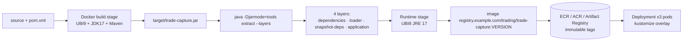

<a id="f-docker-dockerfile"></a>

## D.0 `docker/Dockerfile` — a two-stage, layered, non-root image

```dockerfile
# syntax=docker/dockerfile:1.7
FROM registry.access.redhat.com/ubi9/openjdk-17:latest AS build        # L3  JDK + Maven
USER 0                                                                  # L4  root, build stage only
WORKDIR /build                                                          # L5
COPY pom.xml .                                                          # L6  deps layer key
RUN --mount=type=cache,target=/root/.m2 mvn -B -q dependency:go-offline # L7
COPY src ./src                                                          # L8
RUN --mount=type=cache,target=/root/.m2 mvn -B -q -DskipTests package \
 && java -Djarmode=tools -jar target/trade-capture.jar extract --layers --destination /build/layers  # L9-10
FROM registry.access.redhat.com/ubi9/openjdk-17-runtime:latest          # L13 JRE only
WORKDIR /deployments                                                    # L17
COPY --from=build --chown=185:0 /build/layers/dependencies/ ./          # L19 changes rarely
COPY --from=build --chown=185:0 /build/layers/spring-boot-loader/ ./    # L20
COPY --from=build --chown=185:0 /build/layers/snapshot-dependencies/ ./ # L21
COPY --from=build --chown=185:0 /build/layers/application/ ./           # L22 changes every commit
USER 185                                                                # L24 non-root (jboss)
EXPOSE 8080                                                             # L25 documentation only
ENTRYPOINT ["java","-XX:MaxRAMPercentage=75","-XX:+ExitOnOutOfMemoryError","-jar","trade-capture.jar"]
```

| Concept | Explanation |
|---|---|
| `# syntax=docker/dockerfile:1.7` | Opt into BuildKit syntax (needed for `--mount=type=cache`). |
| **Multi-stage** | Stage 1 has JDK + Maven (hundreds of MB); stage 2 copies only the result into a **JRE-only** image: smaller attack surface, no compiler/Maven in production. |
| **UBI 9** | Red Hat Universal Base Image 9: enterprise-supported, regularly patched, redistributable. |
| `COPY pom.xml` before `COPY src` + `dependency:go-offline` | Docker caches layers by input; dependencies re-download **only when `pom.xml` changes**, not on each code edit. |
| `--mount=type=cache,target=/root/.m2` | Persistent Maven cache across builds (not stored in the image). |
| `-DskipTests` | Tests run in CI, not during image build (Testcontainers needs Docker). |
| `-Djarmode=tools … extract --layers` | Spring Boot 3.3+ tool that splits the fat jar into layers by change-frequency. |
| Layer order | Least → most frequently changed ⇒ a code-only change re-pushes ≈ the `application` layer (~100 KB, per the comment) instead of ~60 MB of libraries. |
| `--chown=185:0` + `USER 185` | The image's non-root user/group; matches `runAsUser: 185` in the Deployment. |
| `-XX:MaxRAMPercentage=75` | JVM heap = 75 % of the container memory limit: with a **1 GiB** limit ⇒ **768 MiB** heap; the other 256 MiB cover metaspace, thread stacks, Kafka direct buffers, code cache. |
| `-XX:+ExitOnOutOfMemoryError` | Die immediately on OOM so Kubernetes restarts a clean pod rather than leaving a zombie. |
| `EXPOSE 8080` | Metadata only; the Service/Deployment do the real port mapping. |

Build & run locally:

```bash
docker build -f docker/Dockerfile -t registry.example.com/trading/trade-capture:1.0.0 .
docker run --rm -p 8080:8080 -e DB_URL=jdbc:postgresql://host.docker.internal:5432/capture \
  -e DB_PASSWORD=... -e KAFKA_BOOTSTRAP=host.docker.internal:9092 \
  registry.example.com/trading/trade-capture:1.0.0
curl localhost:8080/actuator/health/readiness
```

🧒 *Feynman:* A **moving-house packing plan**: heavy furniture (libraries) goes in boxes loaded first and rarely re-packed; your daily clothes (your code) are in the last box, the only one you re-pack each day. Only the finished apartment (JRE + jar) is shipped — not the builders' tools.
⚠️ No root `.dockerignore` (the build context for *this* image is the repo root; only `pom.xml`/`src` are copied, so the image is unaffected, but the context upload includes `web/node_modules` if present — the *web* image has its own [`.dockerignore`](#f-web-dockerignore)). ⚠️ `latest` base tags are unpinned (non-reproducible). ✅ v2 adds the missing **image for the Angular app** ([§D.0b](#f-web-dockerfile)). 🔧 Pin base images by digest.

[⬆️ Back to TOC](#toc)

---

<a id="f-web-dockerfile"></a>

## D.0b `web/Dockerfile` 🆕 — build the bundle, serve it from unprivileged nginx

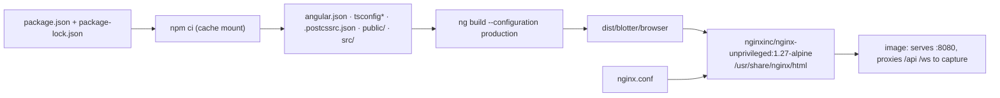

| Line(s) | Explanation |
|---|---|
| `# syntax=docker/dockerfile:1.7` | enables BuildKit features (`--mount`). |
| `FROM node:22-alpine AS build`, `WORKDIR /app` | build stage; alpine keeps it small. |
| `COPY package.json package-lock.json ./` then `RUN --mount=type=cache,target=/root/.npm npm ci --no-audit --no-fund` | **dependency layer first**: re-runs only when the lock file changes; the npm cache is a BuildKit cache mount; `npm ci` = exact, reproducible. |
| `COPY angular.json tsconfig.json tsconfig.app.json .postcssrc.json ./`, `COPY public`, `COPY src` | only what the production build needs (no specs' config, no e2e, no Playwright). |
| `RUN npx ng build --configuration production` | emits `dist/blotter/browser`. |
| `FROM nginxinc/nginx-unprivileged:1.27-alpine` | runtime has **no Node** and runs as a **non-root** user (uid 101) on port 8080 — consistent with the Spring image's hardening. |
| `LABEL … title="trade-capture-terminal"` | OCI metadata. |
| `COPY nginx.conf /etc/nginx/conf.d/default.conf`, `COPY --from=build …/browser /usr/share/nginx/html` | config + static bundle. |
| `EXPOSE 8080`, `HEALTHCHECK … wget -qO- http://127.0.0.1:8080/healthz` | Docker-level health (Kubernetes would use its own probe on `/healthz`). |

🧒 *Feynman:* a **bakery**: the workshop (Node) bakes the loaf (bundle); only the loaf goes to the shop (nginx). The shop has no ovens, so it cannot be abused to bake anything.

⚠️ Unverified here: **no Docker daemon** in this sandbox, so this image was never built; the same build commands (`npm ci`, `ng build`) were run directly. `web/` has **no Kubernetes manifest** yet (🔧 add `Deployment`+`Service`+`Ingress`, or host `dist/` on a CDN; the nginx config below is the contract to preserve either way).

---

<a id="f-web-nginx-conf"></a>

## D.0c `web/nginx.conf` 🆕 — static host + same-origin reverse proxy

| Block | Behaviour and why |
|---|---|
| `upstream capture_backend { server capture:8080; keepalive 16; }` | the Spring service by **DNS name `capture`** (compose service name; in Kubernetes a Service of that name, or edit this line). |
| `map $http_upgrade $connection_upgrade` | `upgrade` when the client asks for it, `close` otherwise — the standard WebSocket map. |
| `listen 8080; root …/html; index index.html;` | unprivileged port. |
| `gzip on` for css/js/json/svg | smaller transfers. |
| headers | `X-Content-Type-Options: nosniff`, `Referrer-Policy: strict-origin-when-cross-origin`, and a **Content-Security-Policy**: `default-src 'self'; connect-src 'self' ws: wss:; style-src 'self' 'unsafe-inline'; img-src 'self' data:; font-src 'self' data:; frame-ancestors 'none'` (inline styles are needed by Angular's component styles and Lightweight Charts; scripts are `'self'` only; no framing ⇒ no clickjacking). |
| `location = /healthz` | `200 ok`, no access log. |
| `location ~* \.(js\|css\|woff2?\|svg\|png\|ico)$` | `expires 1y; Cache-Control: public, immutable` — safe because Angular **hashes** file names (`main-7OCJUFNM.js`). |
| `location = /index.html` | `Cache-Control: no-store` — the entry point must always be fresh so it can point at new hashed bundles. |
| `location /api/` | proxy to the backend with `Host`, `X-Forwarded-For`, `X-Forwarded-Proto`. |
| `location /actuator/health` | proxy (probe through the edge). Only `health` is exposed, not `prometheus`. |
| `location /ws/` | `proxy_http_version 1.1`, `Upgrade`/`Connection` headers, **`proxy_read_timeout 75s`** (must exceed the 1 s heartbeat by a wide margin, or idle sockets are cut). |
| `location /` | `try_files $uri $uri/ /index.html` — **SPA fallback**. |

Why this matters for the code: the browser talks **only to its own origin**, so (a) there is **no CORS**, (b) the server's *same-origin-only* WebSocket policy ([`WebSocketConfig`](#f-src-main-java-com-example-capture-spring-websocketconfig-java)) is satisfied, (c) the CSP can stay `'self'`.

🧒 *Feynman:* a **hotel reception**: guests (browsers) only ever talk to reception; reception walks the request to the kitchen (Spring) and brings the answer back — including a permanent “hotline” (WebSocket) that she keeps open.

---

<a id="f-web-dockerignore"></a>

## D.0d `web/.dockerignore` 🆕

Excludes `node_modules`, `dist`, `.angular`, `e2e`, `test-results`, `playwright-report`, `*.md`, `.vscode` from the **build context** — a faster context upload and no host `node_modules` (wrong OS binaries) leaking into the image.

---

<a id="f-docker-docker-compose-yml"></a>

## D.0e `docker/docker-compose.yml` 🆕 — the whole stack on a laptop

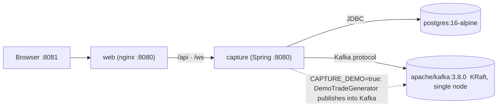

| Service | Key settings |
|---|---|
| `postgres` | `postgres:16-alpine`, db/user `capture`, **`POSTGRES_PASSWORD: ${DB_PASSWORD:?export DB_PASSWORD first}`** — compose *refuses to start* without the variable, so **no password is committed** (AGENTS rule 1); `pg_isready` health check. |
| `kafka` | `apache/kafka:3.8.0` in **KRaft** mode (broker+controller in one node, no ZooKeeper); `PLAINTEXT://kafka:9092`; replication factors and min-ISR forced to **1** (single node — production uses RF 3, minISR 2). |
| `capture` | built from `docker/Dockerfile` (context `..`); `depends_on` postgres **healthy** + kafka started; env `DB_URL`, `DB_USER`, `DB_PASSWORD`, `KAFKA_BOOTSTRAP`, **`CAPTURE_DEMO: ${CAPTURE_DEMO:-true}`** (demo flow on by default locally). |
| `web` | built from `../web`; port **8081 → 8080**. |

Run: `export DB_PASSWORD=anything && docker compose -f docker/docker-compose.yml up --build`, open <http://localhost:8081>.

⚠️ Not executed here (no Docker). The topic `trades.normalized` relies on broker **auto-create**, and the 12 partitions of production become the broker default (1) locally — fine for a demo, different from production. 🔧 add a `kafka-init` one-shot that creates the topic with 12 partitions.

---

## D.1 Kubernetes: the object model

```mermaid
flowchart TB
  NS["Namespace capture<br/>PodSecurity: restricted"]
  SA["ServiceAccount trade-capture<br/>no API token · cloud identity annotation"]
  CM1["ConfigMap trade-capture<br/>env flags"]
  CM2["ConfigMap trade-capture-endpoints<br/>overlay: bootstrap + db-url"]
  SEC["Secret trade-capture-db<br/>created by ExternalSecret"]
  DEP["Deployment trade-capture<br/>3 replicas"]
  SVC["Service :80 → :8080"]
  PDB["PodDisruptionBudget minAvailable 2"]
  NP["NetworkPolicy default-deny + allow-list"]
  KEDA["ScaledObject (KEDA)<br/>NOT in kustomization"]
  ES["ExternalSecret → AWS Secrets Manager"]
  NS --> SA & CM1 & DEP & SVC & PDB & NP
  CM1 --> DEP
  CM2 --> DEP
  ES --> SEC --> DEP
  SA --> DEP
  SVC -. selects .-> DEP
  PDB -. protects .-> DEP
  NP -. restricts .-> DEP
  KEDA -. scales .-> DEP
```

Kustomize merges `k8s/base` (cloud-neutral) with an **overlay** (`k8s/overlays/aws`) via `kubectl apply -k k8s/overlays/aws`.

### How a setting travels from YAML to the Java code

```text
 K8s ConfigMap trade-capture            env var                      application.yml placeholder
 KAFKA_SECURITY_PROTOCOL: SASL_SSL ──►  KAFKA_SECURITY_PROTOCOL ──►  ${KAFKA_SECURITY_PROTOCOL:PLAINTEXT}
 CAPTURE_TOPIC: trades.normalized  ──►  CAPTURE_TOPIC            ──►  capture.topic (relaxed binding)
 overlay patch KAFKA_SASL_MECHANISM ─►  KAFKA_SASL_MECHANISM     ──►  ${KAFKA_SASL_MECHANISM:}
 overlay patch KAFKA_SASL_JAAS      ─►  KAFKA_SASL_JAAS          ──►  ${KAFKA_SASL_JAAS:}
 ConfigMap trade-capture-endpoints  ─►  KAFKA_BOOTSTRAP, DB_URL ──►  ${KAFKA_BOOTSTRAP}, ${DB_URL}
 Secret trade-capture-db (password) ─►  DB_PASSWORD              ──►  ${DB_PASSWORD:}
 fieldRef metadata.name             ─►  HOSTNAME                 ──►  group.instance.id: ${HOSTNAME:local}
```

---

<a id="f-k8s-base-namespace-yaml"></a>

### D.2 `k8s/base/namespace.yaml`

Creates namespace `capture` with labels `pod-security.kubernetes.io/enforce: restricted` and `enforce-version: latest`. **Pod Security Admission** will *reject any pod* that runs as root, allows privilege escalation, lacks a seccomp profile, or keeps Linux capabilities — the Deployment is written to pass these checks.
🧒 *Feynman:* A **building with a strict fire-code inspector at the door**: unsafe tenants are refused entry.

<a id="f-k8s-base-serviceaccount-yaml"></a>

### D.3 `k8s/base/serviceaccount.yaml`

ServiceAccount `trade-capture` with `automountServiceAccountToken: false` — *"the app never calls the Kubernetes API"*, so the default API token is not mounted (smaller blast radius if the pod is compromised). Comments list the **one annotation each cloud overlay adds** to bind the account to a cloud identity: AWS `eks.amazonaws.com/role-arn`, GCP `iam.gke.io/gcp-service-account`, Azure `azure.workload.identity/client-id`. (Workload-identity webhooks inject their own projected tokens.)
🧒 *Feynman:* The pod's **ID badge**: no keys to the building's master room, only the badge the cloud recognises.

<a id="f-k8s-base-configmap-yaml"></a>

### D.4 `k8s/base/configmap.yaml`

Non-secret flags: `KAFKA_SECURITY_PROTOCOL: "SASL_SSL"`, `CAPTURE_TOPIC: "trades.normalized"`, `SPRING_PROFILES_ACTIVE: "prod"` (⚠️ there is no `application-prod.yml`, so the profile currently changes nothing). Loaded wholesale with `envFrom`.

<a id="f-k8s-base-deployment-yaml"></a>

### D.5 `k8s/base/deployment.yaml` — the workload (106 lines)

| Block | Setting | Why |
|---|---|---|
| `replicas: 3`, `revisionHistoryLimit: 5` | three consumers; keep 5 old ReplicaSets for rollback | |
| `strategy.rollingUpdate` | `maxUnavailable: 0`, `maxSurge: 1` | never fewer than 3 ready pods during a rollout (needs a transient 4th) |
| pod labels / annotations | `app.kubernetes.io/name: trade-capture`; `prometheus.io/scrape\|port\|path` | selector + scrape hints (`/actuator/prometheus`) |
| `serviceAccountName` | `trade-capture` | identity |
| `terminationGracePeriodSeconds: 45` | > preStop 5 s + Spring graceful 30 s (= 35 s) | no SIGKILL mid-record |
| pod `securityContext` | `runAsNonRoot`, `runAsUser: 185`, `runAsGroup: 0`, `fsGroup: 0`, `seccompProfile: RuntimeDefault` | passes PSA *restricted*; UID matches the image |
| `topologySpreadConstraints` | `maxSkew: 1` by zone, `DoNotSchedule` | one pod per zone; losing a zone costs ≤ 1/3 of consumers |
| `image` | `registry.example.com/trading/trade-capture:1.0.0` | immutable tag (pin by digest in prod). ⚠️ v2 bumped `pom.xml` to **2.0.0** but left `k8s/**` untouched (rule: nothing under `prod/` and no unrequested infra edits), so this tag still says 1.0.0 — set it to the release you actually push. |
| `envFrom` | ConfigMap `trade-capture` | flags |
| `env` | `KAFKA_BOOTSTRAP`, `DB_URL` from ConfigMap `trade-capture-endpoints`; `DB_PASSWORD` from Secret `trade-capture-db/password`; `HOSTNAME` from the downward API (`metadata.name`) | endpoints are overlay-specific; password never in Git; pod name feeds Kafka static membership |
| `resources` | requests `500m` CPU / `1Gi`; **limit memory `1Gi`, no CPU limit** | memory request = limit ⇒ predictable OOM boundary; no CPU limit avoids CFS throttling latency |
| container `securityContext` | `allowPrivilegeEscalation:false`, `readOnlyRootFilesystem:true`, `capabilities.drop:[ALL]` | hardened; read-only FS ⇒ needs the `/tmp` volume below |
| `startupProbe` | `GET /actuator/health/liveness` every 5 s, 30 failures | up to **150 s** for a cold JVM before liveness begins |
| `livenessProbe` | same path, every 10 s, 3 failures | restart if the JVM is wedged |
| `readinessProbe` | `/actuator/health/readiness`, 5 s, 3 failures | remove from the Service when not ready |
| `lifecycle.preStop` | `sleep 5` | let endpoint removal propagate before SIGTERM handling starts |
| `volumeMounts`/`volumes` | `emptyDir` at `/tmp` | the JVM needs a writable temp dir |

```mermaid
sequenceDiagram
  participant K as Kubelet
  participant P as Pod
  K->>P: start container
  loop up to 150 s
    K->>P: startupProbe liveness
  end
  K->>P: readinessProbe OK ⇒ added to Service endpoints
  Note over K,P: ... runs ...
  K->>P: preStop sleep 5 (endpoints deregister)
  K->>P: SIGTERM ⇒ Spring graceful stop ≤ 30 s
  Note over K,P: SIGKILL only after 45 s
```

🧒 *Feynman:* The **employment contract** of a worker: how many, where they sit, what they wear for safety, how much desk and memory they get, how to check they're awake, and how to say goodbye politely.
⚠️ **F-5 DB user mismatch:** the app's default `DB_USER` is `capture`, but the AWS IaC creates master user `capture_admin` and the ExternalSecret supplies *that* user's password. Unless a `capture` role with the same password exists, authentication fails. Also the app connects with the **master** account (least-privilege violation). 🔧 Create a dedicated app role in a migration/bootstrap job and set `DB_USER` in the endpoints ConfigMap. ⚠️ Pods that run Spring's `HOSTNAME` as `group.instance.id` get a *new* name on every Deployment rollout.

<a id="f-k8s-base-service-yaml"></a>

### D.6 `k8s/base/service.yaml`

`ClusterIP` Service `trade-capture`: selector by label, port `80` → named target port `http` (8080). Gives the pods one stable in-cluster DNS name (`trade-capture.capture.svc`) — used by Prometheus/health checks; nothing external reaches it.

<a id="f-k8s-base-pdb-yaml"></a>

### D.7 `k8s/base/pdb.yaml` — PodDisruptionBudget

`minAvailable: 2` for pods labelled `trade-capture`. During **voluntary** disruptions (node drain, cluster upgrade) Kubernetes may evict only one consumer at a time. Not applicable to crashes or node failure. With 3 replicas one pod may be down; keep `minReplicaCount ≥ 3`.

<a id="f-k8s-base-networkpolicy-yaml"></a>

### D.8 `k8s/base/networkpolicy.yaml` — default-deny + allow-list

| Policy | Effect |
|---|---|
| `default-deny` (`podSelector: {}`, Ingress+Egress) | every pod in `capture` can neither receive nor send, unless another policy allows it |
| `trade-capture` ingress | only from namespace `monitoring` to TCP **8080** (Prometheus scrape) |
| egress #1 | to `kube-system` on **53 UDP/TCP** (DNS) |
| egress #2 | to `ipBlock 10.0.0.0/8` on **9092, 9093, 9098** (Kafka) and **5432** (Postgres): brokers and DB are in the private VPC |

(All three clouds' VPC ranges used by the IaC — 10.40, 10.80 (AKS) and 10.50 (GCP) — fall inside 10.0.0.0/8.)
🧒 *Feynman:* **Every door locked**, then keys cut only for the three corridors the staff must use: phone book (DNS), the conveyor belt (Kafka), the ledger room (Postgres).
⚠️ **F-7 (code-read):** egress to port **443** is not allowed, but *workload identity* needs HTTPS to the cloud's token service (AWS STS for IRSA, Entra ID for Azure, the metadata server for GKE) and Secrets/Key Vault calls. As written, credential exchange would be blocked unless those endpoints are reached on an allowed port. 🔧 Add an egress rule for 443 to VPC endpoints (STS, Secrets Manager) or the cloud's ranges, and an ingress rule when you add an API/ingress controller.

<a id="f-k8s-base-scaledobject-yaml"></a>

### D.9 `k8s/base/scaledobject.yaml` — KEDA autoscaling on Kafka lag

`ScaledObject` targets Deployment `trade-capture`: `min 3`, `max 12` ("never more than the partition count"), `cooldownPeriod 300 s`, trigger `kafka` with `consumerGroup: trade-capture`, `topic: trades.normalized`, `lagThreshold: "500"` (target lag **per replica**), `limitToPartitionsWithLag: "true"`. Desired replicas ≈ $\lceil \text{lag}/500\rceil$ clamped to [3,12] ([§4.6](#foundations)).
🧒 *Feynman:* Hire more cooks when the **order queue** (not the cooks' sweat) grows.
⚠️ **F-6:** (1) the file is **not listed in `kustomization.yaml`**, so it is never applied; (2) `bootstrapServers: ${KAFKA_BOOTSTRAP}` is *not* substituted — Kustomize does no env substitution; (3) MSK needs SASL/IAM auth config for the KEDA scaler (`TriggerAuthentication`), absent; (4) the listener runs **3 threads per pod**, so 12 partitions are saturated by **4 pods** — replicas 5–12 would sit idle (max useful $=\lceil 12/3\rceil=4$). 🔧 Include it in the base or overlay, supply a `TriggerAuthentication`, and either set `max=4` or lower `concurrency` to 1.

<a id="f-k8s-base-kustomization-yaml"></a>

### D.10 `k8s/base/kustomization.yaml`

Lists base resources: `namespace, serviceaccount, configmap, deployment, service, pdb, networkpolicy`. **`scaledobject.yaml` is absent**; also absent: any `images:` transformer (the usual place to bump the image tag per environment).

<a id="f-k8s-overlays-aws-kustomization-yaml"></a>

### D.11 `k8s/overlays/aws/kustomization.yaml`

Resources: `../../base`, `externalsecret.yaml`, `endpoints.yaml`. Two **JSON-6902 patches**:
1. `ServiceAccount/trade-capture`: *add* annotation `eks.amazonaws.com/role-arn: arn:aws:iam::111122223333:role/trade-capture-prod-app` (IRSA binding; the role comes from `module.app_irsa`; account id is a placeholder).
2. `ConfigMap/trade-capture`: *add* `KAFKA_SASL_MECHANISM: AWS_MSK_IAM` and `KAFKA_SASL_JAAS: software.amazon.msk.auth.iam.IAMLoginModule required;` (the callback handler class must also be set — `sasl.client.callback.handler.class=software.amazon.msk.auth.iam.IAMClientCallbackHandler` — which is **not** configured anywhere ⚠️).

<a id="f-k8s-overlays-aws-endpoints-yaml"></a>

### D.12 `k8s/overlays/aws/endpoints.yaml`

ConfigMap `trade-capture-endpoints` with `kafka-bootstrap` (an MSK broker on **9098**, IAM port) and `db-url` (an RDS JDBC URL). Hostnames contain `xxxxxx` placeholders — fill them from `tofu output bootstrap_brokers_sasl_iam` and `db_endpoint`. 🔧 Generate this file from OpenTofu outputs in CI to avoid copy-paste drift; list *all* brokers and add `?sslmode=require` to the JDBC URL.

<a id="f-k8s-overlays-aws-externalsecret-yaml"></a>

### D.13 `k8s/overlays/aws/externalsecret.yaml`

**External Secrets Operator** object: every `1h` it reads the RDS-managed secret (`rds!db-…`, property `password`) from **AWS Secrets Manager** through `ClusterSecretStore aws-secrets-manager` and writes Kubernetes Secret `trade-capture-db` (key `password`). Nothing secret is in Git; rotation propagates within the refresh interval (but a running pod only re-reads env vars on restart ⇒ rotate + rollout). Prerequisites not in the repo: the ESO operator and the `ClusterSecretStore`. ⚠️ API `external-secrets.io/v1beta1` is deprecated in newer ESO releases (use `v1`).

[⬆️ Back to TOC](#toc)

---


<a id="part-e"></a>

# ☁️ PART E — Infrastructure as Code with OpenTofu (AWS · Azure · GCP)

## E.0 Primer: what OpenTofu is and how to read these files

**Infrastructure as Code (IaC)** = describe servers, networks and databases in text files, let a tool create them. **OpenTofu** is the open-source fork of Terraform (same HCL language, `tofu` command). Vocabulary:

| Term | Meaning | Feynman |
|---|---|---|
| **Provider** | plug-in that talks to a cloud API (`aws`, `azurerm`, `google`) | the translator for each country |
| **Resource** | one real thing (`aws_db_instance`) | one item on the shopping list |
| **Module** | reusable bundle of resources (`terraform-aws-modules/vpc/aws`) | a ready-made flat-pack kit |
| **Variable / output** | inputs / printed results | order form / receipt |
| **Local** | named expression inside the config | a scratch note |
| **State** | file recording what exists in reality | the *inventory book* |
| **Backend** | where the state is stored (S3 / Azure Blob / GCS) with locking | a shared, locked safe |
| **`tofu plan`** | show the diff between desired and actual | "here's what I'd buy/return" |
| **`tofu apply`** | execute the diff | do the shopping |
| **State encryption** | *OpenTofu-only*: encrypt the state client-side before upload | the inventory book is written in code |

Each cloud folder has the same four files, read in this order: `versions.tf` (tool, providers, state backend, encryption) → `variables.tf` (inputs) → `main.tf` (resources) → `outputs.tf` (values handed to Kubernetes).

```bash
cd infra/aws                        # or azure / gcp
tofu init                           # download providers, connect backend, load encryption key
tofu plan  -var env=dev -out plan   # review!
tofu apply plan
tofu output                         # copy values into k8s/overlays/<cloud>/
```

### Rosetta stone — the same architecture on three clouds

| Capability | AWS | Azure | GCP |
|---|---|---|---|
| Network | VPC + 3 private/public/db subnets, NAT per AZ | VNet + `aks` and `db` subnets | VPC + subnet with pod/service ranges + Cloud NAT |
| Kubernetes | EKS 1.31, Bottlerocket nodes | AKS private, Azure Linux, Cilium | GKE **Autopilot**, private |
| PostgreSQL 16 | RDS Multi-AZ | Flexible Server zone-redundant | Cloud SQL regional |
| Kafka | **MSK** (real Kafka, IAM auth, port 9098) | **Event Hubs** Kafka endpoint (9093) | **Managed Service for Apache Kafka** (9092) |
| Registry | ECR (immutable) | ACR Premium | Artifact Registry (immutable) |
| Secrets | Secrets Manager (RDS-managed) | Key Vault (RBAC) | Secret Manager |
| Workload identity | IRSA (OIDC role) | Federated credential + UAI | Workload Identity (KSA→GSA) |
| State backend | S3 + DynamoDB lock | Azure Blob | GCS |
| State encryption | `aws_kms` key provider | **none (gap)** | `gcp_kms` key provider |

```mermaid
flowchart LR
  A["tofu apply (per cloud)"] --> B["Network + private K8s cluster"]
  A --> C["Postgres 16 (HA, private)"]
  A --> D["Kafka (managed)"]
  A --> E["Container registry (immutable tags)"]
  A --> F["Workload identity + roles"]
  A --> O["outputs: bootstrap, db endpoint, identity"]
  O --> K["k8s/overlays/cloud: endpoints + SA annotation"]
  E --> P["docker push image"]
  P --> K
  K --> R["kubectl apply -k  ⇒ pods run in the private cluster"]
```

---

## E.1 AWS — `infra/aws/`

<a id="f-infra-aws-versions-tf"></a>

### E.1.1 `infra/aws/versions.tf`

| Block | Meaning |
|---|---|
| `required_version >= 1.8.0` | OpenTofu ≥ 1.8 |
| `required_providers.aws ~> 5.0` | hashicorp/aws 5.x only (pessimistic constraint) |
| `backend "s3"` | state in bucket `acme-tofu-state`, key `trade-capture/aws/terraform.tfstate`, region us-east-1, **DynamoDB lock table** `acme-tofu-locks`, `encrypt = true` (server-side) |
| `encryption { … }` | **OpenTofu-only** client-side encryption: `key_provider "aws_kms" "state"` (key alias `alias/tofu-state`, `AES_256`) → `method "aes_gcm" "state"` → `state { method=…; enforced=true }` (refuse to read/write unencrypted state) |
| `provider "aws"` | region from `var.region`; `default_tags` `application=trade-capture`, `environment=var.env`, `managed-by=opentofu` on **every** resource |

Backend/encryption blocks cannot reference variables — that's why literals appear, and why `AGENTS.md` rule 4 forbids casual edits (a wrong bucket/key could orphan the state).
🧒 *Feynman:* The **safe** (S3) where the inventory book lives, a **sign-out sheet** (DynamoDB lock) so two people don't edit at once, and the book itself is written in a **cipher** (KMS) so a thief of the safe learns nothing.

<a id="f-infra-aws-variables-tf"></a>

### E.1.2 `infra/aws/variables.tf`

`env` (required; `validation` ⇒ `dev|uat|prod`), `region` (default `us-east-1`), `vpc_cidr` (default `10.40.0.0/16`), `kafka_broker_type` (default `kafka.m7g.large`).

<a id="f-infra-aws-main-tf"></a>

### E.1.3 `infra/aws/main.tf` (233 lines)

**Network — `module "vpc"` (terraform-aws-modules/vpc ~> 5.0)**

$$\text{private}_i=\texttt{cidrsubnet}(10.40.0.0/16,4,i)\Rightarrow 10.40.0.0/20,\ 10.40.16.0/20,\ 10.40.32.0/20$$
$$\text{public}_i=\texttt{cidrsubnet}(\cdot,8,200{+}i)\Rightarrow 10.40.200.0/24..202;\qquad \text{database}_i=\texttt{cidrsubnet}(\cdot,8,210{+}i)\Rightarrow 10.40.210.0/24..212$$

(`cidrsubnet(prefix,newbits,netnum)` adds `newbits` to the prefix length and picks block number `netnum`.) `azs` = first 3 AZs. `enable_nat_gateway` with `one_nat_gateway_per_az` (an AZ outage doesn't kill egress elsewhere; costs 3 NATs). VPC **flow logs** to CloudWatch (with auto-created log group & IAM role). Private subnets tagged `kubernetes.io/role/internal-elb=1` (internal load balancers).

**Kubernetes — `module "eks"` (~> 20.0)**: cluster `trade-capture-<env>`, version `1.31`, in the private subnets, `cluster_endpoint_public_access=false` (API reachable only from inside the VPC/VPN), `enable_irsa=true` (OIDC provider for pod identities), one managed node group `main`: `BOTTLEROCKET_x86_64` (minimal, immutable container OS), `m7i.xlarge`, min 3 / max 9 / desired 3.

**Security groups**: `aws_security_group.msk` allows TCP **9098** from `module.eks.node_security_group_id`; `…rds` allows **5432** from the same node SG. Pods use the node's ENIs, so "node SG" ≈ "our pods".

**KMS**: `aws_kms_key.data` with automatic rotation encrypts MSK, RDS and ECR.

**Kafka — MSK**: `aws_msk_configuration` (Kafka `3.7.x`): `auto.create.topics.enable=false`, `default.replication.factor=3`, `min.insync.replicas=2`, `unclean.leader.election.enable=false`, `num.partitions=12`. `aws_msk_cluster`: 3 brokers across the 3 private subnets, instance `kafka.m7g.large`, 500 GiB EBS each, **SASL/IAM only**, at-rest KMS, TLS client↔broker and in-cluster.

**PostgreSQL — `aws_db_instance.capture`**: engine postgres 16, `db.m7g.large`, 200 GiB autoscaling to 1000, KMS-encrypted, db `capture`, admin user `capture_admin`, **`manage_master_user_password=true`** (RDS creates and rotates the password in Secrets Manager; never in state), `multi_az`, DB subnet group, SG above, 14-day backups, `deletion_protection`, Performance Insights, final snapshot `<name>-final`.

**ECR**: repository `trade-capture`, `IMMUTABLE` tags (a tag always means the same bytes), scan-on-push, KMS encryption.

**Workload identity (IRSA)**: `aws_iam_policy.app` allows
- Kafka data plane on the cluster, its topics and groups: `Connect, DescribeTopic, ReadData, WriteData, AlterGroup, DescribeGroup` (the `replace(arn, ":cluster/", ":topic/")` trick builds topic/group ARN prefixes);
- `secretsmanager:GetSecretValue` on the RDS master secret.
`module "app_irsa"` creates role `trade-capture-<env>-app`, attaches the policy, trusts the EKS OIDC provider for service account **`capture:trade-capture`** (namespace:name must match the K8s ServiceAccount).

🧒 *Feynman:* A **gated campus**: private roads (VPC), a guarded main building (EKS, no public door), a sealed vault for the ledger (RDS, encrypted, doubled in another building = Multi-AZ), a conveyor-belt factory (MSK), a warehouse with tamper-proof labels (ECR), and a **visitor badge** system (IRSA) so only the right pod gets the right keys.

⚠️ Observed gaps (code-read): (1) **no Kafka topics are created** (`auto.create.topics.enable=false`) — `trades.normalized` (12 partitions) and `trades.normalized.DLT` must be created by a Kafka provider/job; (2) EKS module v20 needs `enable_cluster_creator_admin_permissions = true` or explicit `access_entries` for anyone to administer the cluster; (3) the app role can read the DB secret but the app never calls Secrets Manager (the ESO identity does) — drop it for least privilege; (4) no MSK broker logging/monitoring blocks; (5) EKS `1.31` — confirm it is still a supported/standard-support version at deploy time; (6) with a private-only API endpoint, `kubectl`/CI must run inside the VPC.

<a id="f-infra-aws-outputs-tf"></a>

### E.1.4 `infra/aws/outputs.tf`

`bootstrap_brokers_sasl_iam` (→ `KAFKA_BOOTSTRAP`), `db_endpoint` (→ `DB_URL` host:port), `app_role_arn` (→ ServiceAccount annotation), `ecr_repository_url` (→ where to `docker push`).

---

## E.2 Azure — `infra/azure/`

<a id="f-infra-azure-versions-tf"></a>

### E.2.1 `infra/azure/versions.tf`

`required_version >= 1.8.0`; provider `hashicorp/azurerm ~> 4.0`; `backend "azurerm"` (resource group `rg-tofu-state`, storage account `acmetofustate`, container `tfstate`, key `trade-capture/azure.tfstate`); `provider "azurerm"` with `subscription_id = var.subscription_id` and `features { key_vault { purge_soft_delete_on_destroy = false } }` (never purge a deleted vault automatically).
⚠️ **No `encryption {}` block** (AWS and GCP both have one) — Azure state is protected only by storage-account encryption; add the OpenTofu `azure_keyvault` key provider for parity (the `AGENTS.md` rule mentions "backend or encryption blocks").

<a id="f-infra-azure-variables-tf"></a>

### E.2.2 `infra/azure/variables.tf`

`subscription_id`, `tenant_id` (required strings), `env` (**no validation**, unlike AWS), `location` (default `eastus2`).

<a id="f-infra-azure-main-tf"></a>

### E.2.3 `infra/azure/main.tf` (197 lines)

| Resource | Key settings |
|---|---|
| `locals` | `name = trade-capture-<env>`; `alnum` = name without dashes (for ACR/Key Vault name rules) |
| Resource group `rg-<name>` | container for everything |
| VNet `10.80.0.0/16`; subnets `aks 10.80.0.0/20`, `db 10.80.16.0/24` | the db subnet is **delegated** to `Microsoft.DBforPostgreSQL/flexibleServers` |
| **AKS** | `Standard` tier; **private cluster**; OIDC issuer + **workload identity**; Azure Policy add-on; auto-upgrade `patch`; one pool `system` `Standard_D4ds_v5`, zones 1-2-3, autoscale 3–9, `AzureLinux`; SystemAssigned identity; Azure CNI **overlay** with **Cilium** data plane and Cilium network policy (so the K8s `NetworkPolicy` objects are enforced) |
| Private DNS zone `<name>.private.postgres.database.azure.com` + VNet link | name resolution for the private DB |
| **PostgreSQL Flexible Server** | v16, `GP_Standard_D4ds_v5`, 256 GiB, zone 1, **ZoneRedundant HA** (standby zone 2), delegated subnet, **public access off**, 14-day backups with **geo-redundancy**, **Entra ID auth only** (`password_auth_enabled=false`) |
| DB `capture` | the database inside the server |
| **Event Hubs** namespace `Premium`, capacity 1, TLS 1.2, `local_authentication_enabled=false` (Entra only) + event hub `trades.normalized` with **12 partitions** | an event hub *is* the Kafka topic; consumer groups are Kafka groups |
| ACR `<alnum>acr` | Premium, admin user off, zone redundant |
| Key Vault `kv-<alnum>` | RBAC authorisation, purge protection |
| User-assigned identity `<name>-app` + **federated credential** | subject `system:serviceaccount:capture:trade-capture`, issuer = AKS OIDC URL, audience `api://AzureADTokenExchange` |
| Role assignments | *Event Hubs Data Receiver*, *Event Hubs Data Sender* (on the namespace), *Key Vault Secrets User* (on the vault) |

🧒 *Feynman:* The same campus built from Microsoft's bricks: the DB sits in its own **fenced courtyard** (delegated subnet), the factory belt is an **Event Hub that speaks Kafka**, and nobody uses passwords — only **signed tokens** (Entra ID).
⚠️ Observed gaps (code-read): (1) **AKS cannot pull from the ACR** — no `AcrPull` role assignment for the kubelet identity; (2) Postgres has Entra-only auth but **no Entra administrator** resource, and the app/JDBC config uses a *password* (`DB_PASSWORD`) — the Postgres JDBC driver needs a token-provider extension for Entra auth; (3) the pom has no OAUTHBEARER login handler for Event Hubs; (4) Kafka feature support (idempotent/transactional producers) varies by Event Hubs tier — validate before enabling `EnrichmentProcessor`; (5) DLT/other topics not created; (6) only a `system` node pool hosts the workload; (7) no `k8s/overlays/azure/`.

<a id="f-infra-azure-outputs-tf"></a>

### E.2.4 `infra/azure/outputs.tf`

`kafka_bootstrap` = `<namespace>.servicebus.windows.net:9093` (SASL_SSL + OAUTHBEARER), `db_fqdn`, `app_client_id` (→ annotation `azure.workload.identity/client-id`).

---

## E.3 GCP — `infra/gcp/`

<a id="f-infra-gcp-versions-tf"></a>

### E.3.1 `infra/gcp/versions.tf`

`hashicorp/google ~> 6.0`; `backend "gcs"` (bucket `acme-tofu-state`, prefix `trade-capture/gcp`); **`encryption`** with `key_provider "gcp_kms" "state"` (`projects/acme-sec/locations/us/keyRings/tofu/cryptoKeys/state`, 32-byte key) → `aes_gcm` → `state { enforced = true }`; `provider "google"` with `project`/`region` variables.

<a id="f-infra-gcp-variables-tf"></a>

### E.3.2 `infra/gcp/variables.tf`

`project_id`, `env` (no validation), `region` (default `us-east4`).

<a id="f-infra-gcp-main-tf"></a>

### E.3.3 `infra/gcp/main.tf` (213 lines)

| Resource | Key settings |
|---|---|
| `google_project_service.apis` (`for_each`) | enables container, sqladmin, servicenetworking, artifactregistry, secretmanager, managedkafka APIs; `disable_on_destroy=false` |
| VPC (custom mode) + subnet `10.50.0.0/20` | `private_ip_google_access`; secondary ranges `pods 10.60.0.0/16`, `services 10.70.0.0/20`; flow logs (5 s, 50 % sampling) |
| Cloud Router + **Cloud NAT** | outbound internet for private nodes |
| **GKE Autopilot** | regional; `deletion_protection`; private nodes **and** private endpoint; release channel `REGULAR`; **Binary Authorization** `PROJECT_SINGLETON_POLICY_ENFORCE` |
| Private services access | global internal address (/20) + `google_service_networking_connection` (VPC peering to Google-managed services) |
| **Cloud SQL** | `POSTGRES_16`, `db-custom-4-16384`, `REGIONAL` (sync standby), autoresize, **private IP only**, backups + **PITR**, `deletion_protection`; DB `capture` |
| **Managed Kafka** cluster | 3 vCPU / 3 GiB (`3221225472` bytes), attached to the subnet; topic `trades.normalized` 12 partitions, RF 3 |
| Artifact Registry `trade-capture` | Docker, `immutable_tags=true` |
| Secret Manager secret `<name>-db-password` | automatic replication (**no secret *version* is created**) |
| Service account `<name>-app` + 3 project roles | `cloudsql.client`, `managedkafka.client`, `secretmanager.secretAccessor` |
| `workloadIdentityUser` binding | `serviceAccount:<project>.svc.id.goog[capture/trade-capture]` ⇒ the K8s SA may act as the GSA |

🧒 *Feynman:* Google's version: the cluster runs in **Autopilot** (Google maintains the machines), the database is reached over a **private tunnel** (peering), and the K8s badge is exchanged for a Google badge.
⚠️ Observed gaps (code-read): (1) no `google_sql_user` and no secret *version* — nothing creates a DB login or password for the app; enabling IAM database auth plus the Cloud SQL connector is the passwordless route; (2) project-wide `secretAccessor` is broader than needed — scope to the secret; (3) private endpoint with no `master_authorized_networks_config`/access path documented; (4) Managed Kafka OAUTHBEARER needs Google's auth-login-handler library (not in `pom.xml`); (5) DLT topic missing; (6) Binary Authorization enforcement will block unattested images unless a policy/attestor is configured; (7) no `k8s/overlays/gcp/`.

<a id="f-infra-gcp-outputs-tf"></a>

### E.3.4 `infra/gcp/outputs.tf`

`kafka_bootstrap` = `bootstrap.<cluster>.<region>.managedkafka.<project>.cloud.goog:9092`, `db_connection_name`, `app_service_account` (→ annotation `iam.gke.io/gcp-service-account`).

[⬆️ Back to TOC](#toc)

---


<a id="runbook"></a>

# 🚀 PART F — Operating It, Fixing It, Extending It

## §13 Runbook

### 13.1 Things you can run **today** (✅ = I ran it while producing v2)

| # | What | Commands | Needs |
|---|---|---|---|
| 1 | ✅ Java core demo | `javac -d /tmp/out src/main/java/com/example/capture/core/*.java && java -cp /tmp/out com.example.capture.core.CaptureDemo` | JDK 17+ |
| 2 | ✅ Web unit + integration tests | `cd web && npm ci && npm test` → **130 passed** (121 unit + 9 integration) | Node 22 |
| 3 | ✅ The full UI against the mock twin | `cd web && npm run build && npm run mock` then open <http://127.0.0.1:4300> (add `curl -XPOST :4300/__control/live -d '{"on":true}' -H 'content-type: application/json'` for a ticking market) | Node |
| 4 | ✅ Browser end-to-end | `cd web && CHROMIUM_PATH=/path/to/chrome npm run e2e` → **13 passed** | Chromium |
| 5 | ✅ Regenerate the screenshots | `cd web && CHROMIUM_PATH=… npm run shots` → `docs/screenshots/*.png` | Chromium |
| 6 | 🟡 Java core unit tests | Maven: `mvn -q test` (**not run here**); in the sandbox they were compiled with `javac` and run through a JUnit-API shim → **28 passed** | JDK (+ Maven Central for the real way) |
| 7 | ⚪ Whole stack | `export DB_PASSWORD=x && docker compose -f docker/docker-compose.yml up --build` then <http://localhost:8081> (**not run here: no Docker**) | Docker |

> `npm start` (dev server, :4200) now **works against the real service**: start Spring (`CAPTURE_DEMO=true`) on :8080 and the dev proxy forwards `/api` and `/ws`. v1's note “`npm start` stays `resync · seq -1` forever” no longer applies.

### 13.2 Run the back end locally

```bash
# 1) infrastructure (or just use the compose file in 13.1 #7)
docker run -d --name pg -p 5432:5432 -e POSTGRES_USER=capture -e POSTGRES_PASSWORD=pw -e POSTGRES_DB=capture postgres:16
docker run -d --name kafka -p 9092:9092 apache/kafka:3.7.0          # single-node KRaft, auto-creates topics

# 2) the service with the synthetic order flow (Flyway creates trade/outbox AND note on start)
cd trade-capture
CAPTURE_DEMO=true DB_PASSWORD=pw mvn spring-boot:run

# 3) the terminal
cd web && npm ci && npm start          # http://localhost:4200  (proxy → :8080)

# 4) poke the API
curl -s localhost:8080/api/system/status
curl -s -XPOST localhost:8080/api/notes -H 'content-type: application/json' \
  -d '{"underlying":"AAPL","notional":1000000,"couponRate":0.02,"couponBarrier":70,"autocallBarrier":100,"kiBarrier":60}'
curl -s -XPOST localhost:8080/api/notes -H 'content-type: application/json' \
  -d '{"underlying":"AAPL","notional":1000000,"couponRate":0.02,"couponBarrier":70,"autocallBarrier":100,"kiBarrier":80}'   # 422 + errors[]
```

*Without* the demo flag you can still inject a real trade the v1 way:

```bash
printf 'ACC7:AAPL:{"tradeId":"EX-1","account":"ACC7","symbol":"AAPL","side":"BUY","quantity":100,"priceMicros":187250000,"source":"FIX:B1","sourceSeq":1,"executedAt":"2026-10-12T14:30:05Z"}\n' | \
docker exec -i kafka /opt/kafka/bin/kafka-console-producer.sh --bootstrap-server localhost:9092 \
  --topic trades.normalized --property parse.key=true --property key.separator=:
# send the same line twice: the terminal's tape shows ONE print, status bar "stored 1 · dup 1"
docker exec pg psql -U capture -c "select source,trade_id,quantity,price_micros from trade;"   # exactly 1 row
curl -s localhost:8080/actuator/prometheus | grep capture_consume
```

(With no type header on the record the consumer falls back to `spring.json.value.default.type = …core.TradeEvent`; `Instant` parses from the ISO string.)

⚠️ The Maven/Docker steps above are the *documented* path; they were **not executed** in the sandbox.

### 13.3 Build → ship → run on a cloud (end-to-end)

```mermaid
sequenceDiagram
  autonumber
  actor OPS as Engineer / CI
  participant TF as OpenTofu
  participant CL as Cloud
  participant REG as Registry
  participant K8 as Kubernetes
  OPS->>TF: tofu init + plan + apply (infra/aws)
  TF->>CL: VPC, EKS, MSK, RDS, ECR, KMS, IRSA role
  TF-->>OPS: outputs: brokers, db endpoint, role ARN, ECR url
  OPS->>CL: create Kafka topics (trades.normalized x12, .DLT)  [not in IaC today]
  OPS->>K8: install ESO, KEDA, monitoring  [prerequisites]
  OPS->>REG: docker build + push capture:VERSION and web:VERSION
  OPS->>OPS: edit overlays/aws endpoints.yaml + role ARN
  OPS->>K8: kubectl apply -k k8s/overlays/aws  [web/ has no manifest yet: host dist/ on a CDN or add one]
  K8->>CL: pods assume role via IRSA, read secret via ESO
  K8-->>OPS: rollout complete, readiness ok
  OPS->>K8: verify metrics, lag, DLT empty
```

**Verification checklist after every deploy**

1. `kubectl -n capture rollout status deploy/trade-capture` — 3/3 ready.
2. `kubectl -n capture get pods -o wide` — one pod per zone.
3. `/actuator/health/readiness` = UP; `/actuator/health` shows `consumerLag.verdict`.
4. Prometheus: `rate(capture_consume_total{outcome="inserted"}[1m]) > 0`; `capture_publish_total{outcome="error"}` flat.
5. Kafka: `trades.normalized.DLT` has no new records; consumer-group lag trending to 0.
6. DB: `select count(*) from trade where captured_at > now() - interval '5 min'`.
7. Terminal: open the web URL; `Quotes` and `Trades` pills **LIVE**, status bar `clients 1/1`, `rtt` small, no `stale`.
8. Rollback: `kubectl -n capture rollout undo deploy/trade-capture` (5 ReplicaSets retained).


### 13.4 Troubleshooting map (symptom → likely cause → file to open)

| Symptom | Likely cause | Open |
|---|---|---|
| Pod `CrashLoopBackOff`, "password authentication failed" | DB user/password mismatch (F-5) | `application.yml`, `externalsecret.yaml`, `infra/aws/main.tf` |
| Pod stuck NotReady; Kafka "timed out" / IAM errors | NetworkPolicy blocks 443 (F-7) or missing IAM callback handler (F-8) | `networkpolicy.yaml`, `overlays/aws/kustomization.yaml` |
| Flyway fails on start: "relation note already exists" / checksum mismatch | someone edited an applied migration | `V1__capture.sql` must stay byte-identical; changes go in `V3__…` |
| Terminal pills `QUOTES CONNECTING` forever | no server on `/ws/quotes`: wrong proxy target, nginx `Upgrade` headers missing, or Spring not started | `proxy.conf.json`, `nginx.conf` (`/ws/` block), `WebSocketConfig` |
| WebSocket connects then closes at once (403) | cross-origin page: the server accepts **same-origin only** | `WebSocketConfig`, how the page is hosted |
| Pills flicker `LIVE`↔`STALE` every few seconds | proxy read timeout shorter than the heartbeat gap | `nginx.conf` `proxy_read_timeout 75s` |
| Pill `RESYNC` and never returns to `LIVE` | server never answers `{"type":"resync"}` (handler not attached) | `FeedSocketHandler.handleTextMessage`, `LiveFeedHub.resync` |
| Tape is empty after a pod restart although the DB has trades | the hub is **in memory**, not warmed from the DB (F-22) | `LiveBoard`, `LiveFeedHub` |
| Only some trades appear with 2+ replicas | each pod's hub only sees the partitions that pod consumes (F-22) | consumer group config |
| Ticket shows `Server error 500` on Book | note table missing (V2 not applied) or DB down | `V2__notes.sql`, logs by `X-Correlation-Id` |
| Ticket shows a red banner with field messages | **expected**: 422 from `NoteTerms`; fix the fields | `NoteTerms`, `ticket.checks.ts` |
| Trades acknowledged but missing in DB after a DB blip | (**fixed in v2**, F-1) if you still see it, you are running a v1 image | `TradeListener.java` |
| DLT growing with `DeserializationException` | bad JSON / wrong type / untrusted package | `application.yml` (`trusted.packages`), producer |
| Consumer lag grows, only some partitions | hot key `account:symbol` | `Murmur2`, `TradeEvent.partitionKey` |
| Lag grows; replicas > 4 but no speed-up | concurrency 3 × pods > 12 partitions (F-6) | `KafkaErrorHandlingConfig`, `scaledobject.yaml` |
| Browser shows a blank page after a deploy | `index.html` cached (must be `no-store`) or CSP blocked a script | `nginx.conf` |

### 13.5 Observability catalogue

| Signal | Name / path | Source |
|---|---|---|
| Liveness / readiness | `/actuator/health/liveness`, `/readiness` | Actuator probes |
| Health incl. lag | `/actuator/health` → `consumerLag` | `LagHealthIndicator` |
| Metrics | `/actuator/prometheus` | Micrometer; tag `application=trade-capture` |
| `capture_publish_total{outcome=ok\|error}` | producer results | `TradePublisher` |
| `capture_consume_total{outcome=inserted\|duplicate}` | consumer results | `TradeListener` |
| **Terminal status bar** 🆕 | seq, msg/s, rtt, skew, clients, stored/dup | `GET /api/system/status` + store health |
| **Correlation id** 🆕 | `X-Correlation-Id: ui-…` ⇒ log MDC `correlationId` ⇒ echoed on the response | `correlationInterceptor` → `CorrelationIdFilter` |
| Slow WebSocket consumers 🆕 | WARN `dropping QUOTES session …` | `LiveFeedHub.broadcast` |
| JVM, Hikari, Kafka client, HTTP server metrics | auto | Boot + Micrometer |

> 🔧 The MDC key is set but the logging pattern in `application.yml` does not print it yet; add `%X{correlationId}` to `logging.pattern.level` to see it in log lines.

[⬆️ Back to TOC](#toc)

---

<a id="findings"></a>

## 🩺 §14 Findings & Improvement Roadmap

> Severity: 🔴 data-loss/security/blocking · 🟠 functional gap or wrong behaviour in some environments · 🟡 hardening/quality · 🔵 polish. **Status column = what v2 did about it.** “Basis”: *verified* = reproduced by running something; *read* = derived from the code.

| ID | Sev | Where | Finding | Basis | v2 status | Fix (summary) |
|---|---|---|---|---|---|---|
| **F-1** | 🔴 | `TradeListener` + `DedupStore` | Key marked “seen” **before** the DB insert; after a transient failure the retry is treated as duplicate, acked, **trade lost**. | read | ✅ **FIXED** — `contains → insert → remember`; `DedupStoreTest` pins the protocol | add a Spring-level “store fails once” test |
| **F-2** | 🟠 | `OutboxRelay`, `application.yml` | No code writes `outbox` rows; relay's `KafkaTemplate<String,String>` shares a producer configured with `JsonSerializer` ⇒ likely double-encoded JSON; multiple relays can reorder per key; rows never purged. | read | ⏳ open | writer, string serializer, per-key claiming, retention |
| **F-3** | 🟠 | Spring service | `/ws/*` and `/api/notes` not implemented. | read | ✅ **IMPLEMENTED** — `LiveFeedHub`, `FeedSocketHandler`, `NotesController`, … ([§9.11–9.20](#spring-live)); only stub-compiled, never Maven-built | run `mvn verify`, add WS integration test |
| **F-4** | 🟠 | `app.ts` | Book was a no-op (output unbound). | read | ✅ **MOOT** — the form was replaced by the ticket, which books through `NotesService` (integration + e2e tests) | — |
| **F-5** | 🟠 | `application.yml`, `externalsecret.yaml`, `infra/aws` | App defaults `DB_USER=capture`; AWS creates `capture_admin`. | read | ⏳ open | least-privilege app role, `DB_USER` per overlay |
| **F-6** | 🟠 | `scaledobject.yaml` | Not in kustomization; unresolved `${KAFKA_BOOTSTRAP}`; no scaler auth; only 4 pods useful. | read | ⏳ open | include + `TriggerAuthentication`; cap replicas |
| **F-7** | 🟠 | `networkpolicy.yaml` | No egress to 443. | read | ⏳ open | allow 443 to cloud endpoints |
| **F-8** | 🟠 | overlay + `pom.xml` | MSK IAM callback handler absent; Azure/GCP auth libs and overlays absent. | read | ⏳ open | add handler; OAUTHBEARER; overlays |
| **F-9** | 🟠 | `infra/*` | No Kafka topics/DLT provisioned. | read | ⏳ open | provision topics incl. `.DLT` |
| **F-10** | 🟡 | `pom.xml`, `AGENTS.md`, `infra/azure/versions.tf` | no Spotless plugin; hook/CI absent; Azure state has no `encryption` block. | read | ⏳ open (and **new Java is unchecked by Spotless**) | add Spotless, CI |
| **F-11** | 🟡 | `ws-feed.client.ts` | A **clean** close completed the stream ⇒ never reconnected; `stale` never set. | **verified** | ✅ **FIXED** — `resilient()` = retry + repeat; `STALE_MS` watchdog; unit + e2e tests | — |
| **F-12** | 🟡 | `EnrichmentProcessor` | Live bean needs `transaction-id-prefix` and topics. | read | ⏳ open | `@ConditionalOnProperty` |
| **F-13** | 🟡 | `LagHealthIndicator` | Needs a raw `Admin` bean; group id hard-coded; not in readiness. | read | ⏳ open | provide `Admin`, use property |
| **F-14** | 🟡 | `CaptureProperties`, `configmap.yaml` | No `@Validated`; `prod` profile has no file. | read | ⏳ open | validate; add file or drop profile |
| **F-15** | 🟡 | `core/Fix*` | Cancels/corrections ignored; `ArithmeticException` retryable; BodyLength unchecked. | read | ⏳ open | event types; QuickFIX/J |
| **F-16** | 🔵 | web UI | No labels/layout (`AAPL187.251K`), weak a11y. | **verified** | ✅ **ADDRESSED** — complete redesign ([§5](#ux)); labels, `aria-sort`, `aria-live`, `role=grid`, focus rings, reduced-motion | audit with axe in CI |
| **F-17** | 🟡 | tests | No core unit tests; no DLT/outbox/lag/failure tests. | read | 🟡 **PARTIAL** — 28 Java core tests + 130 web tests + 13 e2e; DLT/outbox/lag/WS integration still missing | add them |
| **F-18** | 🟠 | `infra/azure`, `infra/gcp` | Azure: no `AcrPull`, no Entra DB admin; GCP: no SQL user / secret version. | read | ⏳ open | add roles/users/secrets |
| **F-19** | 🟡 | `MurexExtractReader` | Failure mid-batch loses already-archived files' trades. | read | ⏳ open | per-file results; `rejected/` |
| **F-20** | 🔵 | `compact`, ticket units | `999_999 → "1000K"`; coupon fraction vs barrier percent. | read | 🟡 **PARTIAL** — units are now *labelled* in the UI; the `1000K` rounding edge **remains** in `compact()` | `Intl.NumberFormat` compact |
| **F-21** | 🟡 | repo | No container/CI for `web/`; no `.dockerignore`; unpinned bases. | read | 🟡 **PARTIAL** — `web/Dockerfile`, `nginx.conf`, `.dockerignore`, compose added; **no CI, no K8s manifest for web, bases not digest-pinned** | CI + digests |
| **F-22** 🆕 | 🟠 | `LiveFeedHub`, `LiveBoard` | **The hub is per pod.** With *n* replicas in one consumer group each pod sees ≈ 1/n of the trades, so each browser sees a partial market; after a restart the tape is empty although the DB has history. | read (design) | ⏳ open — documented | per-pod consumer group for the UI path (`group.id=…-ui-${HOSTNAME}`) or a shared fan-out (Redis / Kafka Streams); warm the board from the `trade` table |
| **F-23** 🆕 | 🟡 | `positions.ts` | Client positions come from the **500-trade tape window** only. | design | ⏳ open — documented | server-side `GET /api/positions` |
| **F-24** 🆕 | 🟡 | `workspace.component.ts` | Maximising **remounts** the panel: half-typed ticket values and the chart's zoom are lost. | read | ⏳ open | keep panels mounted, toggle CSS |
| **F-25** 🆕 | 🔵 | `styles.css` | *Inter* / *JetBrains Mono* are named but **not bundled**; system fallbacks render. | read | ⏳ open | `@fontsource` |
| **F-26** 🆕 | 🟡 | `chart.adapter.ts` | `lightweight-charts` is statically imported (main bundle ≈ 880 kB raw). | measured | ⏳ open | `import()` in `afterNextRender` |
| **F-27** 🆕 | 🟡 | Spring layer | New Spring classes were **stub-compiled only**; `mvn verify` and Spotless never ran; Docker/compose/nginx never built. | honest limitation | ⏳ open | run the pipeline once |
| **F-28** 🆕 | 🔵 | `JdbcNoteStore.recent` | secondary sort `id DESC` is lexicographic. | read | ⏳ open | numeric sort key |
| **F-29** 🆕 | 🟠 | `/api`, `/ws` | **No authentication or authorisation**: anyone who can reach the service can book notes and watch the tape. Acceptable for a demo; not for a trading desk. | read | ⏳ open | Spring Security resource server (OIDC), per-desk entitlements, WS auth on upgrade |
| **F-30** 🔵 | 🟡 | `workspace.store.ts`, `chart.panel.ts` | The layout effect rewrites `localStorage` on *every* state change (e.g. hover); the chart reads theme colours in an effect whose order relative to the store's `dataset` effect is unproven. | read | ⏳ open | `computed` slice; assert order in a test |
| **F-31** 🆕 | 🟡 | `k8s/**`, `pom.xml` | `pom.xml` is `2.0.0` but the AWS overlay still pins image `…:1.0.0`. | read | ⏳ open (left alone on purpose) | bump with the release |

### 14.1 Worked example — F-1, test-first (the repo's own rule 6), now **done**

**Red** — a test that failed against v1 (sketch; a store that throws once):

```java
@Test
void transientStoreFailureDoesNotLoseTheTrade() {
  var store = new FlakyStore();                    // throws on 1st insertIfAbsent, then inserts
  var listener = new TradeListener(store, new LiveFeedHub(), new SimpleMeterRegistry());
  var rec = new ConsumerRecord<>("trades.normalized", 0, 0L, "ACC7:AAPL", TRADE);

  assertThatThrownBy(() -> listener.onTrade(rec, ack)).isInstanceOf(RuntimeException.class);
  listener.onTrade(rec, ack);                      // the container's retry

  assertThat(store.rows()).containsExactly(TRADE); // v1: FAILS, second call skipped as "duplicate"
}
```

**Green** — the minimal fix, **as shipped in v2**: `DedupStore.contains` + `remember`, and the listener order `contains → insert → remember`:

```java
String key = trade.dedupKey();
if (recent.contains(key)) {
  duplicates.increment();
} else {
  boolean fresh = store.insertIfAbsent(trade);   // may throw ⇒ key NOT remembered ⇒ retry works
  recent.remember(key);
  if (fresh) { inserted.increment(); hub.publish(trade); } else { duplicates.increment(); }
}
ack.acknowledge();
```

The *protocol* is pinned by `DedupStoreTest.keyRememberedOnlyAfterTheWorkSucceeded`; the *listener-level* test above is the recommended Spring-aware follow-up (it needs the Spring/Kafka test classpath, which this sandbox lacks).

🧒 *Feynman:* Don't tick a name off the “already handled” list **before** you've actually handled it.

### 14.2 Prioritised roadmap (after v2)

```mermaid
flowchart LR
  subgraph NOW["Now (make v2 trustworthy)"]
    A1["F-27 run mvn verify + Spotless + docker build"] --> A2["F-29 authN/Z on /api and /ws"]
    A2 --> A3["F-22 per-pod consumer group + warm board"]
    A3 --> A4["F-5 DB user, F-7 egress 443, F-8 IAM handler"]
  end
  subgraph NEXT["Next (close the loop)"]
    B1["F-23 server positions"] --> B2["F-2 outbox writer + serializer"]
    B2 --> B3["F-9 topics + DLT in IaC"]
    B3 --> B4["F-6 KEDA wired, F-31 image tags"]
  end
  subgraph LATER["Later (polish and scale)"]
    C1["F-21 CI + web manifests"] --> C2["F-18 Azure/GCP parity"]
    C2 --> C3["F-24 keep panels mounted, F-26 lazy chart, F-25 fonts"]
    C3 --> C4["batch consume, jsonb, partitioning, order-entry audit trail"]
  end
  NOW --> NEXT --> LATER
```

### 14.3 Extension recipes

| Goal | Touch these files, in order |
|---|---|
| Add a **new trade field** (e.g., `venue`) | `V3__add_venue.sql` → `TradeEvent` → `JdbcTradeStore` INSERT → mapper → `LiveBoard.TradeView` + `FeedJson.trade` → `models.ts` `Trade` → tape columns → `FeedJsonTest`, `feed.reducer.spec.ts`, mock |
| Add a **new source** | class in `core/` returning `TradeEvent` → adapter in `spring/` calling `TradePublisher` → test |
| Add a **new panel** (say *Order Book*) | `layout.ts` (`PANEL_IDS`, `PANEL_TITLES`, grid slots) → `panels/orderbook.panel.ts` (wrap in `<app-panel-frame>`) → `workspace.component.ts` `@case` → `icon.component.ts` icon → palette action → spec |
| Add a **hotkey** | `hotkeys.ts` (`HotkeyAction`, `resolveHotkey`, `HOTKEY_HELP`) → `app.ts` `perform` → `hotkeys.spec.ts` |
| Add a **pre-trade check** | `ticket.checks.ts` → the same rule in `NoteTerms` (if blocking) and its test → mock `validate()` |
| Add a **new REST resource** | `NoteStore`-style port + `Jdbc…` adapter → controller + DTO → `notes.api.ts` + a `NotesService`-style query → panel |
| Add **authentication** | Spring Security resource server + browser interceptor adding `Authorization` + WS handshake interceptor + nginx/ingress rule |
| **Another environment** | `tofu apply -var env=uat` (separate state key!) + a new overlay directory |

[⬆️ Back to TOC](#toc)

---

<a id="glossary"></a>

## 📚 Glossary (A–Z)

| Term | Plain meaning |
|---|---|
| **Ack / offset commit** | telling Kafka "I finished up to here" |
| **Actuator** | Spring's built-in health/metrics endpoints |
| **Anti-corruption layer** | translator that stops outside formats leaking into your domain |
| **At-least-once** | never lose, may repeat |
| **Autocallable** | structured note that can redeem early when a barrier is hit |
| **Average-cost position** | position whose cost basis is the average price paid; reducing it realises profit at that average |
| **Back-off** | waiting longer after each failed try |
| **Blotter** | live table of trades/quotes |
| **Brain (spartan)** | unstyled, accessible UI primitives you skin yourself |
| **Branded type** | TypeScript type that blocks mixing look-alike strings |
| **Candle (OHLC)** | open, high, low, close of one time bucket |
| **Command palette** | Ctrl/⌘K search box for every action |
| **Conflation** | keep only the newest update per key in a time window |
| **Consumer group** | team of consumers sharing a topic's partitions |
| **Correlation id** | a tracking token that follows one click through browser, API and logs |
| **cva** | class-variance-authority: component styles as data |
| **Delta / snapshot** | change only / full picture |
| **Discriminated union** | TS type with a tag field telling which shape you have |
| **DLT** | dead-letter topic: where unprocessable records go |
| **Drop-copy** | broker's copy-feed of executions |
| **FIX** | financial text protocol (`tag=value`) |
| **Fixed-point** | integers with an implied decimal point (micros, cents, basis points) |
| **Flyway** | runs versioned SQL migrations |
| **Frame batching** | grouping messages into one UI update per 50 ms |
| **Gate (sequence)** | the apply / ignore / gap decision for a delta |
| **Heartbeat** | a once-a-second “I am alive, I am at sequence N” message |
| **Hexagonal architecture** | domain in the middle, adapters at the edge |
| **Hub (LiveFeedHub)** | server fan-out from the pipeline to browser sockets |
| **Idempotent** | doing it twice = doing it once |
| **IRSA** | AWS: Kubernetes ServiceAccount ⇒ IAM role |
| **KEDA** | event-driven autoscaler (here: Kafka lag) |
| **KI / knock-in** | barrier below which the capital is at risk |
| **Kustomize** | patch-based Kubernetes config composition |
| **Lag** | log-end offset − committed offset |
| **Lightweight Charts** | TradingView's small canvas charting library |
| **Micros** | millionths; price × 10⁶ stored as integer |
| **Mock twin** | the Node server that speaks the same contract as Spring, for tests |
| **Murex** | trading/risk platform |
| **OnPush / signals / zoneless** | Angular change-detection strategies: refresh only on explicit change |
| **Outbox** | table of messages to publish, written in the business transaction |
| **Partition** | one ordered lane of a Kafka topic |
| **PDB** | limit on voluntary pod evictions |
| **Poison message** | record that can never be processed |
| **Problem details (RFC 9457)** | standard JSON error body |
| **signalStore** | NgRx Signals store assembled from `withState/withComputed/withMethods` |
| **SOH** | invisible separator character (ASCII 1) in FIX |
| **Stale** | no message, not even a heartbeat, for 4 s |
| **TanStack Query** | cache + refetch library for server state |
| **TanStack Table** | headless data-grid engine |
| **Tape** | time-and-sales list of recent fills |
| **Testcontainers** | disposable Docker dependencies for tests |
| **Virtual scrolling** | render only visible rows |
| **VWAP** | volume-weighted average price |
| **Zoneless** | Angular without zone.js; updates driven by signals |

[⬆️ Back to TOC](#toc)

---

<a id="appendix-target"></a>

## 🗃️ Appendix A — The `target/` Directory of v1 (30 files, **removed from the enhanced project**)

> The original zip shipped Maven's **generated** `target/` directory (30 files). v2's `.gitignore` ([§12.6b](#f-gitignore)) now ignores it and the enhanced project **does not contain it**, so these files have **no row in the [ledger](#ledger)**; they are listed here so nothing from the original is left unexplained. ✅ `javap -v` on the originals showed class-file **major version 61 = Java 17**, timestamped one minute after the sources. Build output is derived data: **never edit, never commit — rebuild** (`mvn package`). Note that it was *stale* anyway: it contained none of the v2 classes (`LiveBoard`, `LiveFeedHub`, …) and the old `TradeListener` with finding **F-1**.

| File (under `trade-capture/`) | What it is | Source explained in |
|---|---|---|
| `target/classes/application.yml` | copy of the resource | [§10.1](#f-src-main-resources-application-yml) |
| `target/classes/db/migration/V1__capture.sql` | copy of the migration (Flyway reads it from the classpath) | [§10.2](#f-src-main-resources-db-migration-v1-capture-sql) |
| `target/classes/com/example/capture/core/BackoffPolicy.class` | bytecode | [§8.7](#f-src-main-java-com-example-capture-core-backoffpolicy-java) |
| `target/classes/com/example/capture/core/CaptureDemo.class` | bytecode (has `main`) | [§8.9](#f-core-capturedemo) |
| `target/classes/com/example/capture/core/DedupStore$1.class` | the **anonymous** `LinkedHashMap` subclass (`removeEldestEntry`) | [§8.8a](#f-src-main-java-com-example-capture-core-dedupstore-java) |
| `target/classes/com/example/capture/core/DedupStore.class` | bytecode | [§8.8a](#f-src-main-java-com-example-capture-core-dedupstore-java) |
| `target/classes/com/example/capture/core/FixExecutionMapper.class` | bytecode | [§8.3](#f-src-main-java-com-example-capture-core-fixexecutionmapper-java) |
| `target/classes/com/example/capture/core/FixMessage.class` | bytecode | [§8.2](#f-src-main-java-com-example-capture-core-fixmessage-java) |
| `target/classes/com/example/capture/core/LagCalculator$Lag.class` | nested `record Lag` | [§8.8b](#f-src-main-java-com-example-capture-core-lagcalculator-java) |
| `target/classes/com/example/capture/core/LagCalculator$Verdict.class` | nested `enum Verdict` | [§8.8b](#f-src-main-java-com-example-capture-core-lagcalculator-java) |
| `target/classes/com/example/capture/core/LagCalculator.class` | bytecode | [§8.8b](#f-src-main-java-com-example-capture-core-lagcalculator-java) |
| `target/classes/com/example/capture/core/MurexExtractReader.class` | bytecode | [§8.5](#f-src-main-java-com-example-capture-core-murexextractreader-java) |
| `target/classes/com/example/capture/core/Murmur2.class` | bytecode | [§8.6](#f-src-main-java-com-example-capture-core-murmur2-java) |
| `target/classes/com/example/capture/core/SequenceGapDetector$Observation$Kind.class` | nested `enum Kind` inside the record | [§8.4](#f-src-main-java-com-example-capture-core-sequencegapdetector-java) |
| `target/classes/com/example/capture/core/SequenceGapDetector$Observation.class` | nested `record Observation` | [§8.4](#f-src-main-java-com-example-capture-core-sequencegapdetector-java) |
| `target/classes/com/example/capture/core/SequenceGapDetector.class` | bytecode | [§8.4](#f-src-main-java-com-example-capture-core-sequencegapdetector-java) |
| `target/classes/com/example/capture/core/TradeEvent$Side.class` | nested `enum Side` | [§8.1](#f-src-main-java-com-example-capture-core-tradeevent-java) |
| `target/classes/com/example/capture/core/TradeEvent.class` | the `record` | [§8.1](#f-src-main-java-com-example-capture-core-tradeevent-java) |
| `target/classes/com/example/capture/spring/CaptureApplication.class` | bytecode | [§9.1](#f-src-main-java-com-example-capture-spring-captureapplication-java) |
| `target/classes/com/example/capture/spring/CaptureProperties.class` | record bound to `capture.*` | [§9.2](#f-src-main-java-com-example-capture-spring-captureproperties-java) |
| `target/classes/com/example/capture/spring/EnrichmentProcessor.class` | bytecode | [§9.10](#f-src-main-java-com-example-capture-spring-enrichmentprocessor-java) |
| `target/classes/com/example/capture/spring/JdbcTradeStore.class` | bytecode | [§9.6](#f-src-main-java-com-example-capture-spring-jdbctradestore-java) |
| `target/classes/com/example/capture/spring/KafkaErrorHandlingConfig.class` | bytecode | [§9.8](#f-src-main-java-com-example-capture-spring-kafkaerrorhandlingconfig-java) |
| `target/classes/com/example/capture/spring/LagHealthIndicator.class` | bytecode | [§9.9](#f-src-main-java-com-example-capture-spring-laghealthindicator-java) |
| `target/classes/com/example/capture/spring/OutboxRelay$OutboxRow.class` | private nested `record OutboxRow` | [§9.4](#f-src-main-java-com-example-capture-spring-outboxrelay-java) |
| `target/classes/com/example/capture/spring/OutboxRelay.class` | bytecode | [§9.4](#f-src-main-java-com-example-capture-spring-outboxrelay-java) |
| `target/classes/com/example/capture/spring/TradeListener.class` | bytecode | [§9.7](#f-src-main-java-com-example-capture-spring-tradelistener-java) |
| `target/classes/com/example/capture/spring/TradePublisher.class` | bytecode | [§9.3](#f-src-main-java-com-example-capture-spring-tradepublisher-java) |
| `target/classes/com/example/capture/spring/TradeStore.class` | interface bytecode | [§9.5](#f-src-main-java-com-example-capture-spring-tradestore-java) |
| `target/test-classes/com/example/capture/spring/CaptureIntegrationTest.class` | compiled test | [§11.1](#f-src-test-java-com-example-capture-spring-captureintegrationtest-java) |

🧒 *Feynman:* The **leftover sawdust and cut boards** from building the furniture: useful proof the carpenter worked, but you rebuild rather than reuse them — and v2 swept the workshop.

[⬆️ Back to TOC](#toc)

---

<a id="summary"></a>

# ✅ Summary

- 🧱 **Design spine (unchanged):** pure `core/` + Spring `spring/`; Kafka in, PostgreSQL out, **idempotent by primary key**, offsets acknowledged **after** commit, retries with back-off, dead-letter topic, lag health.
- 🆕 **v2 closes the loop:** the Spring service now *serves* the terminal — `/ws/quotes`, `/ws/trades` (snapshot + deltas + heartbeat + resync), `POST/GET /api/notes` with server-side fixed-point validation, `/api/system/status`, correlation ids — over the **same verified pipeline**; **F-1 (possible trade loss) is fixed**.
- 🖥️ **The UI is now a trading terminal:** six dockable panels, dark/light and compact/cozy tokens, virtualised TanStack grid (5,000 symbols), Lightweight Charts, an execution ticket with instant pre-trade checks, a payoff ladder and a state machine that cannot double-book, a ⌘K palette, keyboard-first, layout persisted — all on **spartan/ng + Tailwind + TanStack + NgRx signalStore + CDK**, zoneless.
- ✅ **Verified here:** 130 web unit/integration tests, 13 real-browser e2e tests, 28 Java core tests (via a JUnit shim), a production build, eight real screenshots.
- ⚠️ **Not verified here (be honest in review):** Maven build and Spotless, the Spring runtime and a WebSocket integration test, Docker/compose/nginx images, Kubernetes/OpenTofu. The hub is per pod (**F-22**) and there is no authentication yet (**F-29**).
- 🩺 Next: run the real pipeline once (F-27), add auth (F-29), make the feed multi-replica-safe (F-22), then the open infrastructure findings.

[⬆️ Back to TOC](#toc)

---

<a id="references"></a>

# 📚 References

**Back end**
- Spring Boot reference — <https://docs.spring.io/spring-boot/>
- Spring for Apache Kafka (error handling, DLT, transactions) — <https://docs.spring.io/spring-kafka/reference/>
- Apache Kafka — <https://kafka.apache.org/documentation/> · Murmur2 partitioner (`Utils.murmur2`) in the Kafka clients source
- Transactional outbox pattern — <https://microservices.io/patterns/data/transactional-outbox.html>
- Flyway — <https://documentation.red-gate.com/flyway>
- Micrometer / Prometheus — <https://docs.micrometer.io/>
- Testcontainers — <https://java.testcontainers.org/> · Awaitility — <https://github.com/awaitility/awaitility>
- FIX Trading Community (tags & checksum) — <https://www.fixtrading.org>
- AWS MSK IAM auth library — <https://github.com/aws/aws-msk-iam-auth>

**Front end**
- spartan/ng (brain primitives, “copy the component” model) — <https://www.spartan.ng> · Tailwind CSS v4 — <https://tailwindcss.com/docs> · class-variance-authority — <https://cva.style>
- TanStack Table — <https://tanstack.com/table> · TanStack Query (Angular) — <https://tanstack.com/query/latest/docs/framework/angular/overview> · NgRx Signals — <https://ngrx.io/guide/signals> · Angular CDK — <https://material.angular.io/cdk>
- TradingView Lightweight Charts — <https://tradingview.github.io/lightweight-charts/> · Web Animations API — <https://developer.mozilla.org/docs/Web/API/Web_Animations_API> · RFC 9457 Problem Details — <https://www.rfc-editor.org/rfc/rfc9457>
- Angular — <https://angular.dev> (signals, zoneless, control flow) · RxJS — <https://rxjs.dev> (`webSocket`, `retry`, `bufferTime`, `TestScheduler`)
- Vitest — <https://vitest.dev> · Playwright — <https://playwright.dev> · TypeScript handbook — <https://www.typescriptlang.org/docs/>

**Platform**
- Docker multi-stage & BuildKit — <https://docs.docker.com/build/> · Spring Boot container images / layered jars — <https://docs.spring.io/spring-boot/reference/packaging/container-images/>
- Kubernetes (Pod Security Admission, PDB, NetworkPolicy, topology spread) — <https://kubernetes.io/docs/> · Kustomize — <https://kubectl.docs.kubernetes.io/references/kustomize/>
- KEDA Kafka scaler — <https://keda.sh/docs/latest/scalers/apache-kafka/> · External Secrets Operator — <https://external-secrets.io>
- OpenTofu (state encryption) — <https://opentofu.org/docs/language/state/encryption/> · AWS/Azure/Google provider docs on the OpenTofu registry — <https://search.opentofu.org>
- Terraform AWS modules (VPC, EKS, IAM) — <https://github.com/terraform-aws-modules>

[⬆️ Back to TOC](#toc)

---
